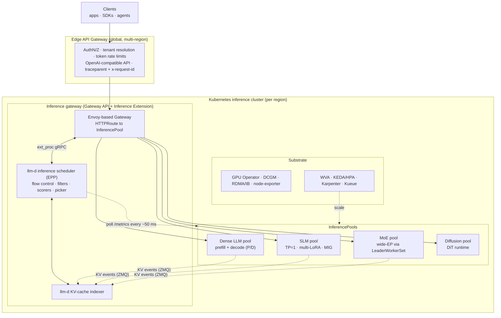
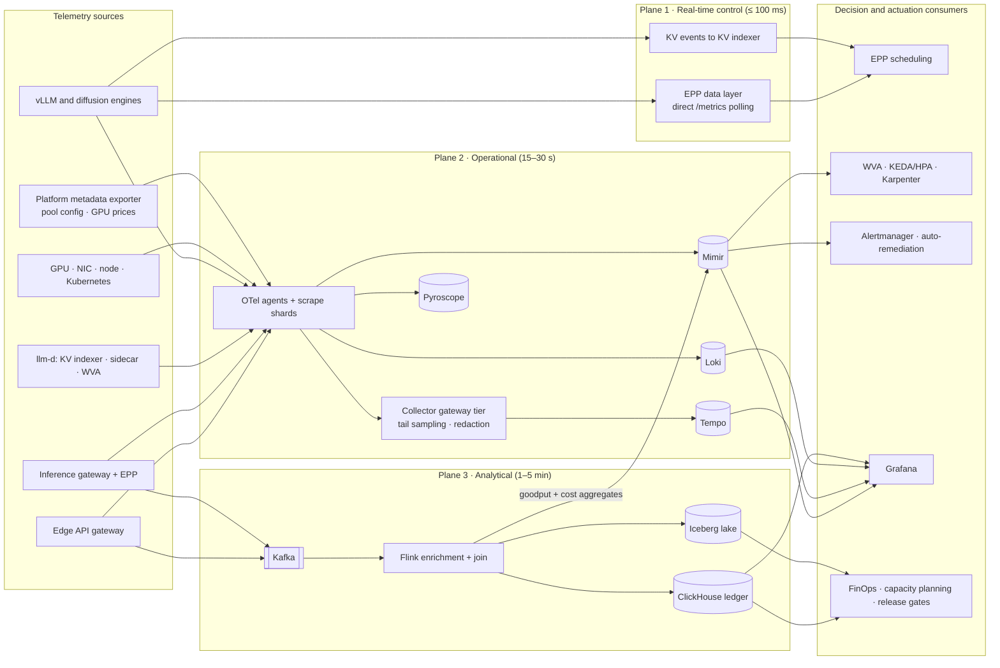
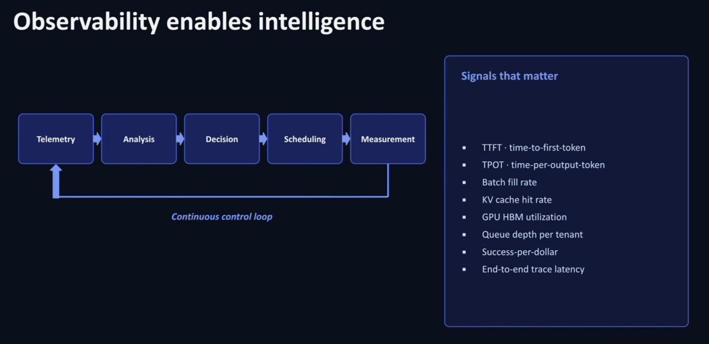
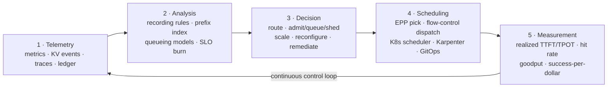
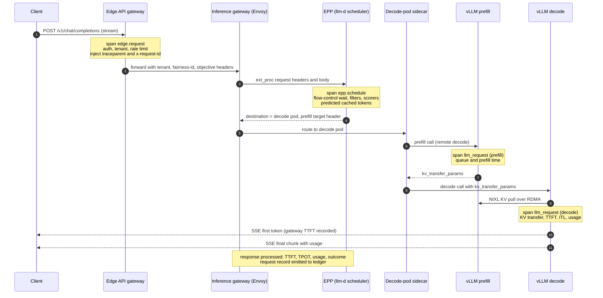
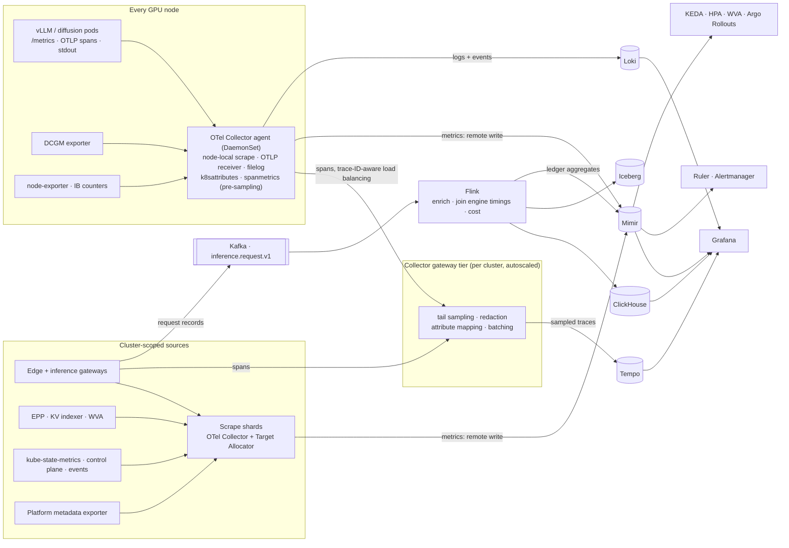
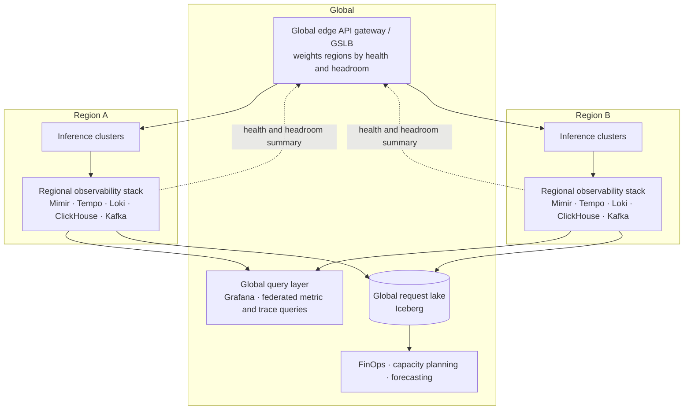

# Observability Architecture for AI Inference at Scale

| | |
|---|---|
| **Status** | Draft v1.0 |
| **Date** | 2026-10-18 |
| **Owner** | Inference Platform Engineering / SRE |
| **Scope** | Observability for a multi-model inference service (LLM, SLM, MoE, diffusion) built on an API gateway, llm-d, vLLM and Kubernetes |
| **Input** | [`docs/inputs/inference-observability.png`](../inputs/inference-observability.png): *"Observability enables intelligence"* |

---

## Table of contents

1. [Executive summary](#1-executive-summary)
2. [Requirements](#2-requirements)
3. [Design principles](#3-design-principles)
4. [The inference platform being observed](#4-the-inference-platform-being-observed)
5. [Observability architecture overview](#5-observability-architecture-overview)
6. [The continuous control loop](#6-the-continuous-control-loop)
7. [Signals that matter: the signal catalog](#7-signals-that-matter-the-signal-catalog)
8. [Observability profiles by model class](#8-observability-profiles-by-model-class)
9. [Instrumentation by layer](#9-instrumentation-by-layer)
10. [Semantic conventions, context propagation and cardinality](#10-semantic-conventions-context-propagation-and-cardinality)
11. [Telemetry pipeline](#11-telemetry-pipeline)
12. [Storage and retention](#12-storage-and-retention)
13. [Analysis](#13-analysis)
14. [Decision and actuation](#14-decision-and-actuation)
15. [Measurement and feedback](#15-measurement-and-feedback)
16. [Multi-region topology](#16-multi-region-topology)
17. [Capacity estimates for the observability system](#17-capacity-estimates-for-the-observability-system)
18. [Reliability of the observability system](#18-reliability-of-the-observability-system)
19. [Security, privacy and multi-tenancy](#19-security-privacy-and-multi-tenancy)
20. [Trade-off analysis](#20-trade-off-analysis)
21. [Implementation roadmap](#21-implementation-roadmap)
22. [Risks, open questions and what to revisit at scale](#22-risks-open-questions-and-what-to-revisit-at-scale)
- [Appendix A: Reference configuration](#appendix-a-reference-configuration)
- [Appendix B: Source metric reference](#appendix-b-source-metric-reference)
- [Appendix C: Glossary](#appendix-c-glossary)

---

## 1. Executive summary

The platform serves millions of requests a day across four model classes: dense **LLMs**, **SLMs**, **Mixture-of-Experts (MoE)** models and **diffusion** models. Requests pass through an **edge API gateway**, then a **Kubernetes Gateway API inference gateway** whose routing decisions come from the **llm-d inference scheduler** (an Endpoint Picker, or EPP). They are served by **vLLM** engines (and diffusion runtimes) running on GPU nodes.

The input diagram makes one point that shapes this whole design: **observability is the sensor layer of a continuous control loop, not just a reporting function**:

```
Telemetry → Analysis → Decision → Scheduling → Measurement → (back to Telemetry)
```

It also names eight **signals that matter**: TTFT, TPOT, batch fill rate, KV-cache hit rate, GPU HBM utilization, queue depth per tenant, success-per-dollar and end-to-end trace latency.

This document defines an observability architecture that runs that loop at four timescales and treats those eight signals as first-class, modality-aware SLIs.

**Key architectural decisions**

1. **Three telemetry planes, separated by freshness.**
   - *Real-time control plane* (≤ 100 ms): the EPP polls engines directly and consumes vLLM KV-cache events. This path never goes through a time-series database.
   - *Operational plane* (15–30 s): Prometheus/OpenTelemetry data flows to Mimir, Tempo and Loki.
   - *Analytical plane* (1–5 min): a 100% per-request ledger flows through Kafka to ClickHouse and Iceberg.
2. **Four nested control loops** consume the planes: request routing (ms), capacity (s–min), health and remediation (s–min), and fleet economics (hours–days).
3. **A normalization layer** of recording rules (`inference:*`) shields dashboards, alerts and autoscalers from metric renames in vLLM, the EPP and DCGM, and from differences between model classes.
4. **Modality-normalized signals.** TTFT and TPOT become *time-to-first-step* and *time-per-denoising-step* for diffusion. "Tokens" generalize to **work units** (tokens, or megapixel-steps for diffusion) so cost can be compared across classes.
5. **Tail-based trace sampling** keeps 100% of errors and SLO violations. The **request ledger** covers 100% of requests for cost, tenant analytics and closed-loop measurement.
6. **Success-per-dollar** is the efficiency metric everything else serves. It divides SLO-compliant successful requests by the GPU cost actually allocated.
7. **Every automated decision is audited** (a routing policy change, a scale event, a remediation) so the *Measurement* stage can attribute outcomes to decisions.
8. **Fail-open.** Inference never blocks on, or slows down because of, telemetry.

---

## 2. Requirements

### 2.1 Functional requirements

| ID | Requirement |
|---|---|
| FR-1 | Collect metrics, traces, logs, events and profiles from every layer: edge gateway, inference gateway, EPP, llm-d components, vLLM and diffusion engines, GPUs, NICs, nodes and Kubernetes. |
| FR-2 | Produce a structured **request record** for 100% of requests: tokens or work units, phase timings, routing decision, outcome and cost. |
| FR-3 | Track SLOs per *model × SLO class × tenant tier* and alert on error-budget burn. |
| FR-4 | Supply **real-time signals** to the inference scheduler (load, KV-cache state, prefix locality) and **near-real-time signals** to autoscalers. |
| FR-5 | Attribute GPU cost to models, tenants, accelerators and requests, and compute **success-per-dollar**. |
| FR-6 | Support drill-down from fleet aggregate → pool → pod → GPU → single request trace in three hops or fewer, using consistent labels and exemplars. |
| FR-7 | Provide modality-aware signals for LLM, SLM, MoE and diffusion workloads. |
| FR-8 | Trigger automated remediation (node cordon/drain, pod restart, traffic shift) and route pages to on-call. |
| FR-9 | Keep an **audit trail of automated decisions** and measure their realized effect. |
| FR-10 | Give tenants per-tenant usage and latency views without exposing other tenants' data. |

### 2.2 Non-functional requirements

| Attribute | Target |
|---|---|
| Request scale | 100 M+ requests/day (≈ 1.2 k RPS average, ≈ 5 k RPS peak). The telemetry pipeline is sized for 3× peak (15 k RPS). |
| Fleet scale | 16 k+ GPUs, 2 k+ GPU nodes, ≈ 6 k engine pods, ≈ 150 InferencePools, multiple regions |
| Freshness | Routing signals ≤ 100 ms. Operational metrics ≤ 30 s end-to-end. Request ledger ≤ 2 min. Cost views ≤ 1 h. |
| Inference overhead | < 1% loss of GPU throughput. < 2 ms p99 added latency at the gateways from telemetry. Zero blocking on telemetry back-ends. |
| Availability | Observability pipeline 99.9%. Autoscaling-critical query path 99.95%. Inference availability is **independent** of observability availability. |
| Detection | MTTD ≤ 2 min for SLO fast-burn, ≤ 1 min for GPU hardware faults |
| Retention | See [§12](#12-storage-and-retention) (raw metrics 30 d, aggregates 13 mo, ledger 90 d hot / 2 y cold) |
| Privacy | No prompt or completion content in telemetry by default. Tenant isolation in every back-end. |
| Portability | Vendor-neutral: OpenTelemetry, Prometheus exposition, open-source back-ends. Accelerator-agnostic normalization (NVIDIA, AMD). |

### 2.3 Constraints and assumptions

- **Fixed serving stack:** API gateway → Gateway API Inference Extension (GIE) → llm-d inference scheduler → vLLM, on Kubernetes. Diffusion runtimes must plug into the same `InferencePool` abstraction.
- Deployment is GitOps-managed (for example, Argo CD). Model deployments use llm-d Helm charts or ModelService.
- GPU nodes run the NVIDIA GPU Operator (or the AMD GPU Operator), which provides DCGM Exporter or the ROCm device-metrics exporter.
- Interactive traffic is mostly streamed (SSE). The edge gateway can rewrite requests, for example to force `stream_options.include_usage=true`.
- Metric names drift between vLLM, GIE and DCGM releases. The design assumes they **will** change and insulates consumers from them (see [§13.1](#131-normalization-layer-recording-rules)).

### 2.4 Non-goals

- Model *quality* evaluation (accuracy, hallucination, toxicity scoring). This design provides hooks only: sampled, redacted payload capture with an opt-in.
- Training or fine-tuning observability.
- Application-level agent tracing *above* the inference API. W3C trace context is propagated so client traces join ours.
- Billing system of record. The ledger informs FinOps, but invoicing uses the gateway's exactly-once metering path.

---

## 3. Design principles

1. **Observability is a control input.** Each signal exists because a decision consumes it. A signal that no decision, alert or investigation uses is a cost, not an asset.
2. **Separate the fast path from the observability path.** Per-request routing reads engine state directly. Dashboards and autoscalers read the TSDB. A TSDB outage degrades insight, not serving.
3. **Measure at the boundary the user experiences, then decompose inward.** User-perceived TTFT is measured at the gateway. Engine TTFT, queue time, prefill time and KV-transfer time explain it.
4. **Normalize across modalities and versions.** Consumers query `inference:*` series, never raw `vllm:*` series directly.
5. **Cardinality is a budget, not an accident.** Request IDs, user IDs and trace IDs never become metric labels. Per-tenant breakdowns live in the ledger. Bounded tenant labels are allowed only where the decision needs them.
6. **Cost is a first-class signal.** Every request carries work units and an estimated cost, so efficiency is measured the same way as latency.
7. **Close the loop explicitly.** Automated decisions emit audit events, and the measurement stage verifies their effect.
8. **Fail-open and bounded overhead.** Telemetry uses bounded queues and drops data under pressure. It never back-pressures an engine or gateway.
9. **Privacy by default.** Content capture is opt-in, sampled, redacted, encrypted and access-controlled.

---

## 4. The inference platform being observed

### 4.1 Components on the request path

| Layer | Component | Role | Telemetry it owns |
|---|---|---|---|
| Edge | **API gateway** (Envoy Gateway, kgateway or agentgateway, or Kong/Apigee) | TLS, authentication (API keys, OIDC/JWT), tenant resolution, token-based rate limits and quotas, OpenAI-compatible API, request normalization, injection of trace and request IDs | Edge latency, auth/quota rejections, per-tenant request and token rates, root spans |
| Inference gateway | **Gateway API + Inference Extension** (Envoy-based Gateway, `HTTPRoute` → `InferencePool`) | Model-aware L7 routing. Calls the EPP over the Envoy `ext_proc` gRPC protocol. Body-based routing extracts the model name. | ext_proc latency, upstream status, per-route RPS |
| Scheduler | **llm-d inference scheduler (EPP)** | Flow control (per-fairness-ID queuing, priority, saturation detection), filters, scorers (prefix-cache, KV utilization, queue, load, LoRA affinity), picker, P/D decision | Scheduling latency, flow-control queue depth and wait time, pool aggregates, decision attributes |
| KV locality | **llm-d KV-cache indexer** | Builds a cluster-wide index of which pod holds which KV blocks, from vLLM `BlockStored` and `BlockRemoved` events (ZMQ) | Event lag, index size, lookup latency |
| P/D | **llm-d routing sidecar** (on decode pods) + **NIXL** KV transfer | Runs the prefill call, then the decode call, and moves KV from prefill to decode over RDMA/NVLink | Prefill-call latency, KV transfer time, bytes moved, failures |
| Engine | **vLLM** (and a diffusion runtime for DiT models) | Continuous batching, PagedAttention, prefix caching, chunked prefill, speculative decoding, TP/PP/DP/EP | `vllm:*` metrics, OTLP `llm_request` spans, KV events, logs |
| Autoscaling | **llm-d Workload Variant Autoscaler (WVA)**, KEDA/HPA, Karpenter or Cluster Autoscaler, Kueue, LeaderWorkerSet | SLO- and cost-aware replica decisions per variant, node provisioning, gang placement for multi-node groups | Desired vs. actual replicas, scale-event audit, time-to-ready |
| Substrate | Kubernetes, NVIDIA/AMD GPU Operator, RDMA/IB fabric, model-weight cache | Scheduling, device plugin, drivers, networking, storage | DCGM, node-exporter, IB counters, kube-state-metrics, events |

### 4.2 Model classes and serving patterns

| Class | Examples | Typical serving pattern | llm-d path | Dominant observability concern |
|---|---|---|---|---|
| **Dense LLM** | Llama 3.3 70B, Qwen3-32B | TP=4 or 8 per replica, prefix caching, chunked prefill. **P/D disaggregation** for long prompts. | Intelligent inference scheduling, P/D disaggregation | TTFT under long context, KV pressure, KV-transfer latency, prefix-hit effectiveness |
| **SLM** | Llama 3.2 3B, Phi-4-mini, Qwen3-4B, Gemma 3 4B | TP=1, many replicas, MIG or fractional GPUs, multi-LoRA | Intelligent inference scheduling, LoRA affinity | Platform overhead as a share of latency, API-server CPU, LoRA swap latency, high RPS |
| **MoE** | DeepSeek-V3/R1, Qwen3-235B-A22B, Llama 4 Maverick, gpt-oss-120b | Wide expert parallelism (DP attention × EP experts) across 2–8 nodes per group, run with **LeaderWorkerSet**, DeepEP all-to-all, EPLB | Wide-EP | Expert load imbalance, all-to-all and fabric latency, rank stragglers, group-level failure domain |
| **Diffusion** | FLUX.1, SD 3.5, Qwen-Image, Wan 2.x (video) | DiT runtime (vLLM-Omni where supported, or a dedicated Diffusers/xDiT server), batched by resolution bucket, multi-step denoising | Inference scheduling (queue/load scorers only) | Time-to-image, step latency, compute saturation, safety-filter outcomes, cost per image |

### 4.3 Platform diagram



---

## 5. Observability architecture overview

### 5.1 Three telemetry planes

| Plane | Freshness | Transport and storage | Producers | Consumers | Failure behavior |
|---|---|---|---|---|---|
| **1 · Real-time control** | 10–100 ms | Direct HTTP polling of engine `/metrics` by the EPP. ZMQ KV events to the KV indexer. In-memory only. | vLLM, diffusion runtime | EPP filters and scorers, flow-control saturation detector | Stale pods are deprioritized or excluded. The scheduler degrades to load-only scoring. |
| **2 · Operational** | 15–30 s | OTel Collector and Prometheus scraping → **Mimir** (metrics), **Tempo** (traces), **Loki** (logs), **Pyroscope** (profiles) | All layers | Dashboards, alerts, autoscalers, canary analysis, on-call | Autoscalers hold or fall back to fixed replicas. Alerts fire through a separate meta-monitoring path. |
| **3 · Analytical** | 1–5 min | Gateway request records → **Kafka** → **Flink** enrichment → **ClickHouse** (hot) and **Iceberg** (cold) | Gateways, EPP, engine spans and logs (joined), platform metadata | FinOps, success-per-dollar, tenant analytics, capacity planning, scheduler-policy evaluation | Collectors buffer to disk and Kafka replays. Gaps are reconciled. |

### 5.2 Logical architecture



---

## 6. The continuous control loop



### 6.1 Loop stages



### 6.2 Four nested loops

The input diagram shows one loop. In practice the same five stages run at four timescales, and each loop consumes a different telemetry plane.

| Stage | **L1 · Request routing** (per request, ms) | **L2 · Capacity** (15 s – 10 min) | **L3 · Health and remediation** (s – min) | **L4 · Fleet economics** (hours – days) |
|---|---|---|---|---|
| **Telemetry** | Engine `/metrics` polled by the EPP (queue depth, running requests, KV usage, active LoRAs). vLLM KV events. Request headers (tenant, objective, model). | Operational metrics in Mimir: queue depth, KV usage, TTFT/TPOT histograms, flow-control queues, replica counts | DCGM XID/ECC/thermal, NCCL/NIXL errors, probe failures, Kubernetes events, error-rate spikes | Request ledger, cost catalog, workload traces, benchmark results |
| **Analysis** | Prefix-match length per candidate (KV indexer), per-pod load, saturation detection, optional latency prediction | Recording rules, SLO burn rates, queueing and throughput models per variant (WVA), saturation trends | Correlation rules (XID + pod restarts + latency), anomaly detection | Success-per-dollar per model, variant and accelerator. ISL/OSL distributions. Prefix-sharing ratio. Utilized vs. allocated GPU. |
| **Decision** | Filter, score and pick an endpoint. Disaggregate (P/D) or not. Admit, queue or shed by priority. | Desired replicas per variant (model × accelerator × role). Prefill:decode ratio. Scale nodes. | Cordon/drain node, restart pod, fail over a pool, shift regional traffic, page a human | Change TP/EP/DP layout, quantization, P/D ratio, accelerator mix, scorer weights, reservations, tenant quotas |
| **Scheduling** | Envoy routes to the chosen pod via `x-gateway-destination-endpoint`. Flow control dispatches from per-tenant queues. | HPA/KEDA scales Deployments or LeaderWorkerSets. Kube-scheduler and Kueue place pods. Karpenter adds GPU nodes. | Kubernetes reschedules pods. The edge gateway reweights regions. | GitOps rollout. Canary through `HTTPRoute` weights between InferencePools. |
| **Measurement** | Realized TTFT/TPOT. Actual `cached_tokens` vs. predicted prefix hit. Scheduler latency. | SLO attainment after the scale event, time-to-ready, over- and under-provisioning minutes | MTTD/MTTR, recurrence, blast radius | A/B deltas in goodput and success-per-dollar. Regression gates. |

### 6.3 Loop stability and safety guardrails

Feedback loops can oscillate or amplify failures. The architecture enforces these guardrails:

| Guardrail | Applies to | Mechanism |
|---|---|---|
| **Staleness bounds** | L1, L2 | Each input has a maximum age. The EPP treats a pod whose metrics are older than the threshold (for example, 3× the polling interval) as unknown and drops it from load-sensitive scoring. KEDA `fallback` holds fixed replicas when its query fails. |
| **Hysteresis and asymmetric scaling** | L2 | Scale up fast, scale down slow. Scale-down stabilization of 10 min or more, because loading a model takes minutes. Cap replica changes per period. |
| **Herding protection** | L1 | Prefix-cache scorers are always combined with load and queue scorers so a hot prefix cannot overload one pod. |
| **Bounded blast radius** | L3 | Rate-limit automated cordons (for example, at most 2% of nodes per pool per hour). A circuit breaker hands over to a human beyond that. |
| **Change isolation** | L4 | One configuration change per pool per evaluation window. Changes must pass a canary before full rollout. |
| **Decision audit** | All | Every automated decision emits a `decision_event` with its inputs snapshot, action and expected effect (see [§14.6](#146-decision-audit-log)). |
| **Fail-safe defaults** | All | If the control plane loses telemetry, the system keeps its last-known-good configuration. It never scales to zero or sheds all traffic. |

---

## 7. Signals that matter: the signal catalog

> **Version note.** The source metric names below match vLLM v0.10–v0.11 (V1 engine), GIE v1.x and DCGM Exporter 4.x. They change between releases; for example, `vllm:gpu_cache_usage_perc` became `vllm:kv_cache_usage_perc`, and `vllm:time_per_output_token_seconds` was split into an inter-token-latency metric and a per-request TPOT metric. Dashboards and automation consume only the normalized `inference:*` series from [§13.1](#131-normalization-layer-recording-rules). Pin versions and verify the mapping on every upgrade.

### 7.1 TTFT: time-to-first-token

| Aspect | Detail |
|---|---|
| **Definition** | Time from request arrival to the first generated token sent to the client. This is the main measure of how responsive interactive traffic feels. |
| **Measured at** | **(a) Gateway TTFT (user-perceived).** The inference-gateway response path records when the first SSE `data:` chunk arrives. This is done by an EPP response-streaming plugin or a lightweight Envoy filter. **(b) Engine TTFT.** `vllm:time_to_first_token_seconds` (histogram), measured from engine arrival to the first token. |
| **Decomposition** | `TTFT_gateway = t_edge + t_flow_queue + t_schedule + t_engine_queue + t_prefill (+ t_kv_transfer for P/D) + t_network`. The ledger stores every term. The gap between gateway and engine TTFT is **platform overhead**. |
| **Normalized series** | `inference:ttft_seconds:p50/p95/p99_5m` by `inference_pool`, `model_name`, `slo_class` |
| **SLO form** | **Length-normalized**, because a 100 k-token prompt cannot meet a fixed 500 ms target: `TTFT ≤ base + k × uncached_input_tokens`. Starting values are in [§13.2](#132-slos-and-error-budgets). |
| **Drives** | L1: P/D threshold and prefix-aware routing weights. L2: prefill-pool scaling. L4: chunked-prefill size, TP degree, prefill accelerator choice. |
| **Pitfalls** | Engine TTFT hides gateway and flow-control queuing. Averages hide long-prompt tails, so segment by input-length bucket. Non-streaming requests have no TTFT; record time-to-response instead. |

### 7.2 TPOT: time-per-output-token

| Aspect | Detail |
|---|---|
| **Definition** | Mean time between output tokens for a request: `(e2e − TTFT) / (output_tokens − 1)`. Inter-token latency (ITL) is the per-gap distribution, and it exposes stalls that TPOT averages away. |
| **Measured at** | Engine: `vllm:request_time_per_output_token_seconds` (per request) and `vllm:inter_token_latency_seconds` (per gap). Gateway: computed per request in the ledger. |
| **Normalized series** | `inference:tpot_seconds:p50/p95/p99_5m`, `inference:itl_seconds:p99_5m` |
| **What moves it** | Decode batch size (memory-bandwidth bound), prefill interference (chunked-prefill budget), KV preemptions, speculative-decoding acceptance, MoE all-to-all latency, thermal or power throttling |
| **Drives** | L2: decode-pool scaling. L4: `max_num_seqs`, spec-decode configuration, P/D split, decode accelerator (HBM-bandwidth-rich parts). |
| **Pitfalls** | Very short outputs make TPOT noisy, so exclude requests with `output_tokens < 8` from TPOT SLIs. Reasoning models stream long hidden token runs, so track TPOT separately for reasoning and visible phases when the API exposes them. |

### 7.3 Batch fill rate

| Aspect | Detail |
|---|---|
| **Definition** | How full the engine's continuous batch is relative to its configured capacity. There are two complementary ratios. **Sequence fill** = `num_requests_running / max_num_seqs`. **Token fill** = `mean tokens per engine step / max_num_batched_tokens`. |
| **Source** | `vllm:num_requests_running`, `vllm:iteration_tokens_total` (histogram of tokens per step). Capacity comes from `inference_pool_config_*` gauges published by the platform metadata exporter ([§9.7](#97-platform-metadata-exporter)). |
| **Normalized series** | `inference:batch_seq_fill:ratio`, `inference:batch_token_fill:ratio` per pod and per pool |
| **Interpretation** | Low fill with an empty queue means the pool is over-provisioned: consolidate or scale down. High fill with a rising queue and TPOT within SLO means scale up. High fill with TPOT in breach means the batch is too large for the SLO: lower `max_num_seqs` or move to a higher-bandwidth part. Moderate fill with high KV usage means the pool is **KV-bound**, not batch-bound: consider KV offload, FP8 KV cache or a larger TP degree. |
| **Drives** | L2: scale-down safety. L4: right-sizing and bin-packing (SLM consolidation, MIG profiles). |
| **Diffusion analog** | Images per denoising batch / max batch for the resolution bucket |

### 7.4 KV-cache hit rate

| Aspect | Detail |
|---|---|
| **Definition** | Fraction of prompt tokens served from an existing KV cache instead of recomputed (token-weighted, not request-weighted). |
| **Source** | Engine: `vllm:prefix_cache_hits_total / vllm:prefix_cache_queries_total`. Per request: `usage.prompt_tokens_details.cached_tokens` (vLLM `--enable-prompt-tokens-details`). KV-connector or offload-tier hits (CPU or LMCache) where the connector exposes them. |
| **Routing efficiency** | `actual cached_tokens / predicted cached_tokens at decision time`. The EPP records the predicted prefix-match length for the chosen pod, and the ledger joins it to the actual value. A falling ratio means stale indexer data or eviction churn. |
| **Workload ceiling** | The **prefix-sharing ratio** from the ledger: the share of tokens in block hashes seen before within the cache-lifetime window. It is the best hit rate any router could achieve. Hit rate divided by ceiling equals routing effectiveness. |
| **Normalized series** | `inference:prefix_cache_hit:ratio_5m` (pool and pod), `inference:routing_cache_efficiency:ratio_1h` (ledger-derived) |
| **Drives** | L1: prefix-scorer weight and session affinity. L4: KV offload tiers, cache sizing, prompt-template guidance for tenants. |
| **Pitfalls** | A high hit rate can coexist with hot-spotting, so always read it next to per-pod queue skew. Watch `BlockRemoved` event rates for churn. For diffusion, use text-embedding and step-cache hit rates instead. |

### 7.5 GPU HBM utilization

HBM utilization has **two distinct meanings**, and dashboards must show both.

| Aspect | Detail |
|---|---|
| **Capacity** | **KV usage** `vllm:kv_cache_usage_perc` is the meaningful capacity signal. `DCGM_FI_DEV_FB_USED / (FB_USED + FB_FREE)` stays flat around `--gpu-memory-utilization` (≈ 90%) because vLLM pre-allocates memory, so it is **not** a load signal. Use it only to detect leaks and out-of-memory risk. |
| **Bandwidth** | `DCGM_FI_PROF_DRAM_ACTIVE`: the fraction of cycles the memory interface is busy. Decode is bandwidth-bound, so this is the best hardware proxy for decode efficiency. |
| **Companion compute signals** | `DCGM_FI_PROF_SM_ACTIVE`, `DCGM_FI_PROF_PIPE_TENSOR_ACTIVE` (prefill and diffusion are compute-bound), power, clock-event (throttle) reasons |
| **Normalized series** | `inference:kv_usage:ratio`, `accelerator:hbm_bandwidth:ratio`, `accelerator:tensor_active:ratio` (AMD uses the ROCm exporter equivalents, mapped to the same names) |
| **Drives** | L1: the KV-utilization scorer (via direct polling). L2: decode scaling on KV pressure. L4: FP8 KV cache, KV offload, choosing HBM-rich accelerators for decode. |
| **Pitfalls** | `DCGM_FI_DEV_GPU_UTIL` only reports whether *any* kernel is running and is close to 100% under light load. **Never scale on it.** DCGM profiling fields need the profiling module and are unavailable while Nsight profiling runs. |

### 7.6 Queue depth per tenant

Requests can wait in three places. Only one of them is tenant-aware by design:

| Queue | Tenant-aware? | Signal |
|---|---|---|
| Edge rate limit and quota | Yes. Rejects rather than queues. | `inference_edge_ratelimited_total{tenant_tier, reason}` |
| **EPP flow control** | **Yes.** Per fairness ID and priority. | Flow-control queue size and queue-wait histograms by fairness ID and priority |
| vLLM waiting queue | No. Per pod. | `vllm:num_requests_waiting` |

| Aspect | Detail |
|---|---|
| **Design stance** | Keep engine queues **shallow**. The EPP saturation detector, driven by queue depth and KV usage, holds excess load in **flow control**, where fairness and priority apply. This is what makes per-tenant queue depth observable *and* controllable. |
| **Tenant identity** | The edge gateway sets `x-gateway-inference-fairness-id` to the tenant ID, or to tenant plus tier. Clients cannot set it. |
| **Normalized series** | `inference:tenant_queue_depth` and `inference:tenant_queue_wait_seconds:p95_5m` (top-K tenants, the rest labelled `other`). The full per-tenant view comes from the ledger. |
| **Drives** | L1: fair-share dispatch and priority shedding. L2: scale-up when aggregate flow-control wait exceeds budget. L4: quota and tier tuning, noisy-neighbor detection. |
| **Fallback** | If the deployed EPP version lacks per-fairness-ID metrics, the edge gateway exports `inference_tenant_inflight_requests` and the ledger provides per-tenant queue time. |

### 7.7 Success-per-dollar

This is the efficiency metric the rest of the catalog serves.

| Aspect | Detail |
|---|---|
| **Definition** | `SPD = good_requests / allocated_cost`, where a **good request** has `outcome = success`, `slo_met = true` (TTFT, TPOT and E2E within its class targets) and, for diffusion, passed the safety filter. A token-weighted variant, **goodput-tokens-per-dollar**, is used for capacity decisions. |
| **Allocated cost** | `Σ (GPUs allocated to the pool × hourly price for that accelerator)` over the window. Prices come from the platform metadata exporter (on-demand, reserved or spot rates). Unallocated node capacity is reported in a separate **idle** bucket, never hidden. |
| **Per-request attribution** | `cost_req = pool_cost_window × work_units_req / Σ work_units_pool`, with `work_units = α·uncached_input_tokens + β·cached_input_tokens + γ·output_tokens` for LLMs, calibrated per model and accelerator from benchmarks. Decode tokens cost far more GPU-seconds than prefill tokens. For diffusion, work units are megapixel-steps. |
| **Computed in** | Flink and ClickHouse (exact, per request). A Prometheus approximation is published as `inference:success_per_dollar:1h` for dashboards and alerts. |
| **Drives** | L4: accelerator mix, quantization, P/D ratios, scorer weights, reservation purchases, tenant pricing. It is the score used to judge every L4 experiment. |
| **Pitfalls** | Improving SPD by relaxing SLOs is not an improvement, which is why SLO compliance is part of the numerator. Exclude aborted requests (client disconnects) from both the numerator and the work-unit denominator, but report their wasted cost separately. |

### 7.8 End-to-end trace latency

| Aspect | Detail |
|---|---|
| **Definition** | Wall-clock time from edge-gateway receipt to the final response byte, broken down by distributed-trace spans across every hop |
| **Span chain** | `edge.request` → `igw.route` → `epp.schedule` (flow-control wait, scoring) → [`pd.sidecar` → `llm_request` (prefill) → NIXL transfer] → `llm_request` (decode) → stream complete. See [§10.4](#104-trace-span-model). |
| **Derived signals** | **Platform overhead** = gateway E2E − engine E2E (target < 5% for LLMs, < 15% for SLMs). The **critical-path share** per hop answers "where did the time go" for SLO-violating traces. |
| **Normalized series** | `inference:e2e_seconds:p99_5m`, `inference:platform_overhead_seconds:p99_5m` (from span metrics generated *before* sampling) |
| **Drives** | L3: localizing incidents. L4: gateway and EPP performance work, regional placement. |
| **Pitfalls** | vLLM emits its `llm_request` span at completion, with phase timings as attributes rather than child spans, so query the attributes. Long streams end after the tail-sampling decision window, which is handled in [§11.3](#113-traces-and-sampling). |

### 7.9 Supporting signals

| Signal | Source | Why it matters |
|---|---|---|
| Error and outcome rate by reason | Gateway status, `vllm:request_success_total{finished_reason}`, EPP errors | Availability SLI. Separates `length` truncations, `abort`s, 429s and 5xxs. |
| Preemptions | `vllm:num_preemptions_total` | KV over-commit. A precursor to TPOT spikes. |
| Client aborts | Gateway (downstream reset), ledger | Wasted GPU work and a sign of latency frustration |
| Speculative-decoding acceptance | `vllm:spec_decode_num_accepted_tokens_total / vllm:spec_decode_num_draft_tokens_total` | Below the break-even point, spec-decode slows TPOT |
| LoRA adapter state | `vllm:lora_requests_info` (running, waiting, max) | LoRA affinity routing and swap thrash |
| Cold start / time-to-ready | Kubernetes events + engine readiness timestamps | Sets autoscaler lead time. Tracks weight-load throughput. |
| EPP scheduling latency | `inference_extension_scheduler_e2e_duration_seconds`, per-plugin durations | Must stay a small share of TTFT, which matters most for SLMs |
| KV transfer (P/D) | NIXL connector stats, routing-sidecar spans | Part of TTFT. Failures fall back to local prefill. |
| MoE expert balance | EPLB balancedness (average/max expert load), per-rank step time | Stragglers throttle the whole EP group |
| Fabric health | DCGM NVLink counters and CRC errors, `node_infiniband_*` counters | All-to-all and KV-transfer performance |
| GPU hardware faults | `DCGM_FI_DEV_XID_ERRORS`, ECC/row-remap, thermal and power clock events | Drives remediation loop L3 |
| Token throughput | `vllm:prompt_tokens_total`, `vllm:generation_tokens_total` | Capacity models, work-unit denominators |
| Input/output length distributions | `vllm:request_prompt_tokens`, `vllm:request_generation_tokens` | Workload characterization, P/D threshold tuning |

### 7.10 Signal × model-class matrix

| Signal | Dense LLM | SLM | MoE | Diffusion |
|---|---|---|---|---|
| **TTFT** | Primary. Length-normalized. Includes KV transfer under P/D. | Primary. Tight targets, so platform overhead dominates. | Primary. Affected by EP all-to-all during prefill. | **Time-to-first-step** (queue + text encode). Time-to-first-preview if previews are streamed. |
| **TPOT** | Primary. HBM-bandwidth bound. | Primary. Often CPU/API-server bound at high RPS. | Primary. Per-step time is set by the slowest rank. | **Time-per-denoising-step**, normalized per megapixel |
| **Batch fill** | Sequence and token fill | Sequence fill. Low per-replica fill means consolidate (MIG). | Per DP rank. Idle ranks run dummy batches (wasted compute). | Images per batch per resolution bucket |
| **KV-cache hit rate** | Prefix hits, routing efficiency | Prefix hits (system prompts), LoRA affinity | Prefix hits per DP rank | **Not applicable.** Use text-embedding and step-cache hits. |
| **GPU HBM** | KV usage + DRAM bandwidth | MIG-slice memory + bandwidth | KV usage per rank + expert weights. NVLink and IB matter as much. | Activation memory. Compute-bound, so tensor-active is the main signal. |
| **Queue depth per tenant** | Flow control | Flow control (high RPS) | Flow control (scarce capacity, strict priority) | Flow control (long requests, so queue wait dominates) |
| **Success-per-dollar** | Per 1 k output tokens | Per request | Per 1 k output tokens, by EP-group size | Per image or per video-second |
| **E2E trace** | Includes P/D hops | Platform overhead share | Includes rank-level spans when detailed tracing is on | Text encode → denoise → VAE decode → safety filter |

---

## 8. Observability profiles by model class

### 8.1 Dense LLMs (aggregated and P/D-disaggregated)

- **Topology.** Aggregated pools for moderate prompt lengths. P/D-disaggregated pools (separate prefill and decode Deployments) for long-context or high-TTFT-sensitivity traffic. The EPP's P/D profile handler decides per request whether to disaggregate, based on the uncached prompt length.
- **Key extra signals:**
  - **P/D decision rate**: share of requests disaggregated vs. served locally, broken down by input-length bucket.
  - **KV transfer**: latency, bytes per request, effective GB/s and failure rate (including fallback to local prefill) from NIXL connector stats and routing-sidecar spans.
  - **Prefill:decode ratio health**: queue time on prefill pods vs. KV and batch pressure on decode pods. A persistent imbalance means the ratio is wrong.
  - **Chunked-prefill interference**: ITL p99 during heavy prefill. Correlate `vllm:iteration_tokens_total` with ITL.
- **Scaling signals:** prefill pool on prefill queue time and pending prompt tokens. Decode pool on KV usage, sequence fill and ITL. Never on GPU utilization.
- **Failure modes to detect:** RDMA path degradation (KV-transfer p99 rises while compute is normal), decode-pod KV exhaustion (preemptions), prefix-index drift (routing efficiency drops).

### 8.2 Small language models (SLMs)

- **Topology.** TP=1 replicas, often several per node, sometimes on MIG slices or fractional GPUs. Multi-LoRA adapters serve many tenant fine-tunes from one base model.
- **Key extra signals:**
  - **Platform overhead share**: with ~100 ms TTFT targets, gateway, ext_proc and EPP time can reach 10–20% of latency. Budget: EPP p99 ≤ 5 ms.
  - **API-server CPU and tokenization**: container CPU throttling (`container_cpu_cfs_throttled_periods_total`) and event-loop lag. Scale API-server processes before scaling GPUs.
  - **LoRA**: adapter load latency, number of resident adapters vs. `max_loras`, swap rate, waiting-for-adapter requests (`vllm:lora_requests_info`).
  - **MIG**: DCGM per-GPU-instance metrics (labelled by MIG profile and instance ID).
- **Cardinality.** Many small pods multiply per-pod series. Use pool-level recording rules and keep per-pod raw data at 30 d.

### 8.3 Mixture-of-Experts (wide-EP)

- **Topology.** One serving *group* is a LeaderWorkerSet spanning several nodes. Attention runs data-parallel and experts are sharded with expert parallelism, using DeepEP all-to-all kernels, optional dual-batch overlap, and EPLB with redundant experts. vLLM labels per-DP-rank metrics with `engine`.
- **Key extra signals:**
  - **Expert load imbalance**: EPLB balancedness (average/max tokens per expert per layer) and rebalance frequency and duration. Where the pinned vLLM version only logs balancedness, the OTel `transform` processor parses it from logs into a gauge.
  - **Rank stragglers**: per-`engine` step time, queue and KV usage. One slow rank (thermal throttling, a bad NIC) slows the whole group. Alert when one rank's step time is more than 1.2× the group median.
  - **Dummy-batch ratio**: idle DP ranks execute dummy forward passes to stay in lockstep. Track the effective fill per rank.
  - **Fabric**: NVLink TX/RX and CRC errors, IB port throughput and errors, all-to-all latency (from detailed traces on canary groups).
- **Failure domain.** Losing one GPU loses the group. Track group-level readiness, group restart time and the capacity lost per incident. MoE scaling moves in whole-group steps of 16–64 GPUs and takes minutes, so it relies on **predictive** scaling from traffic forecasts (L4 feeds L2).

### 8.4 Diffusion models

- **Topology.** DiT runtime pods behind an `InferencePool`. vLLM-Omni is used where the model is supported; otherwise a dedicated diffusion server. Requests are batched by resolution bucket and step count. A request is seconds of compute, not milliseconds.
- **Routing.** The EPP uses only queue and load scorers. Its configurable model-server metric mapping points the queue-depth input at `diffusion_requests_waiting`, and KV/prefix scorers are disabled.
- **Signal mapping.** TTFT becomes *time-to-first-step*, TPOT becomes *time-per-denoising-step* (normalized per megapixel), tokens become *megapixel-steps*, and success-per-dollar is measured per image or per video-second.
- **Diffusion runtime metric contract.** Every diffusion runtime must expose these metrics so dashboards and the EPP treat diffusion like any other pool:

| Metric | Type | Labels | Meaning |
|---|---|---|---|
| `diffusion_requests_waiting` | gauge | `model_name` | Queued requests (EPP queue-scorer input) |
| `diffusion_requests_running` | gauge | `model_name` | In-flight requests |
| `diffusion_queue_time_seconds` | histogram | `model_name` | Arrival to batch admission |
| `diffusion_time_to_first_step_seconds` | histogram | `model_name`, `resolution_bucket` | Arrival to first denoising step (queue + text encode) |
| `diffusion_step_duration_seconds` | histogram | `model_name`, `resolution_bucket` | Wall time per denoising step for the batch |
| `diffusion_batch_size` | histogram | `model_name`, `resolution_bucket` | Images (or clips) per batch |
| `diffusion_vae_decode_seconds` | histogram | `model_name` | Latent → pixel decode |
| `diffusion_safety_check_seconds` | histogram | `model_name` | Output safety-filter latency |
| `diffusion_e2e_seconds` | histogram | `model_name`, `resolution_bucket` | End-to-end time-to-image or time-to-video |
| `diffusion_megapixel_steps_total` | counter | `model_name` | Work units for cost attribution |
| `diffusion_cache_hits_total` / `diffusion_cache_queries_total` | counter | `cache_type` (`text_embedding`, `step_cache`, `lora`) | Cache effectiveness |
| `diffusion_requests_total` | counter | `outcome` (`completed`, `safety_blocked`, `error`, `aborted`) | Outcome SLI |

`resolution_bucket` is bounded, for example `le_1mp`, `1_2mp`, `2_4mp`, `gt_4mp`, plus a frames bucket for video.

---

## 9. Instrumentation by layer

### 9.1 Edge API gateway

- **Root span** `edge.request` with authentication, quota and rate-limit sub-spans. Generates `traceparent` if absent and **always** generates `x-request-id` (client-supplied values are kept as `client.request_id`).
- **Header injection** after authentication: `x-tenant-id` (signed or internal only), `x-gateway-inference-fairness-id`, `x-gateway-inference-objective`, `x-slo-class`. Client-supplied values for these headers are stripped.
- **Request normalization**: forces `stream_options.include_usage=true` on streaming requests so token usage is always available for the ledger.
- **Metrics** (OTel GenAI semantic conventions where they exist): `gen_ai.server.request.duration`, `gen_ai.client.token.usage` equivalents, plus `inference_edge_requests_total{tenant_tier, model_name, outcome}` and `inference_edge_ratelimited_total{tenant_tier, reason}`.
- **Request record**: emits the authoritative per-request record at completion (access log with dynamic metadata from the edge and the EPP) to the analytical plane.

### 9.2 Inference gateway and EPP (llm-d inference scheduler)

- **Envoy**: upstream and downstream latency histograms, ext_proc call latency and errors, per-`HTTPRoute` and per-`InferencePool` RPS, connection and stream stats. Access logs carry EPP dynamic metadata (chosen endpoint, prefill endpoint, objective, predicted cached tokens).
- **EPP metrics**: request totals, durations and token counts per objective. Pool averages for KV utilization and queue size. Per-pod queue size. Ready pods. Scheduler end-to-end and per-plugin latency. Flow-control queue depth and wait time by fairness ID and priority. (Names are in [Appendix B](#appendix-b-source-metric-reference).)
- **EPP span** `epp.schedule` with attributes `inference.flow_control.wait_ms`, `inference.sched.candidates`, `inference.sched.filtered`, `inference.sched.chosen_endpoint`, `inference.sched.prefill_endpoint`, `inference.sched.predicted_cached_tokens`, `inference.sched.top_scores` (truncated) and `inference.sched.profile` (for example, `pd` or `default`).
- **Data-layer health**: per-pod metric staleness and polling errors. These are the staleness guardrail in [§6.3](#63-loop-stability-and-safety-guardrails).

### 9.3 llm-d components

| Component | Instrumentation |
|---|---|
| KV-cache indexer | Event ingest rate and lag (event timestamp vs. processing time), dropped or out-of-order events, index blocks per pod, lookup latency, pods with no recent events (a dead publisher) |
| Routing sidecar (P/D) | `pd.sidecar` span with prefill-call latency, KV-transfer duration and bytes, fallback-to-local-prefill flag. Counters for P/D attempts, successes and fallbacks. |
| Workload Variant Autoscaler | Desired vs. current replicas per `VariantAutoscaling`, model-predicted TTFT/ITL at the desired count, optimizer runtime. Each recommendation is emitted as a decision event. |
| ModelService / Helm releases | Release version and variant labels propagated to pod labels, then to the `model_variant` and `release_stage` metric labels |

### 9.4 vLLM engines

Required engine flags (full example in [Appendix A.1](#a1-vllm-engine-flags)):

| Flag | Purpose |
|---|---|
| `/metrics` (always on) | Prometheus exposition for polling (EPP) and scraping (OTel) |
| `--otlp-traces-endpoint` | Emits an `llm_request` span per request with `gen_ai.*` timing and usage attributes. Sent to the node-local OTel agent. |
| `--collect-detailed-traces` | Per-step model and worker timings. **Canary pods only.** It adds overhead on the hot path. |
| `--kv-events-config` | Publishes `BlockStored`, `BlockRemoved` and `AllBlocksCleared` over ZMQ to the KV-cache indexer (precise prefix routing) |
| `--enable-request-id-headers` | Uses the gateway's `x-request-id` as the engine request ID, the join key across all signals |
| `--enable-prompt-tokens-details` | Returns `cached_tokens` in usage. Needed for routing-efficiency measurement. |
| Per-request logging disabled | No prompt content in logs. Request records come from the gateway. |

Scrape-time hygiene: drop histograms nobody consumes (for example, request-parameter histograms such as `n` and `max_tokens`) using `metric_relabel_configs`, and add `inference_pool`, `model_class`, `role`, `accelerator` and `model_variant` labels from pod labels.

### 9.5 GPU, network and node

- **DCGM Exporter** (DaemonSet, Kubernetes pod-attribution mode, so each GPU metric carries the `pod` and `namespace` of the workload). Field set: FB used/free, `PROF_DRAM_ACTIVE`, `PROF_SM_ACTIVE`, `PROF_SM_OCCUPANCY`, `PROF_PIPE_TENSOR_ACTIVE`, `PROF_GR_ENGINE_ACTIVE`, power, GPU and memory temperature, clock-event reasons, XID errors, ECC and row-remap counters, NVLink TX/RX and CRC errors, PCIe TX/RX. Interval 5–10 s for health fields. Profiling fields are aggregated to 15 s.
- **AMD**: ROCm device-metrics exporter, mapped to the same `accelerator:*` recording rules.
- **node-exporter** with a trimmed collector set, including the InfiniBand collector (`node_infiniband_*` port throughput and error counters), plus a RoCE/NIC exporter where applicable.
- **NVIDIA GPU Operator health**: driver and device-plugin status. Node Problem Detector with GPU and XID rules that publish node conditions.

### 9.6 Kubernetes

- `kube-state-metrics` with a label allowlist (`pods=[inference.platform/pool, inference.platform/model-class, inference.platform/role, inference.platform/accelerator, inference.platform/variant]`). Covers pod phase, resource requests (`nvidia.com/gpu`), Deployment, LeaderWorkerSet and HPA status.
- kubelet and cAdvisor, with series trimmed to CPU, memory, throttling and restarts.
- Kubernetes Events go to Loki (OTel `k8sobjects` receiver). Scheduling failures, OOM kills and image pulls are key evidence for time-to-ready analysis.
- Control plane: API server, scheduler, Kueue admission and LeaderWorkerSet controller metrics.

### 9.7 Platform metadata exporter

A small in-house component that turns **configuration and economics** into metrics, so PromQL can compute ratios and cost without hard-coding values:

| Metric | Source | Used for |
|---|---|---|
| `inference_pool_config_max_num_seqs{inference_pool}` | ModelService / engine args | Sequence fill |
| `inference_pool_config_max_num_batched_tokens{inference_pool}` | Engine args | Token fill |
| `inference_pool_config_gpus_per_replica{inference_pool}` | TP × PP × DP layout | Cost and capacity |
| `inference_pool_config_gpu_hourly_cost_dollars{inference_pool, accelerator, pricing_model}` | FinOps price catalog | Success-per-dollar |
| `inference_pool_slo_target_seconds{inference_pool, slo_class, sli}` | SLO catalog (Git) | SLO-relative dashboards and burn rates |
| `inference_model_info{model_name, model_class, family, params, quantization}` | Model registry | Joins and grouping |

---

## 10. Semantic conventions, context propagation and cardinality

### 10.1 Resource attributes and metric labels

**Resource attributes** (on all OTel signals):
`service.name`, `service.version`, `k8s.cluster.name`, `k8s.namespace.name`, `k8s.pod.name`, `k8s.node.name`, `cloud.region`, `cloud.availability_zone`, `inference.pool`, `inference.model.class` (`dense|slm|moe|diffusion`), `inference.role` (`prefill|decode|both|diffusion`), `inference.accelerator` (for example, `h100-sxm-80g`, `h200`, `b200`, `mi300x`), `inference.model.variant` (for example, `fp8-tp4`), `inference.release.stage` (`stable|canary`).

**Span attributes**: OTel GenAI semantic conventions (`gen_ai.operation.name`, `gen_ai.request.model`, `gen_ai.response.model`, `gen_ai.usage.input_tokens`, `gen_ai.usage.output_tokens`, `gen_ai.response.finish_reasons`), plus an `inference.*` namespace for platform attributes. The collector `transform` processor maps older vLLM attribute names (for example, `gen_ai.usage.prompt_tokens`) to current conventions.

**Metric label policy:**

| Category | Labels |
|---|---|
| **Required** | `cluster`, `region`, `namespace`, `inference_pool`, `model_name`, `model_class`, `role`, `accelerator` |
| **Allowed** | `pod` (raw series only, aggregated away in long-term rules), `engine` (DP rank), `model_variant`, `release_stage`, `slo_class`, `tenant_tier`, `finished_reason`, `outcome`, `resolution_bucket` |
| **Budgeted** | `tenant` only on gateway and flow-control metrics, capped at the top-K tenants per pool (others become `other`). `lora_adapter` only where `max_loras` bounds it. |
| **Forbidden** | `request_id`, `trace_id` (use exemplars), `user_id`, API keys, prompt hashes, session IDs, raw URLs |

### 10.2 Header and context propagation

| Header | Set by | Consumed by | Purpose |
|---|---|---|---|
| `traceparent`, `tracestate` | Client or edge gateway | All hops, vLLM (OTLP) | W3C trace context |
| `baggage` | Edge gateway | Collectors | Only `inference.slo_class` and `inference.tenant_tier`. No PII. |
| `x-request-id` | Edge gateway | Envoy, EPP, sidecar, vLLM, logs, ledger | Universal join key across metrics exemplars, logs, traces and the ledger |
| `x-tenant-id` | Edge gateway (after authentication) | EPP, ledger | Tenant attribution. Stripped if supplied by the client. |
| `x-gateway-inference-fairness-id` | Edge gateway | EPP flow control | Per-tenant fair queuing |
| `x-gateway-inference-objective` | Edge gateway (API key or plan → objective) | EPP | Selects the `InferenceObjective` (priority) |
| `x-slo-class` | Edge gateway | EPP, ledger, span attributes | `interactive`, `standard` or `batch` targets |
| Model-name header (body-based routing) | Body-based-routing filter | `HTTPRoute` | Model-aware routing |
| `x-gateway-destination-endpoint` | EPP | Envoy | Chosen pod (EPP → Envoy contract) |
| Prefill target header | EPP (P/D profile) | Routing sidecar | Selected prefill endpoint |

### 10.3 Cardinality budget

| Dimension | Expected distinct values | Policy |
|---|---|---|
| `inference_pool` | ~150 | Required everywhere |
| `model_name` | ~100 base models + variants | Required. LoRA adapters are **not** model names in metrics. |
| `pod` | ~6 k (churns with scaling) | Raw series for 30 d. Rolled up by recording rules. |
| `tenant` | 10 k+ | Top-K = 50 per pool on gateway and flow-control metrics. Full detail in the ledger. |
| `engine` (DP rank) | ≤ 64 per pod | MoE pools only |
| Histogram buckets | 15–25 per histogram | Native histograms for in-house Go components. vLLM's classic buckets kept, with unused histograms dropped. |

**Enforcement:** Mimir per-tenant series limits, collector `filter` and `transform` processors that drop forbidden labels, CI linting of new metrics, and a cardinality dashboard of the top series contributors by metric and label.

### 10.4 Trace span model



For aggregated (non-P/D) pools, the sidecar and prefill hops are absent. For diffusion pools, the engine emits `diffusion.text_encode`, `diffusion.denoise`, `diffusion.vae_decode` and `diffusion.safety_check` spans.

---

## 11. Telemetry pipeline

### 11.1 Collection topology



**Why node-local scraping:** a DaemonSet agent scrapes only targets on its own node (Kubernetes service discovery filtered by node name). It scales with the fleet, avoids cross-node scrape traffic, and keeps scraping alive on a node even when cluster-level components are degraded. Cluster-scoped targets go to a small sharded scrape tier using the OTel Target Allocator.

### 11.2 Metrics

| Target | Interval | Notes |
|---|---|---|
| vLLM and diffusion `/metrics` | 15 s | Separate from the EPP's ~50 ms polling, which stays in-memory |
| EPP, gateways, llm-d components | 15 s | Native histograms enabled for Go components |
| DCGM health fields | 10 s | XID and thermal fields need fast detection |
| DCGM profiling fields | 15 s | |
| node-exporter, kube-state-metrics, kubelet | 30 s | |
| Platform metadata exporter | 60 s | Slow-changing |

- **Back-end:** Grafana Mimir per region (multi-tenant via `X-Scope-OrgID`, native histograms, OTLP ingest). The **Ruler** evaluates normalization rules, SLO rules and alerts.
- **Exemplars:** gateway and span-metrics histograms carry `trace_id` exemplars, so you can click from a latency spike to a trace.
- **Autoscaling read path:** KEDA and WVA query Mimir's query frontend with a dedicated tenant and priority. Expect 30–45 s of signal lag (scrape + rule evaluation). Pools that need faster reaction (SLM bursts) use a small in-cluster Prometheus with 2 h retention as a low-latency autoscaling source.

### 11.3 Traces and sampling

- **Agents** receive OTLP from engines and gateways, generate **span metrics before sampling** (so RED metrics and platform overhead are exact), then forward spans with trace-ID-aware load balancing so every span of a trace reaches the same gateway-tier collector.
- **The gateway tier** runs `tail_sampling`, redacts sensitive attributes, maps attributes to semantic conventions, batches, and exports to Tempo.

| Policy | Rule | Keep |
|---|---|---|
| Errors | Span status `ERROR`, HTTP 5xx, KV-transfer failure, P/D fallback | 100% |
| SLO violators | TTFT, TPOT or E2E above the class threshold (OTTL condition on `gen_ai.latency.*` / `inference.*` attributes) | 100% (rate-capped) |
| Debug | `inference.debug=true` (authorized operators only, set at the edge) | 100% |
| Canary | `inference.release.stage=canary` | 25% |
| Low-volume guarantee | Rate-limiting policy per `inference_pool` | ≥ N traces/min per pool |
| Baseline | Probabilistic | 1% |

**Long-stream caveat.** Spans are exported when they *end*. The EPP span ends milliseconds into the request, but the decode and edge spans end only when the stream completes, which can be minutes for reasoning models. The design handles this in three ways. First, `decision_wait` is sized to the interactive-class p99 E2E (≈ 90–120 s). Second, sampled and non-sampled decision caches let late spans join traces that were already sampled. Third, for requests that outlive the window, the **100% ledger** remains the source of truth, and the trace is a best-effort enrichment.

### 11.4 Logs

- Structured JSON everywhere, collected by the agent's `filelog` receiver and sent to Loki, with labels limited to `cluster`, `namespace`, `inference_pool`, `role` and `level`. `request_id` and `trace_id` are fields, not labels.
- vLLM per-request logging stays disabled. Engine logs carry startup, configuration, warnings, EPLB stats and errors.
- Kubernetes Events and GPU Operator logs are retained with node and pod correlation.
- Redaction processors run in the agent (API keys, bearer tokens, email patterns).

### 11.5 Request ledger (wide events)

The ledger holds one row per request. It is the only signal with 100% coverage and full dimensionality.

**Assembly.** The edge and inference gateways emit the request record at completion: tenant, objective, routing metadata, usage, gateway timings and outcome. Flink then does three things. It **joins** engine-side timings from `llm_request` span attributes (exported from the agent tier at 100% *before* sampling, as a lightweight record stream) on `request_id` within a 10-minute window. It **enriches** the row with node, accelerator and price from the platform metadata. It **computes** work units, cost and `slo_met`.

**Schema (ClickHouse, abbreviated):**

```sql
CREATE TABLE inference.requests
(
    ts                     DateTime64(3) CODEC(Delta, ZSTD),
    request_id             String,
    trace_id               FixedString(32),
    region                 LowCardinality(String),
    cluster                LowCardinality(String),
    tenant_id              String,
    tenant_tier            LowCardinality(String),
    slo_class              LowCardinality(String),
    operation              LowCardinality(String),  -- chat | completion | embedding | image | video
    model_name             LowCardinality(String),
    model_class            LowCardinality(String),  -- dense | slm | moe | diffusion
    model_variant          LowCardinality(String),
    lora_adapter           String,
    inference_pool         LowCardinality(String),
    decode_pod             String,
    prefill_pod            String,
    node                   String,
    accelerator            LowCardinality(String),
    status_code            UInt16,
    outcome                LowCardinality(String),  -- success | client_error | server_error | aborted | rejected
    finish_reason          LowCardinality(String),
    input_tokens           UInt32,
    cached_tokens          UInt32,
    predicted_cached_tokens UInt32,
    output_tokens          UInt32,
    diffusion_steps        UInt16,
    output_megapixels      Float32,
    work_units             Float64,
    t_edge_ms              Float32,
    t_flow_queue_ms        Float32,
    t_schedule_ms          Float32,
    t_engine_queue_ms      Float32,
    t_prefill_ms           Float32,
    t_kv_transfer_ms       Float32,
    ttft_ms                Float32,
    tpot_ms                Float32,
    e2e_ms                 Float32,
    slo_met                Bool,
    cost_usd               Float64
)
ENGINE = ReplicatedMergeTree
PARTITION BY toDate(ts)
ORDER BY (model_name, tenant_id, ts)
TTL toDateTime(ts) + INTERVAL 90 DAY;
```

**Derived streams.** Flink also publishes low-cardinality aggregates back to Mimir, such as `inference_ledger_requests_total{inference_pool, slo_class, outcome, slo_met}` and `inference_ledger_work_units_total`, so SLO and success-per-dollar dashboards don't need ClickHouse queries.

### 11.6 Profiles

- **Continuous CPU profiling** (Pyroscope via the OTel profiling or eBPF agent) for API servers, tokenizers, EPP and gateways, at low frequency. Catches CPU-bound regressions, which matter most for SLMs.
- **On-demand GPU profiling**: vLLM's torch-profiler endpoints and Nsight Systems, triggered by a runbook on a single canary pod, with artifacts written to object storage. Gated by RBAC, because it pauses DCGM profiling metrics and adds overhead.

### 11.7 Overhead budget

| Mechanism | Budget | Control |
|---|---|---|
| Engine metrics exposition | Negligible (< 0.1% CPU) | Drop unused histograms at scrape time |
| Engine OTLP span per request | < 0.2% | Batch span processor with a bounded queue (drops on overflow) |
| Detailed engine traces | 1–5% (canary only) | `--collect-detailed-traces` on canary pods only |
| EPP direct polling | ~1 request per pod per 50 ms | Per-pool EPP, so each EPP polls ≤ a few hundred pods |
| KV events | Small ZMQ stream | Monitored for lag. Can be disabled per pool (falls back to approximate prefix scoring). |
| Gateway telemetry | < 2 ms p99 added latency | Async access logging, sampled debug |
| Node agent | ≤ 1 vCPU, 1–2 GiB per node | `memory_limiter`, priority class below inference, never preempts inference pods |

---

## 12. Storage and retention

| Data | Back-end | Resolution | Hot retention | Long-term | Primary users |
|---|---|---|---|---|---|
| Raw metrics | Mimir (object-storage blocks) | 10–30 s | 30 d | — | On-call, autoscalers, debugging |
| Aggregated recording-rule series (`inference:*`, `accelerator:*`) | Mimir | 1 min | 13 mo | 13 mo | SLO reporting, trends, capacity |
| Traces (sampled) | Tempo (Parquet on object storage) | Per span | 14 d | — | Debugging, latency decomposition |
| Logs and events | Loki | Per line | 14 d | 90 d archive | Debugging, audit |
| Request ledger | ClickHouse | Per request | 90 d | 2 y in Iceberg | FinOps, tenants, capacity, policy evaluation |
| Decision audit events | ClickHouse + Kafka | Per decision | 1 y | 2 y | Measurement, postmortems |
| Continuous profiles | Pyroscope | 10 s profiles | 7 d | — | Performance engineering |
| GPU profiling artifacts | Object storage | Per capture | 30 d | — | Kernel and performance analysis |
| Payload samples (opt-in, redacted) | Restricted, encrypted store | Per request | ≤ 30 d | — | Quality evaluation (out of scope here) |

---

## 13. Analysis

### 13.1 Normalization layer (recording rules)

All consumers read `inference:*` and `accelerator:*` series. Version drift is absorbed here. The `or` patterns below let one rule work across engine versions during upgrades.

```yaml
groups:
  - name: inference-normalization
    interval: 15s
    rules:
      # TTFT (engine-side) by pool and model
      - record: inference:ttft_seconds:p95_5m
        expr: |
          histogram_quantile(0.95,
            sum by (le, cluster, inference_pool, model_name) (
              rate(vllm:time_to_first_token_seconds_bucket[5m])))

      # Per-request TPOT, with fallback to the pre-rename metric
      - record: inference:tpot_seconds:p95_5m
        expr: |
          histogram_quantile(0.95,
            sum by (le, cluster, inference_pool, model_name) (
              rate(vllm:request_time_per_output_token_seconds_bucket[5m])
              or rate(vllm:time_per_output_token_seconds_bucket[5m])))

      # KV-cache capacity usage (renamed metric across vLLM versions)
      - record: inference:kv_usage:ratio
        expr: |
          max by (cluster, inference_pool, pod, engine) (vllm:kv_cache_usage_perc)
          or max by (cluster, inference_pool, pod, engine) (vllm:gpu_cache_usage_perc)

      # Prefix-cache hit ratio (token-weighted)
      - record: inference:prefix_cache_hit:ratio_5m
        expr: |
          sum by (cluster, inference_pool, model_name) (rate(vllm:prefix_cache_hits_total[5m]))
          /
          clamp_min(sum by (cluster, inference_pool, model_name) (rate(vllm:prefix_cache_queries_total[5m])), 1)

      # Batch fill: sequences
      - record: inference:batch_seq_fill:ratio
        expr: |
          sum by (cluster, inference_pool, pod, engine) (vllm:num_requests_running)
          / on (cluster, inference_pool) group_left
          max by (cluster, inference_pool) (inference_pool_config_max_num_seqs)

      # Batch fill: tokens per engine step
      - record: inference:batch_token_fill:ratio
        expr: |
          (
            sum by (cluster, inference_pool, pod) (rate(vllm:iteration_tokens_total_sum[5m]))
            /
            clamp_min(sum by (cluster, inference_pool, pod) (rate(vllm:iteration_tokens_total_count[5m])), 1)
          )
          / on (cluster, inference_pool) group_left
          max by (cluster, inference_pool) (inference_pool_config_max_num_batched_tokens)

      # Engine queue depth per pool (EPP-independent view)
      - record: inference:queue_depth:pool
        expr: sum by (cluster, inference_pool) (vllm:num_requests_waiting)

      # Pod → pool mapping for joining DCGM series
      - record: inference:pod_pool:info
        expr: |
          max by (cluster, namespace, pod, inference_pool) (
            label_replace(kube_pod_labels{label_inference_platform_pool!=""},
              "inference_pool", "$1", "label_inference_platform_pool", "(.+)"))

      # HBM bandwidth utilization per pool
      - record: accelerator:hbm_bandwidth:ratio
        expr: |
          avg by (cluster, inference_pool) (
            DCGM_FI_PROF_DRAM_ACTIVE
            * on (cluster, namespace, pod) group_left (inference_pool) inference:pod_pool:info)

      # Allocated GPUs and cost per pool
      - record: inference:pool_allocated_gpus
        expr: |
          sum by (cluster, inference_pool) (
            kube_pod_container_resource_requests{resource="nvidia_com_gpu"}
            * on (cluster, namespace, pod) group_left (inference_pool) inference:pod_pool:info
            * on (cluster, namespace, pod) group_left
              max by (cluster, namespace, pod) (kube_pod_status_phase{phase="Running"}))

      - record: inference:pool_cost_dollars_per_hour
        expr: |
          inference:pool_allocated_gpus
          * on (cluster, inference_pool) group_left
          max by (cluster, inference_pool) (inference_pool_config_gpu_hourly_cost_dollars)

  - name: inference-economics
    interval: 5m
    rules:
      - record: inference:success_per_dollar:1h
        expr: |
          sum by (cluster, inference_pool) (
            increase(inference_ledger_requests_total{outcome="success", slo_met="true"}[1h]))
          /
          sum by (cluster, inference_pool) (avg_over_time(inference:pool_cost_dollars_per_hour[1h]))
```

### 13.2 SLOs and error budgets

**SLO classes** (starting points, calibrated per model and accelerator with benchmarks):

| SLO class | Typical workloads | TTFT p95 | TPOT p95 | Availability |
|---|---|---|---|---|
| `interactive` (LLM/MoE) | Chat, copilots, agent steps | ≤ 400 ms + 0.1 ms × uncached input tokens | ≤ 50 ms | 99.9% |
| `interactive` (SLM) | Autocomplete, classification, routing | ≤ 150 ms + 0.02 ms × uncached input tokens | ≤ 15 ms | 99.9% |
| `standard` | Default API traffic | ≤ 1 s + 0.2 ms × uncached input tokens | ≤ 80 ms | 99.5% |
| `batch` | Offline jobs, evals | Completion within the job window (for example, 24 h) | — | 99% |
| `diffusion-interactive` | Image generation | Time-to-image ≤ 4 s at 1 MP / 28 steps (scaled by MP × steps) | Step ≤ 120 ms at 1 MP | 99.5% |

**SLIs.** The *authoritative* SLI is ledger-derived (`slo_met` per request, length-normalized). A *fast* SLI is computed from engine histograms for quick alerting, for example the share of requests with TTFT ≤ 1 s:

```promql
sum by (inference_pool) (rate(vllm:time_to_first_token_seconds_bucket{le="1.0"}[5m]))
/
sum by (inference_pool) (rate(vllm:time_to_first_token_seconds_count[5m]))
```

**Multi-window, multi-burn-rate alerts** (99.9% SLO, so the budget is 0.001):

| Severity | Long window | Short window | Burn rate | Budget consumed |
|---|---|---|---|---|
| Page | 1 h | 5 min | 14.4× | 2% in 1 h |
| Page | 6 h | 30 min | 6× | 5% in 6 h |
| Ticket | 3 d | 6 h | 1× | 10% in 3 d |

Latency SLIs use the same windows with their own budget, for example 0.05 for a 95% TTFT objective.

```yaml
- alert: InferenceAvailabilityFastBurn
  expr: |
    (1 - inference:availability_sli:ratio_rate1h) > (14.4 * 0.001)
    and
    (1 - inference:availability_sli:ratio_rate5m) > (14.4 * 0.001)
  for: 2m
  labels: {severity: page}
  annotations:
    summary: "Availability SLO fast burn on {{ $labels.inference_pool }}"
    runbook_url: "https://runbooks.internal/inference/availability-burn"
```

### 13.3 Workload characterization and capacity models

- **From the ledger:** input/output length distributions per model and tenant, prefix-sharing ratio, arrival burstiness (peak/mean at 1 s and 1 min), session and turn structure, share of reasoning tokens, diffusion resolution and step mix.
- **Benchmark calibration:** a benchmark harness (for example, llm-d-benchmark, inference-perf or GuideLLM) replays characterized workloads against each variant (model × accelerator × parallelism × quantization) to produce throughput-vs-latency curves. These curves give WVA its performance parameters and give the cost model its work-unit coefficients (α, β, γ).
- **Capacity forecasts:** seasonal forecasts of RPS and work units per pool drive predictive scaling for slow-to-scale pools (MoE groups) and reservation planning.

### 13.4 Anomaly detection and correlation

- Seasonal baselines (same hour of week) for RPS, hit rate and success-per-dollar. Alert on robust z-score deviations, not fixed thresholds, for signals whose normal level varies (hit rate, token mix).
- **Correlation rules** for faster triage, for example: a TPOT rise *and* a rank-skew rise *and* an IB error increase on the same node set points to a fabric fault, not load.
- Change correlation: deployments, configuration changes, decision events and node events are annotated on every dashboard.

---

## 14. Decision and actuation

### 14.1 Request routing (L1)

The EPP is configured per pool through scheduling profiles. Scorer weights are **decisions** that L4 tunes and measures. Illustrative profile (plugin parameters omitted):

```yaml
apiVersion: inference.networking.x-k8s.io/v1alpha1
kind: EndpointPickerConfig
plugins:
  - type: precise-prefix-cache-scorer   # llm-d: uses the KV-cache indexer (vLLM KV events)
  - type: kv-cache-utilization-scorer
  - type: queue-scorer
  - type: max-score-picker
schedulingProfiles:
  - name: default
    plugins:
      - pluginRef: precise-prefix-cache-scorer
        weight: 3
      - pluginRef: kv-cache-utilization-scorer
        weight: 2
      - pluginRef: queue-scorer
        weight: 2
      - pluginRef: max-score-picker
```

| Pool type | Scorers emphasized | Telemetry inputs |
|---|---|---|
| Dense LLM, aggregated | Prefix (precise) + KV utilization + queue | KV events, `/metrics` polling |
| Dense LLM, P/D | P/D profile handler (prompt-length threshold) + separate prefill and decode scoring | Same, plus prefill queue |
| SLM | Queue + LoRA affinity + light prefix | `/metrics` polling, LoRA info |
| MoE wide-EP | Per-DP-rank load + prefix | Per-`engine` metrics |
| Diffusion | Queue / load only | `diffusion_requests_waiting` |

### 14.2 Admission, fairness and load shedding

- **Edge:** token-based rate limits and quotas per tenant and plan, using estimated tokens at admission and actual usage at completion. Rejections are counted per tier.
- **EPP flow control:** per-fairness-ID queues with priority from the `InferenceObjective`. When the saturation detector trips (queue and KV thresholds across the pool), lower-priority traffic waits or is shed first. `batch` traffic is shed before `standard`, and `standard` before `interactive`.
- **Signals consumed:** pool saturation (real-time), tenant queue depth and wait (operational), tenant quota usage (ledger aggregates).

### 14.3 Autoscaling (L2)

| Pool type | Primary scale signal | Secondary / guard | Scale unit and lead time |
|---|---|---|---|
| Dense aggregated | WVA (SLO + cost optimizer) or queue depth per replica | KV usage > 85%, TTFT burn | 1 replica (TP GPUs). Minutes. |
| P/D prefill | Prefill queue time / pending prompt tokens | TTFT p95 vs. target | 1 replica. Minutes. |
| P/D decode | KV usage + sequence fill | ITL p99 vs. target | 1 replica. Minutes. |
| SLM | Queue depth per replica, RPS per replica | API-server CPU throttling | 1 replica (≤ 1 GPU). Tens of seconds with a warm image and cached weights. |
| MoE wide-EP | **Predictive** (forecast) + flow-control wait | Per-rank KV, TTFT burn | One LWS group (16–64 GPUs). Minutes. |
| Diffusion | Queue wait time per replica | Time-to-image burn | 1 replica. Minutes. |

**Rules:** never scale on `DCGM_FI_DEV_GPU_UTIL`. Scale-down stabilization of 10 min or more. Fallback replicas when telemetry is unavailable. Karpenter or Cluster Autoscaler node pools are sized with warm headroom from L4 forecasts, because GPU node provisioning plus weight loading often exceeds a burst's duration.

### 14.4 Remediation (L3)

| Trigger | Automated action | Human escalation |
|---|---|---|
| Fatal XID (for example, 48, 79, 94/95), uncorrectable ECC, row-remap failure | Taint and cordon the node, drain inference pods, open a hardware ticket | If more than the rate limit of nodes are affected per hour |
| Pod readiness flapping, engine hang (no step progress with a non-empty queue) | Restart the pod and remove it from the pool (EPP excludes not-ready pods) | After 3 restarts in 30 min |
| MoE rank straggler (step time > 1.2× group median for 10 min) | Drain the node hosting the rank. The group reschedules. | If repeated on new hardware |
| KV transfer failure rate > 1% on a pool | Raise the P/D threshold (more local prefill) as a safe-mode profile | Page the networking on-call |
| Regional SLO fast burn with healthy capacity elsewhere | Edge gateway shifts weight to other regions | Page the service on-call |

### 14.5 Release and configuration decisions (L4)

- **Canaries** use a separate `InferencePool` (new image, model revision or engine arguments), with `HTTPRoute` weights stepping 1% → 5% → 25% → 100%. Argo Rollouts or Flagger analysis gates each step on TTFT/TPOT SLIs, error rate, prefix hit rate and **success-per-dollar** vs. the baseline pool.
- **Scheduler-policy experiments** (scorer weights, P/D threshold) also run as A/B pools, judged on goodput and success-per-dollar from the ledger.

### 14.6 Decision audit log

Every automated actor (EPP configuration changes, WVA, KEDA/HPA, Karpenter, remediation controllers, rollout controllers) emits a `decision_event` to Kafka:

```json
{
  "decision_id": "d-7f3c...",
  "ts": "2026-10-18T14:03:12Z",
  "actor": "wva",
  "loop": "L2",
  "target": {"inference_pool": "llama-70b-decode", "cluster": "use1-a"},
  "inputs": {"kv_usage_p90": 0.91, "itl_p99_s": 0.072, "queue_depth": 38},
  "action": {"type": "scale", "from": 24, "to": 30},
  "expected_effect": {"itl_p99_s": 0.050, "kv_usage_p90": 0.78},
  "evaluation_window_s": 900
}
```

---

## 15. Measurement and feedback

### 15.1 Verifying decisions

A measurement job (Flink or scheduled ClickHouse queries) compares each decision's `expected_effect` with the **realized** signals over its `evaluation_window_s`. It publishes:

- `inference_decision_effect_ratio{actor, loop, action_type}`: realized improvement / expected improvement.
- `inference_decision_regret_total{actor, reason}`: decisions followed by SLO breaches or by a reversal within the window (thrash).
- For L1: `inference:routing_cache_efficiency:ratio_1h` (actual vs. predicted cached tokens) and the scheduler's TTFT-prediction error, when latency-predictive scoring is enabled.

These values feed the *Telemetry* stage of the next iteration, which closes the loop in the input diagram. Persistently low effect ratios trigger review of autoscaler models, scorer weights or remediation rules.

### 15.2 Experimentation

- An A/B framework at the `InferencePool` and `HTTPRoute` level, with ledger-based statistical comparison (goodput, TTFT/TPOT distributions, success-per-dollar), stratified by input-length bucket and tenant tier to avoid mix-shift bias.
- **Shadow scoring:** an EPP plugin can compute an alternative policy's choice without acting on it. The ledger records `shadow_endpoint`, so counterfactual hit rates can be estimated offline at zero risk.

### 15.3 Dashboard hierarchy

| Level | Audience | Key panels | Drill-down to |
|---|---|---|---|
| **0 · Fleet / executive** | Leadership, FinOps | RPS, goodput, success-per-dollar trend, cost by model and tenant tier, allocated vs. useful GPU-hours, SLO attainment | Service SLO |
| **1 · Service SLO** | SRE | Error budgets per SLO class, burn rates, top violating pools | Pool |
| **2 · InferencePool / model** | Model owners, on-call | TTFT/TPOT/ITL percentiles (by length bucket), queue depth, KV usage, hit rate, batch fill, desired vs. actual replicas, P/D metrics | Pod, trace |
| **3 · Engine / pod** | Performance engineering | Per-pod heatmaps, preemptions, spec-decode acceptance, LoRA state, per-DP-rank skew | GPU / node |
| **4 · GPU / node / fabric** | Infrastructure | DCGM bandwidth, tensor and SM activity, power, thermal, XID, NVLink and IB throughput and errors | Logs, events |
| **5 · Request / trace** | Everyone | Tempo trace view, ledger row, linked logs by `request_id` | — |
| **Tenant** | Tenant success, support | Per-tenant queue wait, rate-limit hits, usage, latency (from ClickHouse with row-level security) | Ledger |
| **Scheduler** | Platform | EPP latency, scorer distributions, routing efficiency, flow-control queues, staleness | Decision audit |
| **Meta** | Observability team | Ingest rates, dropped data, cardinality top-N, collector health, Kafka lag | — |

### 15.4 Alert catalog (core)

| Alert | Condition (summary) | Severity | Loop |
|---|---|---|---|
| TTFT / TPOT SLO fast burn | 14.4× over 1 h and 5 min windows | Page | L2/L3 |
| Availability SLO burn | 5xx + server-side aborts above budget burn | Page | L3 |
| Pool below minimum ready | `inference_pool_ready_pods` < min for 5 min | Page | L2/L3 |
| EPP metrics stale | Share of pods with stale metrics > 10% for 2 min | Page | L1 |
| EPP scheduling latency | p99 > 10 ms (> 5 ms for SLM pools) for 10 min | Ticket | L1 |
| KV pressure with preemptions | KV usage > 95% and preemption rate > 0 for 10 min | Ticket (page if TPOT burning) | L2 |
| Prefix hit-rate regression | > 30% below the 7-day seasonal baseline | Ticket | L1/L4 |
| Tenant queue wait | p95 wait > class budget for a priority tier for 10 min | Ticket | L1/L2 |
| KV transfer failures | > 1% of P/D requests for 5 min | Page | L3 |
| MoE rank straggler | Rank step time > 1.2× group median for 10 min | Ticket + auto-remediate | L3 |
| GPU fatal XID / ECC | Any fatal XID, uncorrectable ECC or row-remap failure | Auto-remediate + ticket | L3 |
| Thermal or power throttling | Clock-event reasons show thermal or power capping for > 5% of GPUs in a pool | Ticket | L3 |
| Success-per-dollar regression | > 15% week-over-week drop for a pool, normalized for mix | FinOps review | L4 |
| Autoscaler thrash | > 4 scale direction reversals per hour | Ticket | L2 |
| Telemetry pipeline loss | Dropped spans or metrics > 1%, remote-write failures, Kafka lag > 5 min | Ticket (page if autoscaling data is affected) | Meta |
| Dead-man's switch | Always-firing `Watchdog` alert missing at an external heartbeat receiver | Page | Meta |

---

## 16. Multi-region topology



- **Write regionally, read globally.** All high-volume telemetry stays in-region, which limits blast radius, cross-region egress and data-residency exposure. Global views use federated queries over regional stores plus the global Iceberg lake, which holds ledger data only.
- **Global edge routing** consumes a compact per-region summary (SLO burn, available headroom in work units per model, flow-control backlog) published every 15–30 s. It does not query the TSDB directly.
- **Data residency:** tenants pinned to a region have their ledger rows replicated only to an in-jurisdiction lake partition.

---

## 17. Capacity estimates for the observability system

**Assumptions:** 100 M requests/day (≈ 1,160 RPS average, ≈ 4,600 RPS peak). 16 k GPUs on 2 k nodes. ≈ 6 k engine pods. ≈ 150 pools. ≈ 10 spans per request without detailed engine tracing. Three regions.

**Metrics (fleet-wide active series after hygiene):**

| Source | Count | Series each | Active series |
|---|---|---|---|
| vLLM / diffusion engine pods | 6,000 | ~450 (unused histograms dropped; MoE pods higher because of per-rank series) | ~2.7 M |
| DCGM | 16,000 GPUs | ~30 | ~0.5 M |
| node-exporter (trimmed) | 2,000 nodes | ~400 | ~0.8 M |
| kubelet / cAdvisor (trimmed) | ~20,000 containers | ~25 | ~0.5 M |
| kube-state-metrics, control plane | — | — | ~0.3 M |
| Gateways, EPP, llm-d, collectors, metadata | — | — | ~0.2 M |
| Recording rules | — | — | ~0.3 M |
| **Total** | | | **≈ 5.3 M** (≈ 1.8 M per region) |

At an effective 15 s interval: ≈ 350 k samples/s fleet-wide (≈ 120 k/s per region). With replication factor 3, each region needs a modest Mimir cluster (on the order of 6–10 ingesters), with headroom for 3× growth.

**Traces:**

- Ingest: 1,160 RPS × 10 = ~11.6 k spans/s on average and ~46 k spans/s at peak, with the pipeline sized for ~150 k spans/s.
- Retained: about 3–5% after tail sampling, ≈ 500 spans/s on average, or ≈ 43 M spans/day. At ≈ 0.4 KB per span compressed that is ≈ 17 GB/day, or ≈ 240 GB at 14 days.
- Tail-sampling buffer at peak: 4,600 traces/s × 100 s decision wait × 10 spans × ~1 KB ≈ 4.6 GB across the gateway tier (for example, 12 replicas with 2 GiB memory limits each, autoscaled).

**Request ledger:**

- 100 M rows/day × ~1.2 KB raw ≈ 120 GB/day through Kafka. With 3-day retention and replication factor 3 that is ≈ 1.1 TB.
- ClickHouse compresses columnar data ~10×, giving ≈ 12 GB/day, or ≈ 1.1 TB for 90 days (× 2 replicas).
- Iceberg cold storage: ≈ 4–5 TB/year in compressed Parquet.

**Logs:**

- With per-request logging disabled: ≈ 200–400 GB/day raw fleet-wide, or ≈ 20–40 GB/day stored in Loki.

**What this shows:** the expensive dimension is **metric cardinality per engine pod**, not request volume. Per-request detail goes to the ledger, which is cheap in columnar form. The two most effective cost levers are dropping unused engine histograms and rolling pod-level series up into pool-level rules.

---

## 18. Reliability of the observability system

**Invariant:** *telemetry fails open*. No inference request waits on a telemetry back-end, and no engine blocks on an exporter.

| Failure | Impact | Mitigation |
|---|---|---|
| Mimir query path down | Dashboards, alerts and KEDA queries fail | KEDA `fallback` replicas, last-known-good WVA decisions, an in-cluster Prometheus for autoscaling-critical queries, and a separate small meta-monitoring stack with an external dead-man's switch |
| Mimir ingest degraded | Gaps in metrics | Agents use a persistent queue (file storage) for remote write, so data replays on recovery |
| EPP cannot poll some pods | Routing on stale data | Staleness TTL excludes those pods from load-sensitive scoring. Alert on stale share. |
| KV indexer lag or event loss | Prefix scoring inaccurate | Fall back to approximate (EPP-local) prefix scoring plus load scorers. Alert on lag. Rebuild the index from `AllBlocksCleared` resets. |
| Collector overload | Telemetry drops | `memory_limiter`, bounded queues, drop priority traces → logs → metrics, HPA on the gateway tier, agent priority class below inference |
| Kafka unavailable | Ledger gap | Gateway collectors buffer to disk and Kafka replays. Reconciliation compares ledger counts with gateway counters and flags gaps. |
| Tempo or Loki down | Debug capability lost | Inference unaffected. The ledger plus metrics cover most investigations. |
| Clock skew | Wrong cross-hop timings | PTP or chrony on all nodes. Durations computed within a single process where possible. Skew alerting. |
| Bad recording-rule deploy | Wrong derived signals feed autoscalers | Rules are unit-tested (`promtool test rules`) in CI and canaried on one cluster first. Autoscalers use guarded min/max bounds. |

---

## 19. Security, privacy and multi-tenancy

- **Content:** prompts and completions are **never** in metrics, traces or logs by default. Optional payload capture is opt-in per tenant, sampled, PII-redacted, encrypted with per-tenant keys, stored in a restricted store with ≤ 30 d retention, and access-audited.
- **Identifiers:** API keys are never logged. They appear only as a keyed hash (`api_key_hash`). Tenant IDs are internal opaque IDs.
- **Transport:** mTLS for OTLP, remote write, Kafka and ClickHouse. NetworkPolicies limit who can reach collectors and the EPP. Engine `/metrics` endpoints are reachable only from the EPP, agents and the in-cluster Prometheus.
- **Back-end tenancy:** Mimir, Loki and Tempo tenants are split by environment and domain (`inference-prod`, `inference-staging`, `platform-infra`), with per-tenant limits that contain cardinality incidents.
- **Customer-facing views:** tenants see only their own data through an API backed by ClickHouse row-level security keyed on `tenant_id`. They never get direct back-end access.
- **Integrity:** gateways derive `x-tenant-id` and the fairness and objective headers from authentication and overwrite client-supplied values, so tenants cannot spoof priority or attribution.
- **Compliance:** retention policies and data-residency partitions are enforced at storage (TTL, region-pinned buckets). Deletion requests are applied to the ledger by `tenant_id`.

---

## 20. Trade-off analysis

| Decision | Choice | Alternatives considered | Why | Cost / risk accepted |
|---|---|---|---|---|
| Real-time routing signals | **EPP polls engines directly**, plus KV events | Route on Prometheus data | 50 ms freshness vs. 15–45 s. No TSDB dependency on the request path. | Duplicate collection paths (EPP and scrape). Two views can briefly disagree. |
| Engine metrics transport | **Prometheus pull** (via OTel agents) | OTLP push from engines | vLLM exposes Prometheus natively, the EPP already polls it, and pull gives scrape-health semantics | Classic histograms from vLLM are cardinality-heavy |
| Metrics back-end | **Grafana Mimir** | Thanos, VictoriaMetrics, managed services | Horizontal scale, multi-tenancy, native histograms, OTLP ingest | Operational complexity. Thanos is a valid choice for teams already using it. |
| Trace sampling | **Tail-based** + 100% span metrics before sampling | Head-based probabilistic | Keeps every error and SLO violation, which head sampling would mostly discard | Collector memory, load-balancing complexity, long-stream edge cases (mitigated by the ledger) |
| Per-request analytics | **Dedicated ledger** (Kafka → ClickHouse/Iceberg) | Derive from traces, or high-cardinality metrics | 100% coverage, full dimensionality, cheap columnar storage, SQL for FinOps | A second pipeline to operate. Join logic in Flink. |
| Tenant dimension | **Ledger-first.** Bounded top-K on gateway and flow-control metrics. | Tenant label on all metrics | Avoids a cardinality explosion with 10 k+ tenants | Per-tenant real-time views are limited to the top-K tenants |
| Consumer contract | **Normalization recording rules** | Consumers query raw engine metrics | Survives vLLM, GIE and DCGM renames. Unifies modalities. | Rule maintenance. Slight added latency (one rule-evaluation interval). |
| Diffusion integration | **Same InferencePool + metric contract** | A separate serving and observability stack | One control loop, one set of dashboards and SLO tooling | Requires runtime adaptors to expose the contract |
| Topology | **Regional write, global read** | Central global back-end | Blast radius, egress cost, data residency | Global queries are slower and federated |
| Cost attribution | **Allocated cost with work-unit apportioning** | Utilized-only cost, or flat per-token pricing | Reflects what is actually paid, and exposes idle cost | Coefficients (α, β, γ) need recalibration per variant |

---

## 21. Implementation roadmap

| Phase | Timeline | Deliverables | Exit criteria |
|---|---|---|---|
| **0 · Foundations** | Weeks 0–3 | Label conventions and pod labels. OTel agents and scrape shards. Mimir, Grafana. DCGM and vLLM scraping with hygiene. Normalization rules v1. Level 2–4 dashboards. | All pools visible with TTFT, TPOT, KV usage, batch fill and HBM bandwidth. Cardinality within budget. |
| **1 · SLOs and tracing** | Weeks 3–7 | SLO catalog. Burn-rate alerts and runbooks. Trace-context propagation through edge → EPP → vLLM. Tail sampling. Tempo, Loki. | MTTD ≤ 2 min on synthetic SLO breaches. Trace for every error request. |
| **2 · Request ledger** | Weeks 6–10 | Gateway request records, Kafka, Flink join, ClickHouse. Ledger aggregates to Mimir. Platform metadata exporter. | ≥ 99.9% of requests in the ledger (reconciled). Per-tenant queue and latency views. |
| **3 · Closing the loops** | Weeks 9–14 | EPP scorer tuning with routing-efficiency measurement. Flow-control tenant metrics. WVA/KEDA autoscaling on queue and KV. Remediation controllers. Decision audit log. | Autoscaling meets SLOs in load tests. Decision effect ratios published. |
| **4 · Economics and model classes** | Weeks 12–18 | Success-per-dollar. Cost coefficients from benchmarks. MoE rank and EPLB telemetry. P/D KV-transfer telemetry. Diffusion metric contract and adaptors. | SPD reported for every pool. Diffusion pools on shared SLO tooling. |
| **5 · Optimization** | Week 18+ | A/B and shadow scoring for scheduler policies. Predictive MoE scaling. Latency-predictive routing trained from the ledger. Global region weighting. | Measurable SPD improvement with SLOs held |

---

## 22. Risks, open questions and what to revisit at scale

**Risks**

| Risk | Likelihood | Impact | Mitigation |
|---|---|---|---|
| Upstream metric renames break automation | High | Medium | Normalization layer, upgrade checklist, `promtool` rule tests against recorded fixtures from the new version |
| Cardinality explosion (new labels, LoRA growth) | Medium | High | Per-tenant series limits, CI metric linting, top-N cardinality dashboards |
| Telemetry overhead on SLM hot paths | Medium | Medium | Overhead budget, continuous profiling of gateways and EPP, canary-only detailed tracing |
| Feedback-loop oscillation (autoscaler vs. router) | Medium | High | Guardrails in [§6.3](#63-loop-stability-and-safety-guardrails), thrash alerts, decision audit |
| Cost-model inaccuracy distorts SPD | Medium | Medium | Quarterly recalibration from benchmarks. Show allocated and attributed cost side by side. |

**Open questions**

1. Should the request record be emitted by the EPP (which has scheduling context) or by the edge gateway (which has complete client context)? The current design uses the edge gateway plus EPP dynamic metadata.
2. Should flow-control fairness be per tenant or per tenant × model? Per tenant × model gives better isolation, but cardinality and queue-management cost are higher.
3. What session-level SLOs do multi-turn agents need (for example, end-to-end task latency across many calls)? This would need a `session_id` in the ledger, but not in metrics.
4. Is billing-grade metering derived from the ledger with reconciliation, or kept fully separate?

**Revisit as the system grows**

- **Learned routing:** latency and cache-hit predictors trained on ledger data need a feature store and offline/online consistency checks.
- **Cross-cluster KV-cache awareness** (global prefix index), and the observability of cache offload tiers (CPU, NVMe, remote) as first-class hit-rate tiers.
- **eBPF-based** network and syscall telemetry for gateway and EPP tail latency without code changes.
- **Heterogeneous accelerators** (AMD, TPU, custom ASICs) beyond the `accelerator:*` normalization: per-accelerator work-unit calibration.
- **Kernel-level GPU continuous profiling** at low overhead, as the tooling matures.
- **Tiered ledger storage**, if request volume grows 10× (sampling of non-billing fields beyond 30 days).

---

## Appendix A: Reference configuration

### A.1 vLLM engine flags

```bash
vllm serve meta-llama/Llama-3.3-70B-Instruct \
  --tensor-parallel-size 4 \
  --enable-prefix-caching \
  --enable-request-id-headers \
  --enable-prompt-tokens-details \
  --otlp-traces-endpoint "grpc://${NODE_IP}:4317" \
  --kv-events-config "{\"enable_kv_cache_events\":true,\"publisher\":\"zmq\",\"endpoint\":\"tcp://*:5557\",\"topic\":\"kv@${POD_IP}@llama-3.3-70b\"}"
# Canary pods only:
#   --collect-detailed-traces all
# Environment:
#   OTEL_SERVICE_NAME=vllm
#   OTEL_EXPORTER_OTLP_TRACES_INSECURE=true          # mTLS is terminated by the node-local agent
#   OTEL_RESOURCE_ATTRIBUTES=inference.pool=llama-70b-decode,inference.role=decode,inference.accelerator=h200
#   NODE_IP / POD_IP via the Kubernetes downward API
```

### A.2 OTel Collector: gateway tier (tail sampling)

```yaml
receivers:
  otlp:
    protocols:
      grpc: {endpoint: 0.0.0.0:4317}

processors:
  memory_limiter: {check_interval: 1s, limit_percentage: 80, spike_limit_percentage: 15}
  tail_sampling:
    decision_wait: 100s            # about the interactive-class p99 E2E (long streams)
    num_traces: 1000000
    expected_new_traces_per_sec: 6000
    decision_cache:
      sampled_cache_size: 2000000
      non_sampled_cache_size: 2000000
    policies:
      - name: errors
        type: status_code
        status_code: {status_codes: [ERROR]}
      - name: slo-violation-ttft
        type: ottl_condition
        ottl_condition:
          error_mode: ignore
          span:
            - 'attributes["gen_ai.latency.time_to_first_token"] > 2.0'
      - name: slow-e2e
        type: latency
        latency: {threshold_ms: 60000}
      - name: debug
        type: string_attribute
        string_attribute: {key: inference.debug, values: ["true"]}
      - name: canary
        type: and
        and:
          and_sub_policy:
            - name: is-canary
              type: string_attribute
              string_attribute: {key: inference.release.stage, values: ["canary"]}
            - name: canary-rate
              type: probabilistic
              probabilistic: {sampling_percentage: 25}
      - name: baseline
        type: probabilistic
        probabilistic: {sampling_percentage: 1}
  attributes/redact:
    actions:
      - {key: http.request.header.authorization, action: delete}
      - {key: gen_ai.prompt, action: delete}
      - {key: gen_ai.completion, action: delete}
  batch: {send_batch_size: 8192, timeout: 2s}

exporters:
  otlp/tempo:
    endpoint: tempo-distributor.observability:4317
    sending_queue: {enabled: true, queue_size: 20000}

service:
  pipelines:
    traces:
      receivers: [otlp]
      processors: [memory_limiter, tail_sampling, attributes/redact, batch]
      exporters: [otlp/tempo]
```

The agent tier (DaemonSet) uses the `loadbalancing` exporter with `routing_key: traceID` to send spans to this tier, and runs the `spanmetrics` connector **before** forwarding, so RED metrics reflect 100% of traffic.

### A.3 KEDA ScaledObject: decode pool

```yaml
apiVersion: keda.sh/v1alpha1
kind: ScaledObject
metadata:
  name: llama-70b-decode
  namespace: inference
spec:
  scaleTargetRef:
    name: llama-70b-decode
  minReplicaCount: 4
  maxReplicaCount: 64
  fallback:
    failureThreshold: 3
    replicas: 16                       # hold capacity if telemetry is unavailable
  advanced:
    horizontalPodAutoscalerConfig:
      behavior:
        scaleUp:
          stabilizationWindowSeconds: 0
          policies: [{type: Percent, value: 50, periodSeconds: 60}]
        scaleDown:
          stabilizationWindowSeconds: 600
          policies: [{type: Pods, value: 2, periodSeconds: 300}]
  triggers:
    - type: prometheus
      metadata:
        serverAddress: http://mimir-query-frontend.observability:8080/prometheus
        customHeaders: X-Scope-OrgID=inference-prod
        query: |
          avg(quantile_over_time(0.9,
            inference:kv_usage:ratio{inference_pool="llama-70b-decode"}[2m]))
        threshold: "0.75"
    - type: prometheus
      metadata:
        serverAddress: http://mimir-query-frontend.observability:8080/prometheus
        customHeaders: X-Scope-OrgID=inference-prod
        query: |
          sum(inference:queue_depth:pool{inference_pool="llama-70b-decode"})
        threshold: "8"
```

### A.4 Pod labels (source of metric labels)

```yaml
metadata:
  labels:
    inference.platform/pool: llama-70b-decode
    inference.platform/model-class: dense        # dense | slm | moe | diffusion
    inference.platform/role: decode              # prefill | decode | both | diffusion
    inference.platform/accelerator: h200
    inference.platform/variant: fp8-tp4
    inference.platform/release-stage: stable     # stable | canary
```

---

## Appendix B: Source metric reference

> Verify these names against the versions pinned in the platform BOM on every upgrade (see the version note in [§7](#7-signals-that-matter-the-signal-catalog)). They are listed here for mapping only; consumers use `inference:*` / `accelerator:*`.

**vLLM (V1 engine; labels `model_name`, `engine`)**

| Metric | Type | Used for |
|---|---|---|
| `vllm:num_requests_running` / `vllm:num_requests_waiting` | gauge | Batch fill, queue depth, EPP scoring |
| `vllm:kv_cache_usage_perc` (formerly `vllm:gpu_cache_usage_perc`) | gauge | KV capacity |
| `vllm:prefix_cache_queries_total` / `vllm:prefix_cache_hits_total` | counter (tokens) | KV-cache hit rate |
| `vllm:time_to_first_token_seconds` | histogram | TTFT |
| `vllm:inter_token_latency_seconds` / `vllm:request_time_per_output_token_seconds` (formerly `vllm:time_per_output_token_seconds`) | histogram | ITL / TPOT |
| `vllm:e2e_request_latency_seconds` | histogram | Engine E2E |
| `vllm:request_queue_time_seconds`, `vllm:request_prefill_time_seconds`, `vllm:request_decode_time_seconds` | histogram | Latency decomposition |
| `vllm:iteration_tokens_total` | histogram | Token fill |
| `vllm:prompt_tokens_total` / `vllm:generation_tokens_total` | counter | Throughput, work units |
| `vllm:request_prompt_tokens` / `vllm:request_generation_tokens` | histogram | Workload characterization |
| `vllm:request_success_total{finished_reason}` | counter | Outcomes |
| `vllm:num_preemptions_total` | counter | KV over-commit |
| `vllm:spec_decode_num_accepted_tokens_total` / `vllm:spec_decode_num_draft_tokens_total` | counter | Spec-decode acceptance |
| `vllm:lora_requests_info` | gauge (info) | LoRA state |
| `vllm:cache_config_info` | gauge (info) | KV block configuration |

**Gateway API Inference Extension EPP**

| Metric | Used for |
|---|---|
| `inference_objective_request_total`, `inference_objective_request_error_total` | Request and error rates per objective and model |
| `inference_objective_request_duration_seconds` | Gateway-side latency |
| `inference_objective_input_tokens`, `inference_objective_output_tokens` | Token usage |
| `inference_objective_running_requests` | In-flight requests per objective |
| `inference_pool_average_kv_cache_utilization`, `inference_pool_average_queue_size`, `inference_pool_per_pod_queue_size` | Pool load |
| `inference_pool_ready_pods` | Pool availability |
| `inference_extension_scheduler_e2e_duration_seconds`, `inference_extension_plugin_duration_seconds` | Scheduler latency |
| Flow-control queue size / queue duration (by fairness ID and priority) | Queue depth per tenant |

**DCGM Exporter**

| Field | Used for |
|---|---|
| `DCGM_FI_DEV_FB_USED`, `DCGM_FI_DEV_FB_FREE` | HBM capacity (leak / OOM risk) |
| `DCGM_FI_PROF_DRAM_ACTIVE` | HBM bandwidth utilization |
| `DCGM_FI_PROF_SM_ACTIVE`, `DCGM_FI_PROF_SM_OCCUPANCY`, `DCGM_FI_PROF_PIPE_TENSOR_ACTIVE`, `DCGM_FI_PROF_GR_ENGINE_ACTIVE` | Compute saturation |
| `DCGM_FI_DEV_POWER_USAGE`, `DCGM_FI_DEV_GPU_TEMP`, `DCGM_FI_DEV_MEMORY_TEMP`, clock-event (throttle) reasons | Thermal and power throttling |
| `DCGM_FI_DEV_XID_ERRORS`, ECC volatile/aggregate counters, row-remap failure | Hardware health (L3) |
| `DCGM_FI_PROF_NVLINK_TX_BYTES` / `RX_BYTES`, NVLink CRC error counters | Fabric (MoE all-to-all, TP) |
| `DCGM_FI_PROF_PCIE_TX_BYTES` / `RX_BYTES` | Host transfers, KV offload |

---

## Appendix C: Glossary

| Term | Meaning |
|---|---|
| **TTFT** | Time-to-first-token: latency until the first generated token |
| **TPOT** | Time-per-output-token: mean decode time per token after the first |
| **ITL** | Inter-token latency: distribution of gaps between streamed tokens |
| **Goodput** | Requests (or tokens) that succeed **and** meet their SLO |
| **Work unit** | Normalized compute unit for cost: weighted tokens (LLM) or megapixel-steps (diffusion) |
| **GIE** | Gateway API Inference Extension: Kubernetes APIs (`InferencePool`, `InferenceObjective`) and the EPP protocol |
| **EPP** | Endpoint Picker: the ext_proc service that selects the backend pod. llm-d's inference scheduler is an EPP. |
| **Flow control** | EPP layer that queues requests per fairness ID and priority before dispatch |
| **P/D** | Prefill/decode disaggregation: separate pods for prompt processing and token generation, with KV transferred between them |
| **NIXL** | NVIDIA Inference Xfer Library, used for high-bandwidth KV-cache transfer (RDMA/NVLink) |
| **Wide-EP** | Wide expert parallelism: MoE experts sharded across many GPUs and nodes, with data-parallel attention |
| **EPLB** | Expert-parallel load balancer: replicates and rebalances hot experts |
| **LWS** | LeaderWorkerSet: Kubernetes API for multi-node, gang-scheduled serving groups |
| **WVA** | llm-d Workload Variant Autoscaler: SLO- and cost-aware autoscaling per model variant |
| **HBM** | High-bandwidth memory on the accelerator. Holds weights, activations and the KV cache. |
| **MIG** | Multi-Instance GPU: hardware partitioning of one GPU into isolated slices |
| **DiT** | Diffusion Transformer: the transformer backbone of modern image and video diffusion models |
| **SPD** | Success-per-dollar: good requests divided by allocated accelerator cost |
