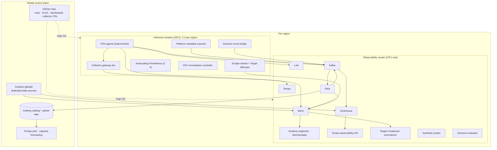
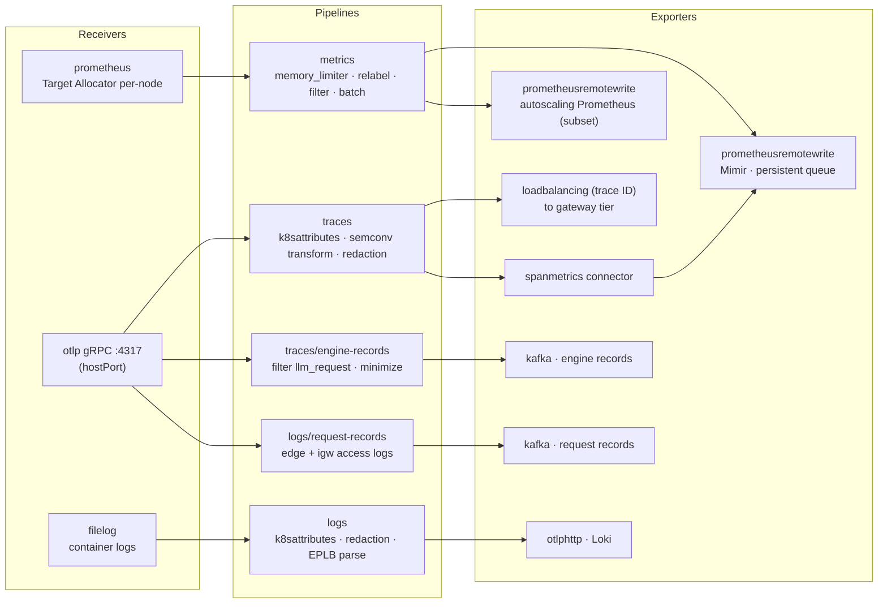
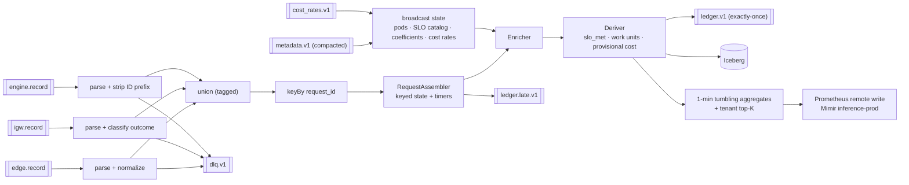
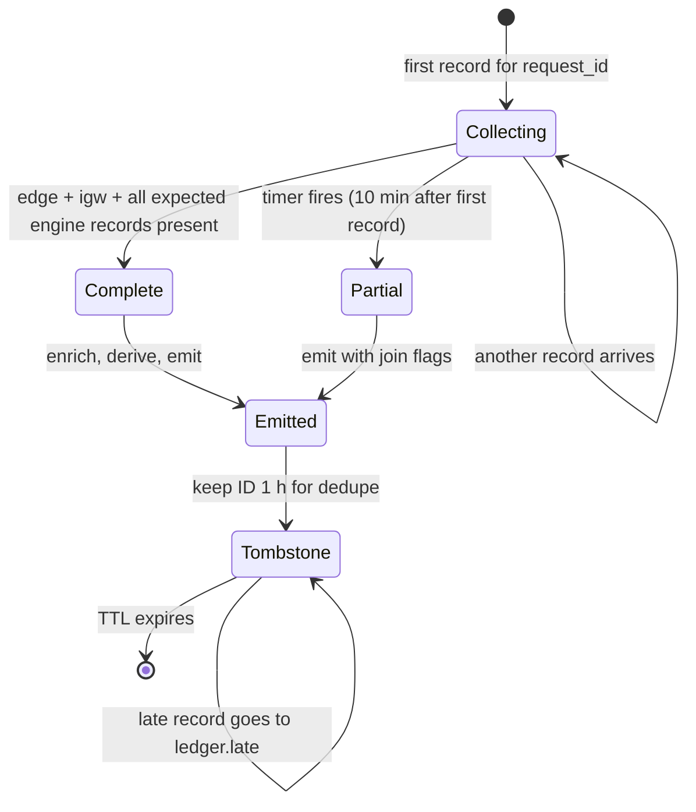
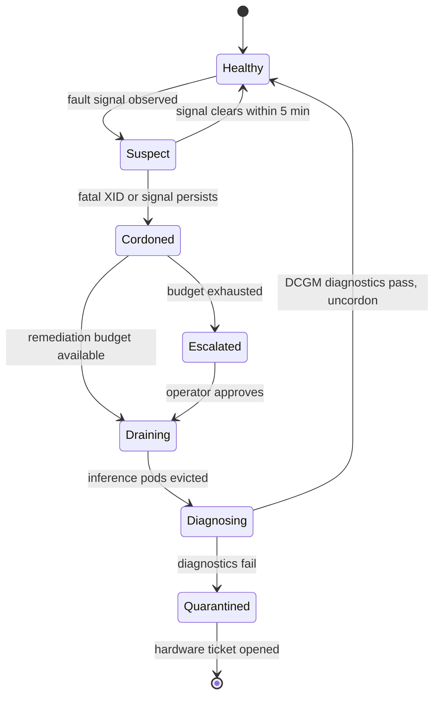
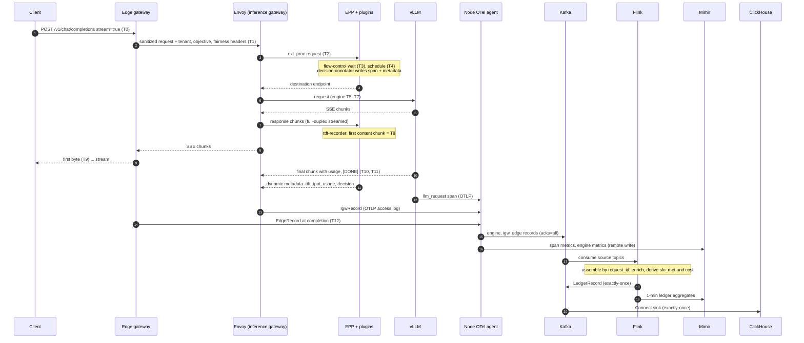
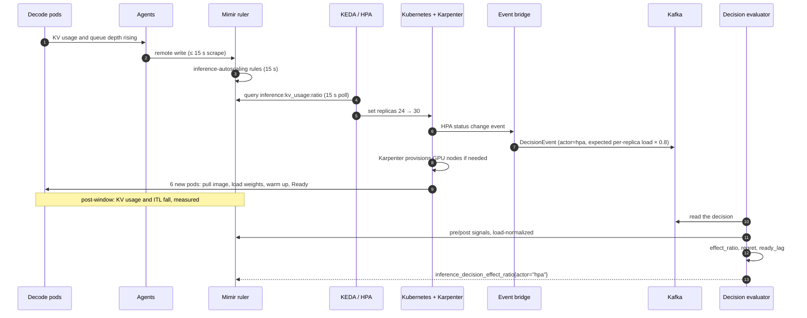
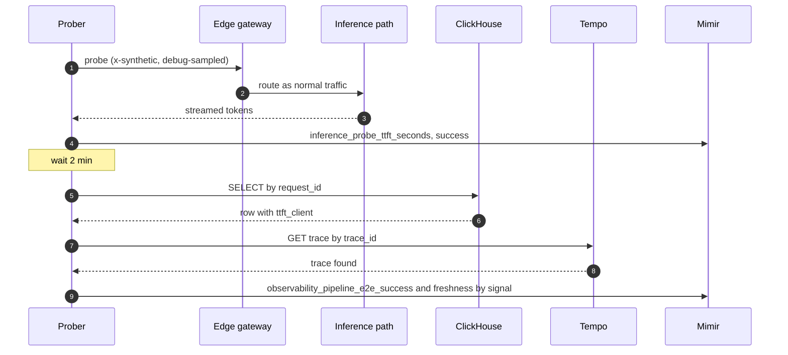

# Observability System Design for AI Inference at Scale

| | |
|---|---|
| **Status** | Draft v1.0 |
| **Date** | 2026-10-18 |
| **Owner** | Inference Platform Engineering / SRE |
| **Parent document** | [System architecture](../architecture/system-architecture.md) |
| **Audience** | Engineers who build and run the observability system: platform, SRE, data engineering, FinOps |

---

## Table of contents

1. [Purpose, scope and traceability](#1-purpose-scope-and-traceability)
2. [Design targets](#2-design-targets)
3. [Deployment topology](#3-deployment-topology)
4. [Telemetry contracts](#4-telemetry-contracts)
5. [Producer components](#5-producer-components)
6. [Collection layer](#6-collection-layer)
7. [Storage back-ends](#7-storage-back-ends)
8. [Request ledger pipeline](#8-request-ledger-pipeline)
9. [Analysis services](#9-analysis-services)
10. [Decision and actuation integrations](#10-decision-and-actuation-integrations)
11. [Measurement services](#11-measurement-services)
12. [Consumption: dashboards, alerting and APIs](#12-consumption-dashboards-alerting-and-apis)
13. [End-to-end flows](#13-end-to-end-flows)
14. [Sizing and cost](#14-sizing-and-cost)
15. [Reliability design](#15-reliability-design)
16. [Security design](#16-security-design)
17. [Testing and validation](#17-testing-and-validation)
18. [Rollout plan](#18-rollout-plan)
19. [Design trade-offs](#19-design-trade-offs)
20. [Open issues](#20-open-issues)
- [Appendix A: OTel agent configuration](#appendix-a-otel-agent-configuration)
- [Appendix B: Envoy request-record access log](#appendix-b-envoy-request-record-access-log)
- [Appendix C: Kafka topics](#appendix-c-kafka-topics)
- [Appendix D: ClickHouse schema](#appendix-d-clickhouse-schema)
- [Appendix E: Alertmanager routing](#appendix-e-alertmanager-routing)
- [Appendix F: Mimir tenant limits](#appendix-f-mimir-tenant-limits)

---

## 1. Purpose, scope and traceability

The [architecture](../architecture/system-architecture.md) sets out *what* the observability system is and *why*. It defines three telemetry planes, four nested control loops, the eight signals that matter, back-end choices and the main trade-offs. This document specifies *how to build it*:

- the components and their interfaces
- the data contracts and schemas
- the algorithms
- deployment, sizing, failure handling and testing

Where the architecture already settles something, this document links to it rather than repeating it.

### 1.1 Traceability

| Architecture section | Realized in this design |
|---|---|
| [§5 Telemetry planes](../architecture/system-architecture.md#5-observability-architecture-overview) | §3 topology, §6 collection, §7 back-ends, §8 ledger |
| [§6 Control loops](../architecture/system-architecture.md#6-the-continuous-control-loop) | §10 actuation integrations, §11 measurement services |
| [§7 Signal catalog](../architecture/system-architecture.md#7-signals-that-matter-the-signal-catalog) | §4.1 timing model, §5.3 TTFT/TPOT capture, §8.4 derived fields, §9.1 rules |
| [§8 Model-class profiles](../architecture/system-architecture.md#8-observability-profiles-by-model-class) | §5.4 engine profiles, §5.5 diffusion adaptor |
| [§10 Conventions and cardinality](../architecture/system-architecture.md#10-semantic-conventions-context-propagation-and-cardinality) | §4.3 header contract, §4.5 conventions registry, §8.5 tenant top-K |
| [§11 Pipeline](../architecture/system-architecture.md#11-telemetry-pipeline) | §6, §8 |
| [§13 Analysis](../architecture/system-architecture.md#13-analysis) | §9 |
| [§14–15 Decision and measurement](../architecture/system-architecture.md#14-decision-and-actuation) | §10, §11, §12 |
| [§17 Capacity](../architecture/system-architecture.md#17-capacity-estimates-for-the-observability-system) | §14 per-component sizing |
| [§18 Reliability](../architecture/system-architecture.md#18-reliability-of-the-observability-system) | §15 |

### 1.2 Refinements to the architecture

These decisions were made during detailed design. They make the architecture more precise without changing its intent:

| # | Refinement | Reason |
|---|---|---|
| R1 | **Fairness IDs are bounded.** Contracted tenants get their own fairness ID. Self-serve tenants are hashed into 64 buckets per tier. Per-tenant gateway metrics come from Flink with top-K and hysteresis. | Keeps flow-control queues and metric series bounded with millions of end users and 10 k+ tenants. Exact per-tenant data remains in the ledger. |
| R2 | The architecture's single `inference.request.v1` stream becomes **three source topics** (edge, inference-gateway and engine records) plus one assembled `inference.ledger.v1` topic. | Each producer writes independently. Flink joins the records on `request_id`. |
| R3 | ClickHouse ingests through the **ClickHouse Kafka Connect sink in exactly-once mode**, not the Kafka table engine. | Avoids duplicate rows that would double-count in rollup materialized views. |
| R4 | **Final per-request cost is computed at query time** by joining requests with an hourly `pool_cost_hourly` table. Flink writes only a provisional cost. | Exact cost needs the hour's total work units, which a stream cannot know. Avoids rewriting rows. |
| R5 | Back-ends run in a **dedicated CPU-only observability cluster per region**, not on GPU clusters. | Isolates failures, makes nodes cheaper, and keeps telemetry available when an inference cluster fails. |
| R6 | Each SLI has its **own error budget**: availability 99.9% (budget 0.001), latency 95% (budget 0.05). | The latency targets are p95-style objectives. Burn-rate maths must use the matching budget. |
| R7 | Aborted requests are **charged** their consumed work units and reported as **waste**. They are excluded from the success-per-dollar numerator. | Attributed cost then always reconciles to allocated cost. |

---

## 2. Design targets

### 2.1 Load model

| Quantity | Value | Derivation |
|---|---|---|
| End users (DAU) | ~5 M | Product assumption |
| Requests/day | 100 M | ~20 requests per DAU |
| Average / peak RPS | 1,160 / 4,600 | Peak-to-average ratio of 4 |
| **Design RPS** (pipeline headroom) | **15,000** | 3× peak |
| Average streamed request duration | ~8 s | Mix of LLM (~16 s), SLM (< 1 s) and diffusion (~5 s) |
| **Peak concurrent streams** | **~37 k** (design 110 k) | Little's law: 4,600 × 8 s |
| Tokens/day | ~150 B input, ~32 B output | 80% LLM share, ~1.5 k input / 0.4 k output tokens average |
| Ledger source records/day | ~330 M | ~3.3 per request (edge + inference gateway + 1–2 engine records) |
| Spans generated/day | ~1 B | ~10 per request. About 4% are retained. |
| Active metric series | ~5.3 M fleet-wide | [Architecture §17](../architecture/system-architecture.md#17-capacity-estimates-for-the-observability-system) |
| Regions | 3 | The largest region (**Region L**) carries 40% of traffic. Per-region sizing below uses Region L. |

### 2.2 SLOs for the observability system

The observability system has SLOs of its own. They are measured with synthetic probes (§5.7) and pipeline self-metrics (§15).

| SLI | Target |
|---|---|
| Metric freshness: scrape → queryable in Mimir | p99 ≤ 30 s |
| Autoscaling read path: availability / latency | 99.95% / p99 ≤ 500 ms |
| Alert latency: condition true → notification | p99 ≤ 90 s (excluding the `for:` duration) |
| Ledger completeness: assembled rows vs. edge request counter, daily | ≥ 99.9% |
| Ledger freshness: request completion → queryable in ClickHouse | p99 ≤ 2 min |
| Sampled error traces queryable in Tempo | ≥ 99% within 2 min |
| Dashboard query latency (panels backed by recording rules) | p95 ≤ 2 s |
| Inference overhead | Within the [architecture's overhead budget](../architecture/system-architecture.md#117-overhead-budget) |

### 2.3 Constraints carried forward

- Serving stack: edge API gateway → Envoy-based Gateway API inference gateway → llm-d EPP → vLLM, plus diffusion runtimes, on Kubernetes.
- Open-source, vendor-neutral components: OpenTelemetry, Prometheus exposition, Mimir, Tempo, Loki, Kafka, Flink, ClickHouse, Iceberg, Grafana.
- **Telemetry fails open.** Nothing on the inference request path waits on a telemetry back-end.

---

## 3. Deployment topology



### 3.1 Where each component runs

| Scope | Components | Rationale |
|---|---|---|
| **Per GPU node** | OTel agent, DCGM Exporter, node-exporter | Node-local collection. Scales with the fleet. |
| **Per inference cluster** | Scrape shards and Target Allocator, collector gateway tier, autoscaling Prometheus, platform metadata exporter, remediation controller, decision event bridge, local KEDA/WVA | Close to the sources and actuators. Survives loss of the observability cluster. |
| **Per region (observability cluster)** | Mimir, Tempo, Loki, Kafka, Flink, ClickHouse, regional Grafana, Alertmanager, tenant API, headroom summarizer, prober, decision evaluator | High-volume storage stays in-region. CPU-only nodes. Isolated failure domain. |
| **Global** | Global Grafana, Iceberg catalog and lake, FinOps and forecasting jobs, GitOps repository | Cross-region views, long-term analytics, a single source of configuration |

### 3.2 Namespaces and repository layout

| Namespace | Contents |
|---|---|
| `obs-agents` | Agent DaemonSet, DCGM Exporter, node-exporter |
| `obs-collect` | Scrape shards, Target Allocator, gateway tier, autoscaling Prometheus |
| `obs-control` | Metadata exporter, remediation controller, event bridge |
| `obs-metrics` / `obs-traces` / `obs-logs` | Mimir / Tempo / Loki |
| `obs-ledger` | Kafka (Strimzi), Flink (Flink Kubernetes Operator), ClickHouse (operator), Kafka Connect |
| `obs-ui` | Grafana, Alertmanager, tenant API |
| `obs-meta` | Meta-monitoring stack (separate Prometheus and Alertmanager with an external heartbeat) |

```
observability/
├── conventions/        # semantic-convention registry (OTel Weaver) → generated Go/Python constants and docs
├── collectors/         # OpenTelemetryCollector CRs, Target Allocator, PodMonitors, custom collector build manifest
├── rules/              # recording and alert rules + promtool tests (per group)
├── slos/               # SLO catalog → generated Sloth specs, Flink SLO config, dashboards
├── dashboards/         # dashboards as code (Grafana Foundation SDK)
├── ledger/             # Kafka topics, schemas (protobuf), Flink jobs, ClickHouse migrations, Connect configs
├── control/            # metadata exporter, headroom summarizer, remediator, prober, evaluator
├── backends/           # Helm values for Mimir, Tempo, Loki, Grafana, per region
└── tests/              # contract conformance, load profiles, chaos experiments
```

---

## 4. Telemetry contracts

### 4.1 Canonical timing model

Every latency signal comes from a fixed set of timestamps. Each timestamp is captured by exactly one component.

| ID | Event | Captured by | Clock |
|---|---|---|---|
| T0 | Edge receives the request headers | Edge gateway | Wall-clock + monotonic |
| T1 | Edge forwards after authentication and rate limiting | Edge gateway | Monotonic |
| T2 | Inference gateway receives the request | Envoy (access log `START_TIME`), and the EPP when the ext_proc stream opens. The EPP value is used for SLIs. | Wall-clock (Envoy) + EPP monotonic |
| T3 | Request leaves flow control (dequeued) | EPP | Monotonic |
| T4 | Endpoint chosen, ext_proc response sent | EPP | Monotonic |
| T5 | Engine arrival | vLLM (`arrival_time`) | Engine-local |
| T6 | First scheduled into a batch | vLLM | Engine-local |
| T7 | First token generated | vLLM | Engine-local |
| T8 | **First content chunk seen at the inference gateway** | EPP `ttft-recorder` plugin (§5.3) | Monotonic |
| T9 | First byte sent to the client | Edge gateway | Monotonic |
| T10 | Engine finished | vLLM | Engine-local |
| T11 | Last content chunk / `[DONE]` at the inference gateway | EPP `ttft-recorder` | Monotonic |
| T12 | Edge completes the response | Edge gateway | Monotonic |

| Derived duration | Formula | Process boundary |
|---|---|---|
| `t_edge` | (T1 − T0) + (T12 − T11) | Within the edge process |
| `t_flow_queue` | T3 − T2 | Within the EPP |
| `t_schedule` | T4 − T3 | Within the EPP |
| `t_engine_queue`, `t_prefill` | From vLLM span attributes (queue time, prefill time) | Within the engine |
| `t_kv_transfer` | From the routing-sidecar span / NIXL stats | Within the sidecar |
| **`ttft_igw`** | T8 − T2 | Within the EPP (monotonic, no clock skew) |
| **`ttft_client`** | T9 − T0 | Within the edge |
| **`tpot`** | (T11 − T8) / (output_tokens − 1), only when output_tokens ≥ 8 | Within the EPP |
| `e2e_igw` / `e2e_client` | T11 − T2 / T12 − T0 | Within the EPP / within the edge |

**Clock rule.** Durations that feed SLIs are always computed **inside one process with a monotonic clock**. Cross-host differences, such as T5 − T4, are diagnostic only. They are stored with a `skew_suspect` flag when negative or above 1 s. All nodes run chrony against regional PTP or NTP sources, and their offsets are exported as metrics.

### 4.2 Model Server Observability Contract (MSOC v1)

Any serving runtime must meet this contract before it can join an `InferencePool`. That includes vLLM, a diffusion runtime, or a future engine. Engine upgrades are also gated on it, which is how metric renames are caught before production (§17.3).

| # | Requirement | Level |
|---|---|---|
| M1 | Serve Prometheus exposition on a container port named `metrics`, scrapeable in under 100 ms at a 50 ms poll rate | MUST |
| M2 | Expose a queue-depth gauge, a running-requests gauge, a request-outcome counter, a TTFT (or time-to-first-step) histogram, an end-to-end histogram, and work-unit counters (tokens or megapixel-steps) | MUST |
| M3 | Expose a KV or memory-pressure ratio gauge (0–1), or declare `kv=none` in the pool's onboarding manifest | MUST |
| M4 | Use `x-request-id` as the request ID and include it in spans and logs | MUST |
| M5 | Extract W3C `traceparent` and emit **one OTLP span per request** (`llm_request` or `diffusion.request`) with phase-timing attributes, to `${NODE_IP}:4317` | MUST |
| M6 | Log JSON to stdout with `ts`, `level`, `msg` and, where applicable, `request_id`. **No prompt or completion content.** | MUST |
| M7 | Readiness is true only after weights are loaded and a warm-up forward pass succeeds. Expose a startup-phase gauge (`downloading`, `loading`, `compiling`, `warming`, `ready`). | MUST |
| M8 | Publish KV-cache events (ZMQ) when prefix caching is enabled | SHOULD |
| M9 | Return `cached_tokens` in `usage.prompt_tokens_details` | SHOULD |
| M10 | Label per-rank metrics with `engine` for data-parallel deployments | SHOULD |

**Conformance harness (`msoc-conformance`).** This is a Kubernetes Job that runs against a candidate image serving a small model. It checks five things:

1. Sends 200 mixed requests (streaming and non-streaming, cancelled, oversized).
2. Scrapes `/metrics` before and after. It verifies the required metric families, that counters only increase, and that histogram sums are consistent.
3. Receives spans on an embedded collector. It verifies that trace IDs match the injected `traceparent`, request IDs match `x-request-id`, and required attributes are present.
4. Greps logs for the injected canary prompt string. **Any match fails the run.**
5. Diffs metric families against the inputs that the normalization rules expect (§17.3).

### 4.3 Header contract and sanitization

The edge gateway is the trust boundary. It runs this logic in its request filter chain:

```text
INTERNAL_HEADERS = [x-tenant-id, x-tenant-tier, x-slo-class, x-inference-debug, x-synthetic,
                    x-gateway-inference-fairness-id, x-gateway-inference-objective]

on_request(req):
    for h in INTERNAL_HEADERS: req.remove(h)                  # never trust client values
    if req.has("x-request-id"):
        req.set("x-client-request-id", truncate(req["x-request-id"], 128))
    req.set("x-request-id", uuid_v7())                        # time-ordered: storage locality
    principal = authenticate(req)                             # API key or OIDC
    t = principal.tenant
    slo = resolve_slo_class(t.plan, req.path, req.model)
    req.set("x-tenant-id", t.id)
    req.set("x-tenant-tier", t.tier)
    req.set("x-slo-class", slo)
    req.set("x-gateway-inference-objective", objective_for(t.plan, slo))
    req.set("x-gateway-inference-fairness-id", fairness_id(t))
    if principal.is_operator and valid_debug_grant(req): req.set("x-inference-debug", "1")
    if principal.is_prober: req.set("x-synthetic", "1")
    req.baggage = {inference.slo_class: slo, inference.tenant_tier: t.tier}   # replace, never merge
    continue_or_start_trace(req)                              # keep client trace ID, ignore its sampled flag
    if req.stream: req.body.stream_options.include_usage = true

fairness_id(t):                                               # refinement R1
    if t.tier in {enterprise, dedicated}: return "t:" + t.id  # bounded, ~500 tenants
    return "b:" + t.tier + ":" + str(hash64(t.id) % 64)       # bounded long tail
```

End-user identifiers (the OpenAI `user` field) are replaced with `HMAC(tenant_salt, user)` and written **only** to the ledger (`end_user_hash`). They are never written to metrics, spans or logs.

### 4.4 Shared histogram bucket layouts

Every component that emits a latency histogram uses the same layouts, so series can be aggregated across components. Go components emit native histograms plus these classic buckets for compatibility. vLLM's own buckets are left unchanged.

| Layout | Buckets (seconds) |
|---|---|
| `ttft` | 0.025, 0.05, 0.1, 0.15, 0.2, 0.3, 0.4, 0.5, 0.75, 1, 1.5, 2, 3, 5, 8, 13, 20, 30, 60 |
| `tpot` | 0.005, 0.01, 0.015, 0.02, 0.025, 0.03, 0.04, 0.05, 0.06, 0.08, 0.1, 0.15, 0.2, 0.3, 0.5 |
| `e2e` | 0.1, 0.25, 0.5, 1, 2, 4, 8, 15, 30, 60, 120, 240, 600 |
| `queue` | 0.001, 0.005, 0.01, 0.025, 0.05, 0.1, 0.25, 0.5, 1, 2, 5, 10, 30 |
| `sched` (EPP, plugins) | 0.0001, 0.00025, 0.0005, 0.001, 0.002, 0.005, 0.01, 0.025, 0.05 |
| `diffusion_step` | 0.01, 0.02, 0.04, 0.06, 0.08, 0.1, 0.12, 0.15, 0.2, 0.3, 0.5, 1 |

Fixed SLO thresholds, such as SLM TPOT of 15 ms, are bucket boundaries, so histogram SLIs for them are exact. Length-normalized TTFT thresholds cannot be bucket boundaries. For those, the authoritative SLI comes from the ledger (§9.2).

### 4.5 Conventions registry and libraries

- A single **semantic-convention registry** (`conventions/registry.yaml`) managed with OTel Weaver. It defines resource attributes, span attributes, metric names, label sets, allowed values and the label policy from [architecture §10.1](../architecture/system-architecture.md#101-resource-attributes-and-metric-labels).
- Weaver generates `inference-telemetry-go` and `inference-telemetry-py` libraries with:
  - attribute and label constants
  - metric constructors that reject forbidden labels at registration time
  - the shared bucket layouts from §4.4
  - a `DecisionEvent` producer (§10.5)
- CI runs a **policy check** on every pull request that adds a metric. The check covers the naming pattern, required labels, whether new labels are within the cardinality budget, and that the metric has an owner and a documented consumer.

---

## 5. Producer components

### 5.1 Edge API gateway

| Concern | Design |
|---|---|
| Timestamps | T0, T1, T9 and T12, captured in the outermost filter |
| Spans | `edge.request` (root), with `edge.auth`, `edge.ratelimit` and `edge.upstream` children |
| Record | An `EdgeRecord` OTLP log record emitted at completion, **including requests rejected at the edge** (401, 403, 429) that never reach the inference gateway |
| Metrics | Only low-cardinality metrics: `inference_edge_requests_total{region, model_name, tenant_tier, outcome}` and `inference_edge_ratelimited_total{tenant_tier, reason}`. Per-tenant metrics come from Flink (§8.5). |
| Long streams | Periodic access-log flush is disabled. Records are emitted once, at completion. |
| Products | If the edge is Envoy-based, the same OTel access logger is used as in §5.2. For a managed API gateway, its log export goes to a regional log forwarder, which writes `EdgeRecord` to Kafka. |

### 5.2 Inference gateway (Envoy)

- **Request record (`IgwRecord`)**: Envoy's OpenTelemetry access logger (`envoy.access_loggers.open_telemetry`) sends one OTLP log record per request to the node-local agent at stream completion ([Appendix B](#appendix-b-envoy-request-record-access-log)). Attributes include the request and trace IDs, the headers from §4.3, upstream host, status code, **response flags**, duration, and the EPP's dynamic metadata (§5.3).
- **Outcome classification** at the inference gateway, using status code plus response flags:

| Condition | `outcome` | Counts against the SLO? |
|---|---|---|
| 2xx, `finish_reason` in {`stop`, `length`, `tool_calls`} | `success` | — |
| Response flag `DC` (downstream connection terminated) | `aborted_client` | No (excluded) |
| 429 with `x-inference-reject: quota` | `rate_limited_quota` | No |
| 429/503 with `x-inference-reject: capacity` (flow control shed) | `shed_capacity` | **Yes** |
| Response flag `UT` or `SI`, or a 504 | `timeout` | **Yes** |
| Response flags `UH`, `UF`, `URX`, or a 5xx | `server_error` | **Yes** |
| Other 4xx | `client_error` | No |

- **Implementation note.** Gateway implementations expose access logging through their own CRDs (Envoy Gateway `EnvoyProxy` telemetry, Istio Telemetry API, kgateway policies). Appendix B shows the underlying Envoy configuration so the design is unambiguous.

### 5.3 EPP telemetry plugins

The llm-d EPP already processes request and response bodies through ext_proc in full-duplex streaming mode, to parse usage. Three in-house plugins are added at the EPP's request-control extension points (pre-request and response hooks):

| Plugin | Hook | Responsibility | Hot-path budget |
|---|---|---|---|
| `ttft-recorder` | Response streaming / complete | Captures T8 and T11, parses final usage, computes TTFT and TPOT, observes `inference_gateway_ttft_seconds` and `inference_gateway_tpot_seconds` histograms, writes dynamic metadata | ≤ 20 µs per chunk p99 |
| `decision-annotator` | Post-schedule | Writes scheduling attributes to the `epp.schedule` span and to dynamic metadata: candidates, filtered count, chosen and prefill endpoints, profile, predicted cached tokens, top-3 scores | ≤ 30 µs per request |
| `shadow-scorer` (optional, per pool) | Post-schedule | Runs an alternative scheduling profile **without acting on it** and records `shadow_endpoint` and `shadow_predicted_cached_tokens` | ≤ 200 µs per request. Disabled automatically if EPP p99 exceeds its budget. |

**First-content detection.** This is cheap because the full JSON parse runs only until the first content is found:

```text
on_response_chunk(ctx, chunk):
    now = monotonic()
    for event in split_sse(chunk):                       # zero-copy split on "\n\n"
        if event == "data: [DONE]": ctx.t11 = ctx.t_last_content; continue
        if not ctx.first_content:
            delta = parse_json(event).choices[0].delta   # full parse only until first content
            if nonempty(delta.content) or nonempty(delta.reasoning_content)
               or delta.tool_calls or nonempty(choices[0].text):
                ctx.first_content = true; ctx.t8 = now
            # a role-only first chunk ({"role":"assistant"}) does NOT count as first content
        elif contains(event, "\"usage\""):
            ctx.usage = parse_json(event).usage           # final chunk (include_usage forced at edge)
        else:
            ctx.t_last_content = now                     # substring check only, no parse

on_response_complete(ctx):
    ttft = ctx.t8 - ctx.t2
    tpot = (ctx.t11 - ctx.t8) / (ctx.usage.completion_tokens - 1)  if completion_tokens >= 8
    emit dynamic_metadata {ttft_ms, tpot_ms, input_tokens, cached_tokens, output_tokens, ...}
```

For non-streaming responses, `ttft_igw` is not recorded. Instead, `e2e_igw` is recorded, and the request is excluded from the TTFT SLI.

**Fallback.** Pools where response-body ext_proc is turned off for performance use an Envoy Lua filter instead. It runs `body_chunk` callbacks that do the same first-content scan and write the same dynamic-metadata keys.

### 5.4 Engine profiles (vLLM)

All engines use the base flags in [architecture Appendix A.1](../architecture/system-architecture.md#a1-vllm-engine-flags). Each model class adds the following:

| Model class | Additional observability-relevant configuration | Notes |
|---|---|---|
| Dense, aggregated | Prefix caching, KV events | — |
| Dense, P/D | `--kv-transfer-config` with `NixlConnector`. Pod label `inference.platform/role=prefill` or `decode`. | The routing sidecar **must** forward `x-request-id` and `traceparent` on both the prefill and decode calls, so the ledger can join two engine records. |
| SLM | `--enable-lora`, `--max-loras` sized to the adapter working set | Check that metrics are aggregated correctly when several API-server processes run. |
| MoE, wide-EP | `--data-parallel-size`, `--enable-expert-parallel`, `--enable-eplb` with balancedness logging | The agent's `transform` processor parses balancedness log lines into `inference_moe_eplb_balancedness{inference_pool, engine}`. |
| Canary pods (any class) | `--collect-detailed-traces all` | Only pods with `release_stage=canary` |

**Request-ID normalization.** vLLM prefixes request IDs by endpoint type (for example, `chatcmpl-` or `cmpl-`). The Flink parser strips known prefixes before joining. The trace ID is a secondary join key.

### 5.5 Diffusion telemetry adaptor

This is a Python library, `inference-diffusion-telemetry`, that implements the [diffusion metric contract](../architecture/system-architecture.md#84-diffusion-models) and MSOC v1 for any Diffusers- or DiT-based server.

```python
from inference_diffusion_telemetry import Telemetry

tel = Telemetry(model_name="flux-1-dev", pool="flux-dev-h100")

async def handle(req):
    with tel.request(req.headers, resolution=(req.width, req.height), steps=req.steps) as r:
        with r.phase("text_encode"):
            emb = encode(req.prompt)          # r.cache("text_embedding", hit=...) on embedding-cache lookups
        r.first_step_started()                # → diffusion_time_to_first_step_seconds
        latents = pipe(prompt_embeds=emb, num_inference_steps=req.steps,
                       callback_on_step_end=r.step_callback)   # per-step timing, batch size
        with r.phase("vae_decode"):
            image = decode(latents)
        with r.phase("safety_check"):
            r.outcome = "safety_blocked" if unsafe(image) else "completed"
    return image
```

- `step_callback` times successive Diffusers step callbacks. Each sample is attributed to the batch with labels `model_name` and `resolution_bucket`.
- The queue gauges wrap the server's internal admission queue. The EPP pool configuration maps its queue-depth input to `diffusion_requests_waiting` and disables the KV and prefix scorers.
- Work units are `megapixels × steps × frames`. They are exported as `diffusion_megapixel_steps_total` and as the span attribute `inference.work_units`.

### 5.6 Platform metadata exporter

This is a Go controller with two replicas per inference cluster.

| Input (informers) | Derived output |
|---|---|
| `InferencePool` (`inference.networking.k8s.io/v1`), pods carrying `inference.platform/pool` | Pool membership, roles, variants |
| Pod container args (a representative pod per pool) | `max_num_seqs`, `max_num_batched_tokens`, TP/PP/DP size, so `gpus_per_replica` |
| Nodes: `nvidia.com/gpu.product` (GPU Feature Discovery), instance type, zone | Normalized `accelerator` (for example, `NVIDIA-H100-80GB-HBM3` → `h100-sxm-80g`) |
| `PriceCatalog` CR (owned by FinOps): price per accelerator × pricing model × region | `gpu_hourly_cost_dollars` |
| `InferenceSLOClass` (generated from the SLO catalog) | `inference_pool_slo_target_seconds` |

**Outputs:**

1. Prometheus gauges ([architecture §9.7](../architecture/system-architecture.md#97-platform-metadata-exporter)). Both replicas export identical values, and rules aggregate with `max`.
2. A compacted Kafka topic `inference.metadata.v1`, keyed by pod UID. It carries the pod's node, accelerator, pool, variant, role, GPU count and price key. Only the replica holding the Kubernetes Lease publishes to it. Deleted pods are kept for 24 h (with a `deleted_at` field) so late records can still be enriched, then tombstoned.

### 5.7 Synthetic prober

The prober is a Go service with two replicas per region. It is the outside-in check of both serving and the telemetry pipeline.

- **Probe matrix**: every 30 s, for each (region × model × SLO class). Requests are streaming with fixed prompts and `max_tokens=64`, and carry `x-synthetic: 1` and the `synthetic-prober` tenant. There are two variants per model:
  - *warm*: a stable prefix, to measure cache-hit behavior
  - *cold*: a random-nonce prefix
- **Client-side metrics**: `inference_probe_ttft_seconds`, `inference_probe_tpot_seconds` and `inference_probe_success_total{region, model_name, variant}`.
- **Pipeline verification**: two minutes after each probe, the prober checks three things:
  - the `request_id` exists in ClickHouse
  - the trace exists in Tempo (probes are always sampled through the debug policy)
  - the probe's latency agrees with the ledger's `ttft_client` within 50 ms

  It then emits `observability_pipeline_e2e_success_total{signal=ledger|trace|metrics}` and `observability_pipeline_freshness_seconds{signal}`. These are the SLIs in §2.2.
- Probe traffic is excluded from tenant SLOs and billing because of `x-synthetic`, but it has its own probe SLO.

---

## 6. Collection layer

### 6.1 Agent DaemonSet

The agents are a **custom OpenTelemetry Collector build** made with the OpenTelemetry Collector Builder (ocb). It contains only the components listed here and pins their versions. The agents are managed by the OpenTelemetry Operator, run on every node (tolerating GPU taints), and use a priority class *below* inference pods.



| Pipeline | Key processing | Destination | Delivery |
|---|---|---|---|
| `metrics` | Pod-label relabeling (through PodMonitors), dropping unused vLLM histograms, removing forbidden labels, adding `cluster` and `region` external labels | Mimir (`inference-prod`). A subset goes to the autoscaling Prometheus. | Persistent queue (file storage), retries for 5 min |
| `traces` | `k8sattributes`, mapping vLLM `gen_ai.*` attributes to current semantic conventions, redaction | Gateway tier through `loadbalancing` (k8s resolver, routed by trace ID). Also `spanmetrics`. | In-memory queue. Dropped under pressure. |
| `traces/engine-records` | Keep only `llm_request` and `diffusion.request` spans. Keep only allow-listed attributes (IDs, timings, usage, model, role). | Kafka `inference.engine.record.v1` | Persistent queue, `acks=all` |
| `logs/request-records` | Route by `log_name` (edge or igw). Validate required attributes. Records that fail validation go to the dead-letter topic. | Kafka `inference.edge.record.v1` and `inference.igw.record.v1` | Persistent queue, `acks=all` |
| `logs` | Container log parsing, redaction (keys, tokens, email patterns), parsing EPLB balancedness into a gauge | Loki (native OTLP), with `request_id` and `trace_id` as structured metadata | In-memory queue. Dropped under pressure. |

Spans and request records arrive over the same OTLP receiver. Routing connectors separate them by signal and by `log_name`. Full configuration is in [Appendix A](#appendix-a-otel-agent-configuration).

**Resources**: requests of 0.5 vCPU and 1 GiB, limits of 1 vCPU and 2 GiB, and 10 GiB of persistent-queue storage on the node's local SSD (hostPath).

### 6.2 Scrape shards and Target Allocator

- Cluster-scoped targets are scraped by a StatefulSet of collectors whose Target Allocator uses the `consistent-hashing` strategy. These are gateways, the EPP, llm-d components, kube-state-metrics, the control plane and the metadata exporter.
- The agent DaemonSet's Target Allocator uses the `per-node` strategy. Each agent scrapes only the engines, DCGM Exporter and node-exporter on its own node.
- Teams declare targets with `PodMonitor` and `ServiceMonitor` CRs. Relabeling from pod labels to metric labels is standardized in a shared PodMonitor template:

```yaml
apiVersion: monitoring.coreos.com/v1
kind: PodMonitor
metadata: {name: inference-engines, namespace: inference}
spec:
  selector:
    matchExpressions: [{key: inference.platform/pool, operator: Exists}]
  podMetricsEndpoints:
    - port: metrics
      interval: 15s
      relabelings:
        - {sourceLabels: [__meta_kubernetes_pod_label_inference_platform_pool],          targetLabel: inference_pool}
        - {sourceLabels: [__meta_kubernetes_pod_label_inference_platform_model_class],   targetLabel: model_class}
        - {sourceLabels: [__meta_kubernetes_pod_label_inference_platform_role],          targetLabel: role}
        - {sourceLabels: [__meta_kubernetes_pod_label_inference_platform_accelerator],   targetLabel: accelerator}
        - {sourceLabels: [__meta_kubernetes_pod_label_inference_platform_variant],       targetLabel: model_variant}
        - {sourceLabels: [__meta_kubernetes_pod_label_inference_platform_release_stage], targetLabel: release_stage}
      metricRelabelings:
        - sourceLabels: [__name__]
          regex: 'vllm:(request_params_n|request_params_max_tokens|request_max_num_generation_tokens)_.*'
          action: drop
```

### 6.3 Collector gateway tier

- A Deployment per inference cluster behind a headless Service. The agents' `loadbalancing` exporter uses the k8s resolver, so membership changes re-hash trace IDs with bounded disruption.
- Tail-sampling policies are as in [architecture Appendix A.2](../architecture/system-architecture.md#a2-otel-collector-gateway-tier-tail-sampling). Probes and debug requests are always kept.
- **HPA** scales on CPU (60%) and memory (70%), between 4 and 24 replicas. `memory_limiter` stops the tier from OOMing. When it refuses data, agents drop spans, which is acceptable because span metrics were already computed upstream.
- During scale events, re-hashing can split a few in-flight traces across replicas. Those traces may be sampled incompletely. This is accepted, since the ledger and span metrics are unaffected.

### 6.4 Metric-name fidelity

The pipeline must preserve Prometheus names **exactly**, including the `vllm:` prefix, `_total` suffixes, and `_bucket`, `_sum` and `_count`. Recording rules and the EPP's own model-server protocol depend on them.

- The collector build pins the Prometheus translation feature gates. The receiver and exporter are configured for name-preserving round trips.
- The conformance suite (§17.1) scrapes a reference vLLM, sends the data through the agent to a test Mimir, and asserts that every metric family name survives unchanged.
- **Fallback.** If a collector upgrade breaks fidelity, the metrics pipeline can switch to Grafana Alloy or Prometheus in agent mode, using the same PodMonitors, without changing the traces or logs pipelines.

### 6.5 Autoscaling Prometheus

- A small Prometheus StatefulSet per inference cluster (two replicas, 2 h retention). It accepts remote write of an **allow-listed subset** from the agents at a 5 s interval: queue depth, running requests, KV usage, flow-control queues and `inference_pool_config_*`.
- It evaluates the same `inference-autoscaling` rule group as Mimir. Both copies are generated from one source in `rules/`, so they cannot drift.
- KEDA reads it for **burst-sensitive pools** (SLM, interactive diffusion). All other pools read Mimir's isolated autoscaling path (§7.1).

---

## 7. Storage back-ends

### 7.1 Mimir

- **Topology**: microservices mode with zone-aware replication (RF 3 across three AZs), and blocks in the regional object-storage bucket.
- **Tenants:**

| Tenant | Contents | Retention | Notes |
|---|---|---|---|
| `inference-prod` | All operational metrics, ledger aggregates from Flink, span metrics | 30 d | Out-of-order ingestion window of 10 min, for Flink aggregates and late remote-write batches |
| `inference-longterm` | Pool-level rollups only | 13 mo | Filled by **federated rule groups** (`source_tenants: [inference-prod]`) |
| `platform-infra` | Kubernetes, node and control-plane metrics not used by inference consumers | 30 d | — |

- **Isolated autoscaling read path.** KEDA and WVA use a dedicated query-frontend, query-scheduler and querier deployment (two, two and three replicas). It has its own concurrency limits, so a heavy dashboard query cannot starve autoscaling. Queries on this path must hit recording rules only. CI enforces this by linting the generated ScaledObjects and WVA configs for `inference:*` selectors. A per-tenant blocked-query rule would also block engine dashboards, which share the tenant.
- **Limits**: [Appendix F](#appendix-f-mimir-tenant-limits).
- **Long-term fallback.** If federated rule groups are not available in the deployed Mimir version, a small "rollup writer" job runs the same queries every minute and remote-writes the results into `inference-longterm`.

### 7.2 Tempo

- Distributors → ingesters → Parquet blocks in object storage, with 14 d retention. Ingest volume is small because sampling happens upstream (≈ 200 spans/s per region on average).
- The **metrics-generator is disabled**. Span metrics are generated before sampling in the agents. If they were generated after sampling, they would be biased toward errors and slow requests.
- TraceQL is enabled, and the Grafana "trace to logs" and "trace to metrics" correlations key on `trace_id` and `inference.pool`.

### 7.3 Loki

- Simple scalable deployment (separate write, read and backend targets), with native OTLP ingest.
- **Index labels**: `cluster`, `namespace`, `inference_pool`, `role`, `level`, `service_name`. Request and trace IDs go into **structured metadata**, not labels, so they can be filtered without creating streams.
- Retention is 14 d, with a 90 d compacted archive for audit-relevant streams (Kubernetes events, remediation, gateway errors).

### 7.4 Kafka

Kafka runs under Strimzi with three brokers across AZs, `min.insync.replicas=2`, zstd compression, and a Schema Registry (Apicurio) for the protobuf output schemas. Topics are listed in [Appendix C](#appendix-c-kafka-topics). The key properties:

- Source topics carry **OTLP protobuf** envelopes (collector `otlp_proto` encoding). The attribute contract is enforced by the agent validation step and by the Flink parser.
- The assembled `inference.ledger.v1` topic carries the typed `LedgerRecord` protobuf (§8.2), registered in the Schema Registry with **backward-compatible** evolution: add-only optional fields.
- ACLs work per principal: agents produce to source topics, Flink consumes source topics and produces outputs, the Connect sink consumes only `inference.ledger.v1`.

### 7.5 ClickHouse

- **Cluster**: two shards × two replicas per region (each 16 vCPU, 64 GiB, 2 TB NVMe), plus three ClickHouse Keeper nodes. Tiered storage moves parts older than 14 d to an object-storage volume.
- **Tables** ([Appendix D](#appendix-d-clickhouse-schema)):
  - `requests_local` (ReplicatedReplacingMergeTree keyed on `request_id`) and its `requests` Distributed table. The schema follows [architecture §11.5](../architecture/system-architecture.md#115-request-ledger-wide-events).
  - `requests_late`, holding late-arriving fields.
  - Rollup tables `requests_1m_pool` and `requests_1h_tenant` (AggregatingMergeTree), filled by materialized views.
  - `pool_cost_hourly`, with the `requests_costed` view on top of it (refinement R4).
  - `decision_events` and `decision_effects` (§10.5, §11.1).
- **Ingest**: ClickHouse Kafka Connect sink in exactly-once mode (refinement R3), with batches of 50 k rows or 5 s.
- **Tenant isolation**: a row policy on tenant-facing tables, keyed on a per-query `custom_tenant_id` setting. The tenant API (§12.3) sets it from the authenticated principal. The policy is defence in depth against a query-construction bug.
- **Sorting key**: `(model_name, tenant_id, ts)`. With UUIDv7 request IDs, point lookups by `request_id` use a bloom-filter skip index.

### 7.6 Iceberg

- Flink writes the ledger to Iceberg with exactly-once semantics, committing on each checkpoint (every 5 min). Data is partitioned by `day(ts)` and `model_class`.
- A nightly job compacts files, expires snapshots older than 7 d, and merges `requests_late` fields into the base rows (`MERGE INTO`).
- The global catalog federates the regional tables (one table per region, plus a global view). Regional tables respect residency partitions.

---

## 8. Request ledger pipeline

### 8.1 Job graph



- **Runtime**: Flink Kubernetes Operator in application mode, with Kubernetes HA for the JobManagers. RocksDB state backend with incremental checkpoints to object storage every 60 s. Parallelism is 24. The source topics have 48 partitions, so the job can scale to 48 without repartitioning.
- **Watermarks**: bounded out-of-orderness of 30 s, with a 1 min idleness timeout per partition.

### 8.2 Assembly algorithm

Each `request_id` is assembled by a small state machine:



```text
process(record, ctx):                                  # keyed by request_id
    st = state.get() or new AssemblyState()
    if st.emitted:                                     # tombstone: dedupe and late handling
        if not st.seen(record.fingerprint): emit_side("ledger.late", record)
        return
    st.add(record)                                     # edge | igw | engine[role]
    if st.expected_engine_records is None and record.kind == IGW:
        st.expected_engine_records = 2 if record.disaggregated else (1 if record.reached_engine else 0)
    if st.first_seen is None:
        st.first_seen = ctx.timestamp
        ctx.timer_service.register(ctx.timestamp + 10m)
    if st.has_edge and (st.has_igw or st.edge.rejected_at_edge) \
       and st.engine_count >= (st.expected_engine_records or 0):
        emit(st, timed_out=False)

on_timer(ctx):
    st = state.get()
    if st and not st.emitted: emit(st, timed_out=True)   # partial: join flags record what is missing
    ctx.timer_service.register(ctx.timestamp + 1h)       # tombstone TTL; state cleared on that timer

emit(st, timed_out):
    rec = LedgerRecord.from(st)                         # edge fields take precedence for tenant and client timings
    rec.join = JoinStatus(st.has_edge, st.has_igw, st.engine_count,
                          st.expected_engine_records, timed_out)
    out.collect(rec); st.emitted = true; st.clear_payloads()
```

- **State size**: there are about 1.8 k new requests/s at Region L peak. Most requests finish assembling within seconds of completion. The worst case, where every record waits for the 10 min timer, is about 1.1 M keys × about 3 KB ≈ 3.3 GB across the job, which RocksDB handles comfortably.
- **Edge-rejected requests** (401, 403, 429 at the edge) complete with only an edge record.

**`LedgerRecord` (protobuf, abbreviated):**

```protobuf
syntax = "proto3";
package inference.telemetry.v1;
import "google/protobuf/timestamp.proto";

message LedgerRecord {
  string request_id = 1;                       // UUIDv7 from the edge
  string trace_id = 2;
  google.protobuf.Timestamp received_at = 3;   // T0
  uint32 schema_version = 4;
  Tenant tenant = 10;
  Routing routing = 11;
  Usage usage = 12;
  Timings timings = 13;
  Outcome outcome = 14;
  Cost cost = 15;
  Diffusion diffusion = 16;
  JoinStatus join = 17;
  bool synthetic = 18;
}
message Tenant   { string tenant_id = 1; string tier = 2; string slo_class = 3; string fairness_id = 4; string end_user_hash = 5; }
message Routing  { string region = 1; string cluster = 2; string inference_pool = 3; string model_name = 4;
                   string model_class = 5; string model_variant = 6; string lora_adapter = 7; string decode_pod = 8;
                   string prefill_pod = 9; string node = 10; string accelerator = 11; bool disaggregated = 12;
                   uint32 predicted_cached_tokens = 13; string shadow_endpoint = 14; string release_stage = 15; }
message Usage    { uint32 input_tokens = 1; uint32 cached_tokens = 2; uint32 output_tokens = 3; double work_units = 4; }
message Timings  { float edge_ms = 1; float flow_queue_ms = 2; float schedule_ms = 3; float engine_queue_ms = 4;
                   float prefill_ms = 5; float kv_transfer_ms = 6; float ttft_igw_ms = 7; float ttft_client_ms = 8;
                   float tpot_ms = 9; float e2e_igw_ms = 10; float e2e_client_ms = 11; bool skew_suspect = 12; }
message Outcome  { uint32 status_code = 1; string outcome = 2; string finish_reason = 3; bool slo_met = 4;
                   repeated string slo_violations = 5; }        // e.g. ["ttft"], ["tpot","availability"]
message Cost     { double provisional_usd = 1; string cost_rate_version = 2; bool waste = 3; }
message Diffusion{ uint32 steps = 1; float megapixels = 2; uint32 frames = 3; string resolution_bucket = 4; }
message JoinStatus { bool has_edge = 1; bool has_igw = 2; uint32 engine_records = 3;
                     uint32 engine_records_expected = 4; bool timed_out = 5; }
```

### 8.3 Enrichment

Enrichment uses broadcast state, refreshed from compacted topics:

| Broadcast state | Source | Used for |
|---|---|---|
| Pod → node, accelerator, pool, variant, role, GPU count, price key | `inference.metadata.v1` | Filling `Routing` fields from `decode_pod` and `prefill_pod` |
| SLO catalog (per class and pool overrides) | `slos/` → `inference.config.v1` | `slo_met`, `slo_violations` |
| Work-unit coefficients (α, β, γ) per model × accelerator | Benchmark calibration → `inference.config.v1` | `work_units` |
| Cost rate (USD per work unit, previous hour) | `inference.cost_rates.v1` (§8.7) | `provisional_usd` |

If a pod is missing from the metadata state, the record is emitted with `accelerator="unknown"` and counted in `ledger_enrichment_miss_total`. The alert threshold is 0.1%.

### 8.4 Derived fields

```text
work_units =  α·(input_tokens − cached_tokens) + β·cached_tokens + γ·output_tokens   # LLM / SLM / MoE
           |  megapixels × steps × max(frames, 1)                                    # diffusion

threshold_ttft_ms = slo.ttft.base + slo.ttft.per_uncached_token × (input_tokens − cached_tokens)

violations = []
if outcome in {shed_capacity, timeout, server_error}:          violations += ["availability"]
if outcome == success and streamed and ttft_igw_ms > threshold_ttft_ms: violations += ["ttft"]
if outcome == success and output_tokens >= 8 and tpot_ms > slo.tpot.threshold_ms: violations += ["tpot"]
slo_met = (outcome == success) and violations == []

provisional_usd = work_units × cost_rate[pool, previous_hour]
waste = (outcome == aborted_client)
```

The edge-measured `ttft_client` is stored, but SLIs use `ttft_igw`. That keeps client network conditions out of the platform's SLO, while the prober tracks the client-side view separately.

### 8.5 Aggregates and tenant top-K

Every minute, the job emits cumulative counters to Mimir by Prometheus remote write. The counters are kept in keyed state, so they survive restarts.

| Metric | Labels |
|---|---|
| `inference_ledger_requests_total` | `region`, `cluster`, `inference_pool`, `model_name`, `slo_class`, `outcome`, `slo_met` |
| `inference_ledger_sli_events_total` | `inference_pool`, `slo_class`, `sli` (`availability`, `ttft`, `tpot`), `good` |
| `inference_ledger_work_units_total` | `inference_pool`, `outcome` |
| `inference_ledger_cost_usd_total` | `inference_pool`, `waste` |
| `inference_tenant_requests_total`, `inference_tenant_queue_wait_seconds` (summary, p95) | `inference_pool`, `tenant` (top-K or `other`) |

**Top-K with hysteresis.** This keeps tenant series stable:

```text
every 5 min, per inference_pool:
    rank tenants by requests over the last 1 h (keyed state, space-saving sketch with ε = 0.1%)
    enter top-K  if rank ≤ K           (K = 50)
    leave top-K  if rank > 1.5·K for 3 consecutive evaluations
    all other tenants → tenant="other"
```

A tenant series that drops out stops updating. Mimir marks it stale after 5 min, so it never vanishes and reappears mid-window.

### 8.6 Delivery guarantees, late data and reconciliation

| Concern | Mechanism |
|---|---|
| Duplicate source records (collector retries) | Fingerprint dedupe in assembler state. Tombstones are kept for 1 h. |
| Exactly-once output | Kafka transactional sink (`inference.ledger.v1`) and Iceberg commits, both tied to Flink checkpoints. The ClickHouse Connect sink runs in exactly-once mode. |
| Late records (after emit) | Go to `inference.ledger.late.v1` → `requests_late`. Rollups ignore them. The nightly Iceberg merge applies them. The late rate is monitored (target < 0.1%). |
| Poison records | Parse failures go to `inference.dlq.v1` with the error reason. The DLQ rate is alerted. |
| **Completeness reconciliation** | Hourly job: assembled rows (by edge `received_at` hour) vs. `inference_edge_requests_total` increase. A gap above 0.1% raises a ticket. Results are stored as `ledger_completeness_ratio` (an SLI in §2.2). |

### 8.7 Cost finalization

Final cost is a scheduled job: a Kubernetes CronJob running at minute 5 of each hour.

1. Query Mimir for each pool's `avg_over_time(inference:pool_cost_dollars_per_hour[1h])` and `inference:pool_allocated_gpus` for the hour just finished.
2. Query ClickHouse for `sum(work_units)` per pool for that hour, **including aborted requests** (refinement R7).
3. Write `pool_cost_hourly(hour, cluster, pool, gpu_hours, cost_usd, work_units, usd_per_work_unit, version)`.
4. Publish `usd_per_work_unit` to `inference.cost_rates.v1`. Flink uses it as the next hour's provisional rate.
5. The `requests_costed` view gives `cost_usd_final = work_units × usd_per_work_unit` with no row rewrites. Idle capacity is part of the pool cost, so it shows up in a higher cost per work unit. FinOps reports the idle share separately as `1 − Σwork_units / capacity_work_units`.

If a job run fails, the next run backfills any missing hours (the job is idempotent through `version`).

---

## 9. Analysis services

### 9.1 Rule repository and evaluation

| Rule group | Interval | Evaluated in | Purpose |
|---|---|---|---|
| `inference-normalization` | 15 s | Mimir ruler | Raw → `inference:*` and `accelerator:*` ([architecture §13.1](../architecture/system-architecture.md#131-normalization-layer-recording-rules)) |
| `inference-autoscaling` | 15 s (5 s locally) | Mimir ruler + autoscaling Prometheus | Scale signals. Generated from one source. |
| `inference-sli` | 30 s | Mimir ruler | Error ratios over 5 m, 30 m, 1 h, 2 h, 6 h, 1 d and 3 d windows |
| `inference-slo-alerts` | 1 m | Mimir ruler | Burn-rate alerts (generated) |
| `inference-economics` | 5 m | Mimir ruler | Cost, success-per-dollar |
| `inference-baselines` | 5 m | Mimir ruler | Robust z-scores against baselines (§9.3) |
| `inference-longterm` | 1 m | Mimir ruler (federated) | Pool-level rollups into `inference-longterm` |
| `pipeline-health` | 30 s | Meta-monitoring Prometheus | The observability system's own SLIs |

**Conventions:**

- Names follow `level:metric:operations`.
- Rules aggregate *before* `histogram_quantile`: per-pod rates first, then per-pool quantiles.
- No rule reads a raw `vllm:` metric except the normalization group.
- Every group has `promtool` unit tests (§17.2).
- Ruler groups are sharded, and evaluation lag is alerted when it exceeds one interval.

### 9.2 SLO catalog and generation

SLO definitions live in Git as `InferenceSLOClass` documents:

```yaml
apiVersion: slo.inference.platform/v1
kind: InferenceSLOClass
metadata:
  name: interactive-llm
spec:
  appliesTo: {sloClass: interactive, modelClass: [dense, moe]}
  window: 28d
  objectives:
    availability: {target: 0.999}
    ttft:
      target: 0.95                              # 95% of successful streamed requests
      thresholdMs: {base: 400, perUncachedInputToken: 0.1}
    tpot:
      target: 0.95
      thresholdMs: 50
      minOutputTokens: 8
  alerting:
    page:   [{long: 1h, short: 5m, burn: 14.4}, {long: 6h, short: 30m, burn: 6}]
    ticket: [{long: 3d, short: 6h, burn: 1}]
  overrides:
    - inferencePool: deepseek-r1-wide-ep
      ttft: {thresholdMs: {base: 800, perUncachedInputToken: 0.15}}
```

A CI generator turns each catalog entry into four artifacts:

1. **Sloth** specs, then `PrometheusRule` objects. The SLI is event-based, built from `inference_ledger_sli_events_total{good="false"}` over the total.
2. Flink SLO broadcast configuration (`inference.config.v1`).
3. `inference_pool_slo_target_seconds` entries for the metadata exporter.
4. SLO dashboards.

The generator rejects catalogs whose thresholds conflict with bucket layouts for histogram-based SLIs.

**Budgets (refinement R6).** Availability uses a budget of 0.001. A 14.4× fast burn pages when more than 1.44% of requests fail over both the 1 h and 5 m windows. Latency uses a budget of 0.05. The 14.4× fast burn pages at 72% of requests slow, and the 6× rule pages at 30% slow. For latency, the 6× and 1× rules do most of the work, and an engine-histogram **symptom alert** catches gross breaches: p95 TTFT above 2× threshold for 10 min.

### 9.3 Baselines and anomaly detection

This approach needs no ML platform. Two pieces are involved:

- **Baseline job.** Runs hourly in ClickHouse and Mimir. For each (pool, signal, hour-of-week) it computes the median and MAD over the last 4 weeks, excluding incident windows annotated in the decision and incident log. Signals are RPS, prefix hit ratio, success-per-dollar, TTFT p95, input/output length means and abort rate. It exports `inference_baseline_median{signal, inference_pool}` and `inference_baseline_mad{...}` through a small exporter.
- **Anomaly rule:**

```promql
(
  inference:prefix_cache_hit:ratio_5m
  - on (inference_pool) group_left inference_baseline_median{signal="prefix_hit"}
)
/ on (inference_pool) group_left
(1.4826 * clamp_min(inference_baseline_mad{signal="prefix_hit"}, 0.005))
< -4
```

When `TelemetryPipelineDegraded` fires, it inhibits anomaly alerts ([Appendix E](#appendix-e-alertmanager-routing)). Missing data must never look like an anomaly.

### 9.4 Correlation

- **Change annotations.** Grafana annotations come from three places: `decision_events`, Argo CD sync events and Kubernetes node events. They are pulled through the ClickHouse data source and a Loki query.
- **Topology-aware inhibition.** A region-level outage suppresses pool alerts in that region. A node with a fatal GPU fault suppresses pod-level alerts on that node. A pool below its minimum ready count suppresses that pool's latency burn alerts.
- **Fault signatures.** These are rule-based correlations, kept as multi-condition alert rules:

| Signature | Conditions (same pool or node set, 10 min) | Likely cause |
|---|---|---|
| `FabricDegradation` | TPOT/ITL p99 up, per-rank skew up, IB or NVLink errors up | NIC, cable or switch |
| `PrefixIndexDrift` | Routing efficiency down, KV indexer event lag up, hit rate down | Indexer or event path |
| `KVPressure` | KV usage > 95%, preemptions > 0, TPOT up | Under-provisioned decode, or a change in the input-length mix |
| `ThermalThrottle` | Clock-event thermal flag, TPOT up on a node subset | Cooling or power capping |

---

## 10. Decision and actuation integrations

### 10.1 Autoscaling signal path and lag budget

| Stage | Mimir path | Autoscaling-Prometheus path |
|---|---|---|
| Scrape interval (worst case) | 15 s | 5 s |
| Remote-write batching | ≤ 5 s | ≤ 1 s |
| Rule evaluation | 15 s | 5 s |
| KEDA polling interval | 15 s | 5 s |
| HPA sync | 15 s | 15 s |
| **Worst-case telemetry → decision** | **≈ 65 s** | **≈ 31 s** |
| Pod start + weight load + warm-up | 1–10 min | 1–10 min |

**Design consequence.** Telemetry lag is small next to model start-up time. Responsiveness therefore comes from **warm capacity** (pre-pulled images, weights on local NVMe or in a node-local cache, minimum replicas sized from forecasts) and **predictive scaling** for MoE groups. Shortening scrape intervals would not help much.

### 10.2 KEDA and WVA integration

- **KEDA `ScaledObject`s** are generated per pool from a template, using the scale signal for the pool's model class ([architecture §14.3](../architecture/system-architecture.md#143-autoscaling-l2)).
  - The template always sets `fallback` replicas, asymmetric HPA behavior, and `X-Scope-OrgID` for the autoscaling tenant.
  - Its queries must reference `inference:*` series only.
- **WVA-managed pools.** WVA reads Mimir and publishes desired replicas as a metric. KEDA, or HPA through an external metric, scales on that metric. WVA's own recommendation becomes a decision event (§10.5).
- **LeaderWorkerSet groups** (MoE) scale whole groups. The ScaledObject targets the LWS through its scale subresource, so one replica equals one group.

### 10.3 GPU remediation controller

This is a Kubernetes controller (`gpu-remediator`), deployed per inference cluster with leader election.

- **Inputs:**
  - Node conditions from Node Problem Detector, with GPU and XID rules.
  - DCGM health watches.
  - Alertmanager webhooks for metric-derived conditions, such as a rank straggler or KV-transfer failures.
- **Alternative:** an existing operator such as Medik8s Node Healthcheck can supply the cordon and drain actions. The budget and decision-event logic below still apply.



| Design element | Detail |
|---|---|
| Cordon | Taint `inference.platform/gpu-unhealthy:NoSchedule` plus `node.kubernetes.io/unschedulable` |
| Drain | Evictions respect PDBs. For LWS groups, the group is deleted and recreated elsewhere, because a partial group is useless. |
| Diagnose | Runs a DCGM diagnostic Job on the node (level 3, about 15 min). The result is recorded on the node and in the decision event. |
| **Budget** | Token bucket per pool (at most 2% of the pool's nodes per hour) and per cluster (at most 5 nodes per hour). Exhausting it moves the node to `Escalated` and pages a human. |
| Idempotency | The state is stored as node annotations, so the controller can restart and resume. |
| Audit | Every transition emits a `DecisionEvent` (`actor=gpu-remediator`, `loop=L3`). |

### 10.4 Region headroom summarizer

The summarizer is a service per region that feeds the edge's global traffic weighting. Every 15 s it computes, per (model, SLO class):

- `capacity_wu_s`: ready replicas × calibrated work units per second per replica, at the SLO operating point (from benchmarks).
- `load_wu_s`: from `inference_ledger_work_units_total` and from live engine token counters.
- `headroom_ratio`, `burn_state` and the flow-control wait p95.

```http
GET /internal/v1/headroom
200 OK
{
  "region": "us-east-1",
  "generated_at": "2026-10-18T14:03:15Z",
  "ttl_s": 60,
  "models": [
    {"model": "llama-3.3-70b", "slo_class": "interactive",
     "capacity_wu_s": 1.8e6, "load_wu_s": 1.2e6, "headroom_ratio": 0.33,
     "burn_state": "ok", "flow_queue_wait_p95_ms": 35}
  ]
}
```

**Edge policy:**

- Regional weight is proportional to `max(headroom_ratio, floor)` for regions where `burn_state != critical`.
- Weights change by at most 10 points per minute.
- If a summary is older than `ttl_s`, that region's weight decays toward a static default.

Every change in weights is recorded as a decision event (`actor=edge-gslb`, `loop=L2`).

### 10.5 Decision events

**Schema.** Kafka topic `inference.decision.v1`, protobuf:

```protobuf
message DecisionEvent {
  string decision_id = 1;
  google.protobuf.Timestamp ts = 2;
  string actor = 3;                       // epp-config | wva | keda | hpa | karpenter | gpu-remediator | edge-gslb | rollout
  string loop = 4;                        // L1 | L2 | L3 | L4
  map<string, string> target = 5;         // cluster, inference_pool, node, region ...
  map<string, double> inputs = 6;         // snapshot of the signals that drove the decision
  string action_type = 7;                 // scale | cordon | drain | reweight | config_change | rollout_step
  map<string, string> action = 8;         // from/to, weights, versions
  map<string, double> expected_effect = 9;
  uint32 evaluation_window_s = 10;
  string correlation_id = 11;             // alert fingerprint, rollout ID, incident ID
}
```

**Producers:**

- **In-house actors** (remediator, headroom summarizer, rollout hooks, WVA wrapper) emit events directly through `inference-telemetry-go`.
- **Third-party actors** (HPA, KEDA, Karpenter) are covered by the **decision event bridge**. The bridge is an OTel collector with the `k8sobjects` receiver watching HPA status changes, `ScaledObject` events and Karpenter `NodeClaim` lifecycle events. A transform turns each change into a `DecisionEvent`. Because these actors don't state an expected effect, the evaluator (§11.1) uses a default model for them. For a scale from N to M replicas, it expects per-replica load to fall by N/M.

---

## 11. Measurement services

### 11.1 Decision evaluator

This is a scheduled job (every 5 min) in the observability cluster.

```text
for each decision d where now ≥ d.ts + ready_lag(d) + d.evaluation_window_s and not evaluated(d):
    pre  = signals(d.target, [d.ts − W, d.ts])                           # W = d.evaluation_window_s
    post = signals(d.target, [d.ts + ready_lag(d), d.ts + ready_lag(d) + W])
    load_adj = post.work_rate / pre.work_rate                            # control for traffic change
    for k in d.expected_effect:
        realized_delta = post[k] / load_adj − pre[k]                     # load-normalized for load-proportional signals
        expected_delta = d.expected_effect[k] − pre[k]
        effect_ratio[k] = realized_delta / expected_delta   (guard |expected_delta| > ε)
    regret = slo_burn(post) > 1   or   reversed_within(d, W)             # thrash detection
    write decision_effects(d.decision_id, effect_ratio, regret, load_adj)
```

`ready_lag(d)` is the measured time until the action took effect: replicas ready, node drained, weights applied. It comes from Kubernetes status and is stored with the evaluation.

**Outputs:**

- ClickHouse `decision_effects`.
- Mimir: `inference_decision_effect_ratio{actor, action_type}` (median per hour) and `inference_decision_regret_total{actor, reason}`.

A persistently low effect ratio, or rising regret for an actor, opens a ticket for its owner. Typical causes are a miscalibrated WVA model, wrong scorer weights or an over-eager remediation rule.

### 11.2 Experiment analysis

- Experiments are declared as `InferenceExperiment` documents in Git. Each one names a control pool, treatment pools, `HTTPRoute` weights, the primary metric (success-per-dollar or goodput), guardrail metrics (TTFT/TPOT SLIs, error rate), minimum sample size and maximum duration.
- The analysis runs in ClickHouse every hour:
  - Results are stratified by input-length bucket × tenant tier, to avoid mix-shift bias.
  - Ratio metrics get bootstrap confidence intervals.
  - The run stops early if a guardrail is breached.
- Results are published to a Grafana experiment dashboard and a decision event (`actor=rollout`, `loop=L4`).

### 11.3 Routing efficiency and shadow scoring

```sql
-- Routing efficiency per pool, hourly (rows with a prediction only)
SELECT inference_pool, toStartOfHour(ts) AS hour,
       sum(cached_tokens) / nullIf(sum(predicted_cached_tokens), 0) AS routing_efficiency
FROM inference.requests
WHERE predicted_cached_tokens > 0 AND outcome = 'success'
GROUP BY inference_pool, hour;
```

For shadow scoring, the counterfactual hit rate of the alternative policy is estimated from `shadow_predicted_cached_tokens`, scaled by the observed routing efficiency. This is an estimate, labelled as one. A policy that looks promising in shadow mode moves to a live A/B test (§11.2) before rollout.

---

## 12. Consumption: dashboards, alerting and APIs

### 12.1 Grafana

- **Dashboards as code** with the Grafana Foundation SDK, in `dashboards/` and provisioned by Argo CD. Manual edits are discarded on the next sync.
- **Shared template variables**: `region`, `cluster`, `inference_pool`, `model_name`, `slo_class`, `model_class`.
- **Data sources**:
  - Mimir: `inference-prod` and `inference-longterm`, with exemplars linked to Tempo.
  - Tempo: trace to logs and trace to metrics.
  - Loki: derived field `trace_id` → Tempo.
  - ClickHouse: ledger, decisions, experiments.
- **Performance rules**:
  - Panels with ranges over 6 h must query recording rules or `inference-longterm`.
  - Raw `vllm:` histogram queries are allowed only on level-3 engine dashboards, with `$__rate_interval`.
  - CI lints dashboards for these rules.
- **Hierarchy**: [architecture §15.3](../architecture/system-architecture.md#153-dashboard-hierarchy). Each level links to the next with the current variables preserved.

### 12.2 Alertmanager

- A per-region Alertmanager cluster (three replicas). Routing and inhibition are in [Appendix E](#appendix-e-alertmanager-routing).
- Every alert must carry `team`, `severity`, `runbook_url` and `dashboard_url`. CI rejects rules without them.
- Auto-remediation alerts (`action="auto-remediate"`) go to the `gpu-remediator` webhook **and** to a ticket receiver (`continue: true`).
- **Meta path**: the `obs-meta` Prometheus monitors Mimir, the collectors, Kafka and Flink. It has its own Alertmanager and an always-firing `Watchdog` alert sent to an external heartbeat service.

### 12.3 Tenant observability API

A read-only REST service that gives tenants their own data. It is backed by ClickHouse rollups with row policies.

| Endpoint | Returns | Maximum range / step |
|---|---|---|
| `GET /v1/observability/usage` | Requests, input, cached and output tokens, work units, by model | 31 d at 1 h, 7 d at 5 m |
| `GET /v1/observability/latency` | TTFT, TPOT and queue-wait p50/p95, SLO-met ratio, by model | 31 d at 1 h, 24 h at 1 m |
| `GET /v1/observability/errors` | Outcome breakdown (`rate_limited_quota`, `shed_capacity`, `timeout`, ...) | 31 d at 1 h |
| `GET /v1/observability/slo` | SLO attainment per class against contracted targets | 90 d at 1 d |
| `GET /v1/observability/requests/{request_id}` | Timeline of one request: phase timings, outcome, model, tokens. No content. | 90 d retention |

```http
GET /v1/observability/latency?model=llama-3.3-70b&start=2026-10-18T00:00:00Z&end=2026-10-18T06:00:00Z&step=5m
Authorization: Bearer <tenant API key or OIDC token>

200 OK
{
  "model": "llama-3.3-70b",
  "step": "5m",
  "series": [
    {"ts": "2026-10-18T00:00:00Z", "requests": 18234,
     "ttft_ms": {"p50": 182, "p95": 611}, "tpot_ms": {"p50": 21, "p95": 38},
     "queue_wait_ms": {"p95": 40}, "slo_met_ratio": 0.991}
  ],
  "next_cursor": null
}
```

- **Authentication**: the same API keys and OIDC as the inference API. The tenant comes from the principal and is never a parameter.
- **Limits**: 10 requests/s per tenant, responses cached for 60 s, cursor pagination.
- **Errors**: 400 for an invalid range or step, 404 for an unknown request ID (also returned for another tenant's ID, so existence isn't leaked), 429 when rate-limited.
- **Non-goal**: invoices. Billing comes from the metering system.

### 12.4 Runbooks

- Runbooks live in the same repository as the alerts, at `runbooks/<alert>.md`. Each has the same sections: *Impact*, *Diagnose (dashboards and queries)*, *Mitigate*, *Escalate*.
- Each alert's `runbook_url` points to the rendered page. CI fails if an alert's runbook file is missing.

---

## 13. End-to-end flows

### 13.1 Telemetry lifecycle of a streaming request



### 13.2 Scale-up with audit and measurement



### 13.3 Synthetic probe and pipeline verification



---

## 14. Sizing and cost

### 14.1 Per-region sizing (Region L: 40% of global traffic)

| Load dimension | Today (peak) | Design (3×) |
|---|---|---|
| RPS | 1,850 | 5,500 |
| Concurrent streams | ~15 k | ~45 k |
| Active series | ~2.1 M | ~6.4 M |
| Samples/s | ~140 k | ~425 k |
| Spans/s generated | ~18.5 k | ~55 k |
| Ledger source records/s | ~6.1 k | ~18 k |
| Ledger rows/day | ~40 M | ~120 M |

| Component | Today | Design (3×) | Scale trigger |
|---|---|---|---|
| OTel agent | Per node: 0.5 vCPU / 1 GiB request | Same | Node count |
| Scrape shards (per cluster) | 3 × (1 vCPU, 2 GiB) | 6 × | > 500 k series per shard |
| Gateway tier (per cluster, ~3 clusters) | 4 × (2 vCPU, 4 GiB) | 10 × | CPU 60% / memory 70% |
| Autoscaling Prometheus (per cluster) | 2 × (2 vCPU, 8 GiB) | 2 × (4 vCPU, 16 GiB) | Head series |
| Mimir distributors | 3 × 2 vCPU | 6 × 3 vCPU | ~25 k samples/s per vCPU |
| Mimir ingesters (3 zones) | 9 × (3 vCPU, 8 GiB) | 18 × (4 vCPU, 12 GiB) | ~300 k in-memory series per vCPU, after RF 3 |
| Mimir queriers / query-frontend / query-scheduler | 4 / 2 / 2 | 8 / 2 / 2 | Query concurrency |
| Mimir autoscaling read path | 2 query-frontend / 3 queriers | Same | p99 > 500 ms |
| Mimir store-gateways / compactor / ruler | 3 / 1 / 3 | 6 / 2 / 6 | Blocks / series / rule groups |
| Tempo (distributor / ingester / querier / compactor) | 2 / 3 / 2 / 1 | 3 / 6 / 4 / 2 | Retained spans/s |
| Loki (write / read / backend) | 3 / 3 / 3 | 6 / 6 / 3 | Ingest MB/s |
| Kafka brokers (8 vCPU, 32 GiB, 2 TB NVMe) | 3 | 5 | Storage: ~45 GB/day compressed × 3 d × RF 3 ≈ 0.4 TB today |
| Flink (JobManager HA / TaskManagers at 4 vCPU, 16 GiB) | 2 / 6 | 2 / 16 | Consumer lag > 60 s |
| ClickHouse (16 vCPU, 64 GiB, 2 TB NVMe) | 2 shards × 2 replicas | 4 × 2 | Query p95, merge backlog |
| Grafana / tenant API / control services | 3 / 3 / ~8 pods | Same | — |

These are starting points from vendor rule-of-thumb ratios. The load tests in §17.1 validate them before each phase gate.

### 14.2 Cost estimate (order of magnitude, fleet-wide)

| Item | Estimate | Basis |
|---|---|---|
| Observability-cluster compute (3 regions) | ~900 vCPU | Sum of the table above, about 300 vCPU per region today |
| Agent compute on GPU nodes | ~1,000 vCPU | 2,000 nodes × 0.5 vCPU. This is mostly idle host CPU, so the marginal cost is low. |
| Compute cost | ~$55 k/month | ~1,900 vCPU × 730 h × ~$0.04/vCPU-h (memory included) |
| Block storage (Kafka, ClickHouse) | ~$4–5 k/month | ~40 TB provisioned NVMe/SSD |
| Object storage (Mimir, Tempo, Loki, Iceberg) | ~$1 k/month | ~15–40 TB |
| Cross-AZ transfer (replication) | ~$5–15 k/month | Kafka RF 3, Mimir RF 3, collector-to-ingester traffic. Reduced by zone-aware routing. |
| **Total** | **~$65–80 k/month** | |
| GPU spend for comparison | ~$35 M/month | 16 k GPUs × ~$3/GPU-h × 730 h |
| **Observability as a share of GPU spend** | **≈ 0.2%** | Target ≤ 1% |

The largest cost risk is not this baseline. It is **uncontrolled cardinality**: a single label mistake on vLLM metrics could double Mimir ingester cost. That is why §4.5 and Appendix F enforce limits in CI and at ingest.

---

## 15. Reliability design

### 15.1 Failure-mode analysis

| Component | Failure | Detection | Impact | Mitigation | RTO / RPO |
|---|---|---|---|---|---|
| Agent | OOM or crash on a node | `up`, restart count, meta alerts | That node's metrics, spans and records are delayed | Persistent queue replays records and metrics after restart. Priority class protects inference pods. | 1 min / 0 for queued data |
| Gateway tier | Overload | Refused-span metrics | Trace sampling degraded | HPA, `memory_limiter`. Span metrics come from upstream and are unaffected. | Self-healing / traces only |
| Mimir ingesters | Loss of one zone | Ring health | None (RF 3, quorum 2) | Zone-aware replication | 0 / 0 |
| Mimir read path | Down | Probe and meta alerts | Dashboards and alerts degraded | Separate autoscaling path. KEDA fallback. Meta stack still alerts. | 15 min / — |
| Autoscaling Prometheus | Down | Meta alerts | Burst pools use Mimir instead | KEDA `fallback` replicas, two replicas | 5 min / — |
| Kafka | Broker loss | Under-replicated partitions | None (RF 3, `min.insync.replicas=2`) | Strimzi rolling recovery | 0 / 0 |
| Kafka | Cluster unavailable | Producer errors, agent queue growth | Ledger delayed | Agent persistent queues: 10 GiB per node holds 10 h or more of records, even on the busiest gateway nodes (~200 records/s × 1.2 KB). Replay on recovery. | 1 h / 0 within buffer |
| Flink | Job failure | Job status, consumer lag | Ledger delayed | Restart from checkpoint (≤ 60 s of reprocessing, exactly-once) | 10 min / 0 |
| ClickHouse | Replica loss | Replication queue alerts | None (two replicas) | Keeper-based recovery | 0 / 0 |
| ClickHouse | Data corruption or bad migration | Reconciliation job | Wrong analytics | Rebuild partitions from Iceberg (the source of truth for history) | 4 h / ≤ 5 min |
| Metadata exporter | Down | `up`, enrichment-miss rate | Cost and accelerator enrichment degraded | Two replicas. Flink keeps the last-known metadata in broadcast state. | 5 min / — |
| Observability cluster | Regional loss | External heartbeat | Regional telemetry lost. Inference continues. | Inference-cluster components buffer and autoscale locally. Global views drop that region. | 4 h / per buffers |

### 15.2 Backpressure, retry and buffering policy

| Path | Queue | Retry | On overflow |
|---|---|---|---|
| Engine → agent (OTLP spans) | vLLM batch span processor, bounded | None | **Drop** (fail-open) |
| Envoy → agent (access logs) | Envoy gRPC access-log buffer, bounded | Envoy built-in | Drop and count `access_log_dropped` |
| Agent → Kafka (records) | Persistent file queue, 10 GiB | Exponential backoff, no maximum elapsed time | Oldest dropped *only* when the disk quota is reached. Alert at 50% fill. |
| Agent → Mimir (metrics) | Persistent file queue, 2 GiB | Backoff, maximum elapsed 30 min | Drop oldest |
| Agent → gateway tier (spans) | In-memory, 5,000 batches | Backoff, maximum elapsed 60 s | Drop |
| Agent → Loki (logs) | In-memory | Backoff, maximum elapsed 5 min | Drop (debug and info first, through `filter` priority) |
| Flink → Mimir (aggregates) | Flink sink buffer | Retry with backoff. The 10 min out-of-order window absorbs delays. | Job back-pressures. Ledger outputs are unaffected because the sinks are separate operators with separate buffers. |

### 15.3 Degradation ladder

When the pipeline is under sustained pressure, operators or automation switch to emergency collector profiles in this order. The profiles are pre-built configurations, switched by Argo CD sync or OpAMP.

1. Turn off detailed engine traces (canary pods).
2. Cut baseline trace sampling from 1% to 0.1%. Turn off the canary policy.
3. Drop debug logs. Sample info logs at 10%.
4. Reduce span-metric dimensions (drop `model_variant`).
5. Drop non-essential metric families (cAdvisor extras, unused node-exporter collectors).

**Never shed**: request records (ledger), autoscaling series, alert-critical series, error traces, probe telemetry.

### 15.4 Backup and disaster recovery

| Data | Protection | Recovery source |
|---|---|---|
| Mimir, Tempo, Loki blocks | Object-storage versioning. `inference-longterm` is replicated cross-region. | Object storage |
| Ledger | Kafka (3 d) + Iceberg (2 y, cross-region replicated) + ClickHouse replicas | Iceberg, for rebuilding ClickHouse |
| Flink state | Checkpoints and savepoints in object storage. A savepoint is taken before every upgrade. | Latest checkpoint |
| Configuration (rules, SLOs, dashboards, collector CRs) | Git | Argo CD resync (RPO 0) |
| Grafana state (users, annotations) | Daily Postgres backups | Backup |

---

## 16. Security design

### 16.1 Identity and transport

- Workload identity comes from SPIFFE IDs issued by SPIRE, or from certificates issued by cert-manager. **mTLS** protects every hop:
  - agent → gateway tier
  - agent → Mimir, Loki and Kafka
  - Flink → Kafka and Mimir
  - Connect → ClickHouse
- Mimir, Tempo and Loki sit behind an authenticating gateway. It maps the client certificate or OIDC identity to `X-Scope-OrgID`, so clients cannot choose their own tenant.
- Engine `/metrics` endpoints are restricted by NetworkPolicy to the EPP, the agents and the autoscaling Prometheus.
- Kafka uses mTLS authentication, with topic ACLs per principal (§7.4).

### 16.2 Authorization matrix

| Principal | Mimir | Tempo / Loki | Kafka | ClickHouse | Grafana |
|---|---|---|---|---|---|
| Agents, gateway tier | Write `inference-prod`, `platform-infra` | Write | Produce source topics | — | — |
| Flink | Write `inference-prod` | — | Consume sources, produce outputs | — | — |
| Connect sink | — | — | Consume `ledger.v1` | Insert into `requests_local` | — |
| KEDA, WVA | Read (autoscaling path) | — | — | — | — |
| SRE, platform engineers | Read all | Read | — | Read (no `end_user_hash`) | Editor (Git-backed dashboards are read-only) |
| Model owners | Read | Read | — | Read rollups | Viewer + team folders |
| FinOps | Read `inference-longterm` | — | — | Read cost and rollup tables | Viewer |
| Tenant API | — | — | — | Row-policy read on tenant tables | — |

### 16.3 Redaction and payload capture

- **Redaction runs in the agent**, at the earliest point. Three kinds of rule apply:
  - delete header and attribute keys: `authorization`, `x-api-key`, `cookie`
  - mask values: bearer tokens, API-key patterns, email addresses, card-number patterns (OTTL `replace_pattern`)
  - drop `gen_ai.prompt` and `gen_ai.completion` attributes unconditionally
- **The payload-capture service** is opt-in per tenant, for quality evaluation, which is out of scope for this design but has to be supported safely:
  - The edge mirrors a sampled share of requests (default 0.1%, set per tenant) to a capture endpoint, asynchronously and outside the inference path.
  - The capture service applies PII redaction and envelope-encrypts with the tenant's KMS key. It writes to a restricted bucket with 30 d expiry.
  - Access is break-glass, audited and time-bound.
- The **conformance harness** (§4.2) and a weekly scan check for leakage. The scan searches Loki and Tempo for canary strings injected by the prober.

### 16.4 Audit

- Every read of the ledger (`requests` table) and of payload captures is logged in the ClickHouse query log and object-storage access logs, shipped to the audit tenant in Loki and retained for 1 y.
- Every change to rules, SLOs, collector configurations or pricing goes through a Git pull request with required review. Argo CD sync history provides the deployment audit.

---

## 17. Testing and validation

### 17.1 Test suite

| Layer | What is tested | Tooling | When |
|---|---|---|---|
| Rules | Recording and alert correctness, rename compatibility (`or` fallbacks) | `promtool test rules` with fixtures | Every pull request |
| SLO generator | Catalog → Sloth, Flink and dashboard outputs. Bucket-boundary checks. | Golden-file tests | Every pull request |
| Collector configs | Config validity, metric-name fidelity, redaction (secrets must not survive) | `otelcol validate`, golden-pipeline tests with recorded inputs | Every pull request |
| Conventions | Label policy, cardinality budget for new metrics | Weaver registry checks | Every pull request |
| Flink jobs | Assembly (complete, partial, late, duplicate), enrichment misses, top-K hysteresis, exactly-once across restarts | Flink MiniCluster + Testcontainers (Kafka, ClickHouse) | Every pull request |
| Engine contract | MSOC v1 conformance | `msoc-conformance` Job | Every engine image or version bump |
| Pipeline load | 3× design load for metrics, spans and records | `telemetrygen`, Kafka perf tools, **vLLM-compatible simulator pods** (for example, `llm-d-inference-sim`) to reproduce thousands of engine targets without GPUs | Before each phase gate, then quarterly |
| Fail-open | Inference p99 latency and throughput unchanged while telemetry back-ends are down or slow | Chaos experiments (Chaos Mesh): kill Mimir, block Kafka, inject 2 s latency on OTLP | Phase gates, then monthly |
| End-to-end | Probe → ledger, trace and metrics within SLO | Synthetic prober (§5.7) | Continuous in production |
| Game days | Incident response with the real dashboards and runbooks | Scripted scenarios (fabric fault, KV pressure, region loss) | Quarterly |

### 17.2 Rule test example

```yaml
rule_files: [../inference-normalization.yaml]
evaluation_interval: 15s
tests:
  - interval: 15s
    input_series:
      - series: 'vllm:prefix_cache_hits_total{cluster="c1",inference_pool="p1",model_name="m"}'
        values: '0+300x40'
      - series: 'vllm:prefix_cache_queries_total{cluster="c1",inference_pool="p1",model_name="m"}'
        values: '0+1000x40'
      # Older engine exposing only the pre-rename KV metric
      - series: 'vllm:gpu_cache_usage_perc{cluster="c1",inference_pool="p1",pod="old-0",engine="0"}'
        values: '0.42x40'
    promql_expr_test:
      - expr: inference:prefix_cache_hit:ratio_5m
        eval_time: 10m
        exp_samples:
          - labels: 'inference:prefix_cache_hit:ratio_5m{cluster="c1",inference_pool="p1",model_name="m"}'
            value: 0.3
      - expr: inference:kv_usage:ratio
        eval_time: 10m
        exp_samples:
          - labels: 'inference:kv_usage:ratio{cluster="c1",inference_pool="p1",pod="old-0",engine="0"}'
            value: 0.42
```

### 17.3 Upgrade gates for vLLM, the EPP and DCGM

1. Run `msoc-conformance` on the new image.
2. Run a **metric-family diff**: compare the families exposed by the new version with every raw metric referenced in `rules/` and with the EPP's model-server metric mapping. A missing family fails the gate. A new family is reported for review.
3. Canary one pool with the new version. The normalization rules must produce continuous series across the boundary, which is checked with a "series gap" query against the canary pool.
4. Roll out progressively. During the upgrade window, the `or` fallbacks in normalization rules cover mixed versions.

---

## 18. Rollout plan

This plan refines the [architecture roadmap](../architecture/system-architecture.md#21-implementation-roadmap) into environment-by-environment rollout steps.

| Step | Environment | Scope | Gate to proceed |
|---|---|---|---|
| 1 | Dev (simulator-based) | Full pipeline against `llm-d-inference-sim` pods at 1× design load | Load test meets §2.2 SLOs. Chaos fail-open test passes. |
| 2 | Staging (real GPUs, small) | All components. Real vLLM, P/D, a diffusion pool. | MSOC conformance for all engines. Ledger completeness ≥ 99.9% over 7 d. |
| 3 | Production, one canary cluster | Agents and metrics first, then traces, then ledger producers. Each stage has a feature flag (collector profile). | No measurable inference regression (A/B against a sibling cluster). Pipeline SLOs met for 7 d. |
| 4 | Production, one region | All clusters in the region. Observability cluster at full size. | Autoscaling moved from legacy signals to `inference:*` signals, pool by pool, with the KEDA fallback verified |
| 5 | Fleet | Remaining regions. Global views. FinOps cost finalization. | Success-per-dollar reported for every pool. Tenant API in beta. |
| 6 | Optimization | Shadow scoring, experiments, predictive MoE scaling | Per-experiment criteria (§11.2) |

**Feature flags** are collector profiles and EPP plugin enablement per pool:

- `records.enabled`
- `traces.tail_sampling.enabled`
- `epp.ttft_recorder.enabled`
- `epp.shadow_scorer.enabled`
- `degradation.level` (0–5)

**Migration.** Existing dashboards and alerts run in parallel for two weeks per pool. A diff report compares old and new alert firings, and the old ones are retired only when they agree.

---

## 19. Design trade-offs

| Decision | Choice | Alternatives | Why | Cost accepted |
|---|---|---|---|---|
| Request-record source | Envoy OTel access log + EPP dynamic metadata, plus an edge record | EPP emits records directly. Engine logs. | Covers every request, including those rejected or failed before the EPP. Asynchronous and standard. Envoy-native outcome flags. | Three-way join in Flink |
| TTFT capture | EPP response plugin (already on the body path), with a Lua filter as fallback | Lua only. Engine TTFT only. | Measures the platform boundary with no new hop. Detects content precisely. | Cost per chunk in the EPP, kept within budget and monitored |
| Engine timings | 100% `llm_request` spans → Kafka (filtered pipeline) | vLLM request logs | Structured, carries timings, no prompt-content risk, reuses OTLP | Extra agent pipeline and Kafka topic |
| Ledger assembly | Flink | ClickHouse query-time joins (simpler MVP) | Streaming aggregates to Mimir, enrichment, exactly-once Iceberg, late-data handling | Operating Flink. MVP teams can start with ClickHouse joins and migrate. |
| ClickHouse ingest | Kafka Connect sink, exactly-once | Kafka table engine | No duplicates feeding rollup materialized views | A Connect cluster to operate |
| Per-request cost | Query-time join with an hourly cost table | Rewrite rows. Streaming estimates only. | Exact, with no row rewrites. Provisional cost still available in real time. | Final cost is available only after the hour closes, plus 5 min |
| Tenant cardinality | Bounded fairness IDs + Flink top-K with hysteresis | Raw tenant labels limited by Mimir | Bounded series. Stable dashboards. Fairness for the tenants that need it. | Self-serve tenants share fairness buckets. Exact per-tenant data only in the ledger. |
| Back-end placement | A dedicated observability cluster per region | Co-locate on GPU clusters | Isolated failures, cheap CPU nodes, telemetry survives cluster loss | Intra-region cross-cluster traffic |
| Long-term rollups | Mimir federated rule groups into a long-retention tenant | Thanos downsampling. A separate long-term Prometheus. | One back-end and one query language. Rollups are explicit and curated. | Relies on a Mimir feature that may be experimental, with the rollup-writer fallback (§7.1) |
| Collector distribution | Custom ocb build | Upstream contrib distribution | Smaller attack surface, pinned components, in-house processors | Build and release pipeline to maintain |
| Request ID | UUIDv7 generated at the edge | UUIDv4, or client-supplied IDs | Time-ordered (storage locality, debugging). Not client-controlled. | Client IDs kept separately as `x-client-request-id` |

---

## 20. Open issues

| # | Issue | Owner | Proposed resolution path |
|---|---|---|---|
| O1 | Exact EPP extension-point names and the chunk-hook overhead in the deployed llm-d version | Platform | Spike against the pinned EPP version. Benchmark `ttft-recorder` at 5 k streams/s per EPP replica. |
| O2 | Whether the routing sidecar propagates `x-request-id` and `traceparent` on the prefill call | Platform | Verify. If it doesn't, contribute a fix upstream and, in the meantime, join on trace ID only. |
| O3 | Native Prometheus histograms from vLLM (currently classic buckets only) | Observability | Track upstream. Until then, drop unused histograms at scrape time. |
| O4 | Fairness granularity per tenant × model (cardinality vs. isolation) | Platform + Product | Measure flow-control memory and noisy-neighbor incidents after phase 4 |
| O5 | Session-level SLOs for multi-turn agents | Product | Add `session_id` to the ledger (never to metrics). Define session SLIs in phase 6. |
| O6 | Reconciling the ledger with billing metering | FinOps | Daily diff report between ledger work units and metering units. The tolerance is agreed with Finance. |
| O7 | Calibrating work-unit coefficients for new accelerators (for example, AMD MI3xx) | Performance | Run the benchmark harness on each new SKU before it serves production traffic |

---

## Appendix A: OTel agent configuration

This is abbreviated. Credentials, TLS and resource settings are omitted. The routing connectors split the shared OTLP receiver by signal type.

```yaml
extensions:
  health_check: {}
  file_storage/queue:
    directory: /var/lib/otelcol/queue
    compaction: {on_start: true, on_rebound: true, directory: /var/lib/otelcol/queue}

receivers:
  otlp:
    protocols:
      grpc: {endpoint: 0.0.0.0:4317}
  prometheus:
    config: {scrape_configs: []}               # targets come from the Target Allocator (per-node strategy)
    target_allocator:
      endpoint: http://otel-agent-targetallocator.obs-collect:80
      interval: 30s
      collector_id: ${env:POD_NAME}
  filelog:
    include: [/var/log/pods/*/*/*.log]
    exclude: [/var/log/pods/obs-*/*/*.log]
    operators: [{type: container}]

processors:
  memory_limiter: {check_interval: 1s, limit_percentage: 80, spike_limit_percentage: 15}
  k8sattributes:
    filter: {node_from_env_var: K8S_NODE_NAME}
    extract:
      metadata: [k8s.pod.name, k8s.pod.uid, k8s.namespace.name, k8s.node.name]
      labels:
        - {tag_name: inference.pool,           key: inference.platform/pool,          from: pod}
        - {tag_name: inference.model.class,    key: inference.platform/model-class,   from: pod}
        - {tag_name: inference.role,           key: inference.platform/role,          from: pod}
        - {tag_name: inference.accelerator,    key: inference.platform/accelerator,   from: pod}
        - {tag_name: inference.release.stage,  key: inference.platform/release-stage, from: pod}
  resource/cluster:
    attributes:
      - {key: k8s.cluster.name, value: ${env:CLUSTER_NAME}, action: upsert}
      - {key: cloud.region,     value: ${env:REGION},       action: upsert}
  transform/semconv:
    trace_statements:
      - context: span
        statements:
          - set(attributes["gen_ai.usage.input_tokens"], attributes["gen_ai.usage.prompt_tokens"]) where attributes["gen_ai.usage.prompt_tokens"] != nil
          - set(attributes["gen_ai.usage.output_tokens"], attributes["gen_ai.usage.completion_tokens"]) where attributes["gen_ai.usage.completion_tokens"] != nil
  filter/engine-records:
    error_mode: ignore
    traces:
      span:
        - 'name != "llm_request" and name != "diffusion.request"'   # drop everything else
  transform/minimize:
    trace_statements:
      - context: span
        statements:
          - keep_matching_keys(attributes, "^(gen_ai\\.(request\\.id|request\\.model|response\\.model|usage\\..*|latency\\..*)|inference\\..*)$")
  redaction/secrets:
    allow_all_keys: true
    blocked_values:
      - '(?i)bearer\s+[a-z0-9\-\._~\+\/]+=*'
      - 'sk-[A-Za-z0-9]{20,}'
      - '[A-Za-z0-9._%+-]+@[A-Za-z0-9.-]+\.[A-Za-z]{2,}'
  attributes/drop-content:
    actions:
      - {key: gen_ai.prompt,     action: delete}
      - {key: gen_ai.completion, action: delete}
  filter/autoscaling-subset:
    error_mode: ignore
    metrics:
      metric:
        - 'not IsMatch(name, "^(vllm:num_requests_(waiting|running)|vllm:(kv|gpu)_cache_usage_perc|diffusion_requests_(waiting|running)|inference_pool_config_.*)$")'
  batch: {send_batch_size: 8192, timeout: 1s}

connectors:
  spanmetrics:
    histogram:
      explicit:
        buckets: [25ms, 50ms, 100ms, 200ms, 400ms, 750ms, 1s, 2s, 4s, 8s, 15s, 30s, 60s, 120s]
    dimensions:
      - {name: inference.pool}
      - {name: inference.role}
      - {name: gen_ai.request.model}
    exemplars: {enabled: true}
  routing/logs:
    default_pipelines: [logs/app]
    table:
      - context: log
        statement: route() where attributes["log_name"] == "inference-igw" or attributes["log_name"] == "inference-edge"
        pipelines: [logs/request-records]

exporters:
  prometheusremotewrite/mimir:
    endpoint: https://mimir-gateway.obs-metrics.svc:443/api/v1/push
    headers: {X-Scope-OrgID: inference-prod}
    external_labels: {cluster: ${env:CLUSTER_NAME}, region: ${env:REGION}}
    wal: {directory: /var/lib/otelcol/prw-wal}
    remote_write_queue: {enabled: true, queue_size: 20000, num_consumers: 8}
  prometheusremotewrite/autoscale:
    endpoint: http://autoscaling-prometheus.obs-collect:9090/api/v1/write
    external_labels: {cluster: ${env:CLUSTER_NAME}}
  loadbalancing/traces:
    routing_key: traceID
    protocol:
      otlp: {timeout: 2s}
    resolver:
      k8s: {service: otel-gateway-headless.obs-collect, ports: [4317]}
  kafka/engine-records:
    brokers: [kafka-bootstrap.obs-ledger.svc:9093]
    topic: inference.engine.record.v1
    encoding: otlp_proto
    producer: {required_acks: -1, compression: zstd}
    sending_queue: {enabled: true, storage: file_storage/queue}
    retry_on_failure: {enabled: true, max_elapsed_time: 0}
  kafka/request-records:
    brokers: [kafka-bootstrap.obs-ledger.svc:9093]
    topic: inference.igw.record.v1               # edge records use the same pipeline via a topic attribute (omitted)
    encoding: otlp_proto
    producer: {required_acks: -1, compression: zstd}
    sending_queue: {enabled: true, storage: file_storage/queue}
    retry_on_failure: {enabled: true, max_elapsed_time: 0}
  otlphttp/loki:
    endpoint: https://loki-gateway.obs-logs.svc/otlp

service:
  extensions: [health_check, file_storage/queue]
  pipelines:
    metrics:
      receivers: [prometheus]
      processors: [memory_limiter, batch]
      exporters: [prometheusremotewrite/mimir]
    metrics/autoscale:
      receivers: [prometheus]
      processors: [memory_limiter, filter/autoscaling-subset, batch]
      exporters: [prometheusremotewrite/autoscale]
    metrics/spanmetrics:
      receivers: [spanmetrics]
      processors: [batch]
      exporters: [prometheusremotewrite/mimir]
    traces:
      receivers: [otlp]
      processors: [memory_limiter, k8sattributes, resource/cluster, transform/semconv, attributes/drop-content, redaction/secrets]
      exporters: [loadbalancing/traces, spanmetrics]
    traces/engine-records:
      receivers: [otlp]
      processors: [memory_limiter, filter/engine-records, k8sattributes, transform/semconv, transform/minimize, batch]
      exporters: [kafka/engine-records]
    logs:
      receivers: [otlp, filelog]
      processors: [memory_limiter]
      exporters: [routing/logs]
    logs/request-records:
      receivers: [routing/logs]
      processors: [k8sattributes, resource/cluster, batch]
      exporters: [kafka/request-records]
    logs/app:
      receivers: [routing/logs]
      processors: [k8sattributes, resource/cluster, redaction/secrets, batch]
      exporters: [otlphttp/loki]
```

## Appendix B: Envoy request-record access log

This is the underlying Envoy configuration. Gateway implementations express it through their own telemetry CRDs. The dynamic-metadata namespace is illustrative.

```yaml
access_log:
  - name: envoy.access_loggers.open_telemetry
    typed_config:
      "@type": type.googleapis.com/envoy.extensions.access_loggers.open_telemetry.v3.OpenTelemetryAccessLogConfig
      common_config:
        log_name: inference-igw
        transport_api_version: V3
        grpc_service:
          envoy_grpc: {cluster_name: otel-agent-local}   # node-local agent via hostIP:4317
      body:
        string_value: "inference.request"
      attributes:
        values:
          - {key: log_name,        value: {string_value: "inference-igw"}}
          - {key: request_id,      value: {string_value: "%REQ(X-REQUEST-ID)%"}}
          - {key: trace_id,        value: {string_value: "%TRACE_ID%"}}
          - {key: tenant_id,       value: {string_value: "%REQ(X-TENANT-ID)%"}}
          - {key: tenant_tier,     value: {string_value: "%REQ(X-TENANT-TIER)%"}}
          - {key: slo_class,       value: {string_value: "%REQ(X-SLO-CLASS)%"}}
          - {key: fairness_id,     value: {string_value: "%REQ(X-GATEWAY-INFERENCE-FAIRNESS-ID)%"}}
          - {key: synthetic,       value: {string_value: "%REQ(X-SYNTHETIC)%"}}
          - {key: upstream_host,   value: {string_value: "%UPSTREAM_HOST%"}}
          - {key: status_code,     value: {string_value: "%RESPONSE_CODE%"}}
          - {key: response_flags,  value: {string_value: "%RESPONSE_FLAGS%"}}
          - {key: reject_reason,   value: {string_value: "%RESP(X-INFERENCE-REJECT)%"}}
          - {key: start_time,      value: {string_value: "%START_TIME(%s.%3f)%"}}
          - {key: duration_ms,     value: {string_value: "%DURATION%"}}
          - {key: bytes_sent,      value: {string_value: "%BYTES_SENT%"}}
          - {key: epp,             value: {string_value: "%DYNAMIC_METADATA(envoy.filters.http.ext_proc)%"}}
```

## Appendix C: Kafka topics

| Topic | Key | Partitions | Retention | Cleanup | Payload |
|---|---|---|---|---|---|
| `inference.edge.record.v1` | `request_id` | 48 | 3 d | delete | OTLP logs (`EdgeRecord` attributes) |
| `inference.igw.record.v1` | `request_id` | 48 | 3 d | delete | OTLP logs (`IgwRecord` attributes) |
| `inference.engine.record.v1` | trace ID | 48 | 3 d | delete | OTLP traces (minimized `llm_request` / `diffusion.request`) |
| `inference.metadata.v1` | pod UID | 12 | ∞ | compact | `PodMetadata` protobuf |
| `inference.config.v1` | config key | 3 | ∞ | compact | SLO catalog and work-unit coefficients |
| `inference.cost_rates.v1` | pool | 6 | ∞ | compact | `CostRate` protobuf |
| `inference.ledger.v1` | `request_id` | 48 | 3 d | delete | `LedgerRecord` protobuf (Schema Registry) |
| `inference.ledger.late.v1` | `request_id` | 12 | 7 d | delete | Late source records |
| `inference.decision.v1` | `decision_id` | 6 | 30 d | delete | `DecisionEvent` protobuf |
| `inference.dlq.v1` | — | 6 | 7 d | delete | Raw record + error |

All topics use RF 3, `min.insync.replicas=2` and zstd compression. Producers use `acks=all` and idempotence.

The engine-record topic is keyed by trace ID, because that is what the collector Kafka exporter partitions on. Flink re-keys by normalized `request_id`, so co-partitioning is not needed.

## Appendix D: ClickHouse schema

The base `requests` table follows [architecture §11.5](../architecture/system-architecture.md#115-request-ledger-wide-events) with `ReplicatedReplacingMergeTree` keyed on `request_id`, plus the `LedgerRecord` fields from §8.2. The rollups, cost and isolation objects are:

```sql
-- 1-minute pool rollup (fed on insert into requests_local on each shard)
CREATE TABLE inference.requests_1m_pool ON CLUSTER '{cluster}'
(
    minute          DateTime,
    inference_pool  LowCardinality(String),
    model_name      LowCardinality(String),
    slo_class       LowCardinality(String),
    outcome         LowCardinality(String),
    requests        AggregateFunction(count),
    slo_met         AggregateFunction(countIf, UInt8),
    input_tokens    AggregateFunction(sum, UInt64),
    cached_tokens   AggregateFunction(sum, UInt64),
    output_tokens   AggregateFunction(sum, UInt64),
    work_units      AggregateFunction(sum, Float64),
    ttft_q          AggregateFunction(quantilesTDigest(0.5, 0.95, 0.99), Float32),
    tpot_q          AggregateFunction(quantilesTDigest(0.5, 0.95, 0.99), Float32)
)
ENGINE = ReplicatedAggregatingMergeTree
PARTITION BY toYYYYMM(minute)
ORDER BY (inference_pool, model_name, slo_class, outcome, minute)
TTL minute + INTERVAL 400 DAY;

CREATE MATERIALIZED VIEW inference.mv_requests_1m_pool ON CLUSTER '{cluster}'
TO inference.requests_1m_pool AS
SELECT
    toStartOfMinute(ts)                                AS minute,
    inference_pool, model_name, slo_class, outcome,
    countState()                                       AS requests,
    countIfState(toUInt8(slo_met))                     AS slo_met,
    sumState(toUInt64(input_tokens))                   AS input_tokens,
    sumState(toUInt64(cached_tokens))                  AS cached_tokens,
    sumState(toUInt64(output_tokens))                  AS output_tokens,
    sumState(work_units)                               AS work_units,
    quantilesTDigestState(0.5, 0.95, 0.99)(ttft_ms)    AS ttft_q,
    quantilesTDigestState(0.5, 0.95, 0.99)(tpot_ms)    AS tpot_q
FROM inference.requests_local
WHERE synthetic = false
GROUP BY minute, inference_pool, model_name, slo_class, outcome;

-- Hourly cost per pool (written by the cost finalization job)
CREATE TABLE inference.pool_cost_hourly ON CLUSTER '{cluster}'
(
    hour               DateTime,
    cluster            LowCardinality(String),
    inference_pool     LowCardinality(String),
    gpu_hours          Float64,
    cost_usd           Float64,
    work_units         Float64,
    usd_per_work_unit  Float64,
    version            UInt32
)
ENGINE = ReplicatedReplacingMergeTree(version)
ORDER BY (inference_pool, cluster, hour);

-- Final cost at query time (refinement R4)
CREATE VIEW inference.requests_costed AS
SELECT r.*, r.work_units * c.usd_per_work_unit AS cost_usd_final
FROM inference.requests AS r
LEFT JOIN (SELECT * FROM inference.pool_cost_hourly FINAL) AS c
  ON c.inference_pool = r.inference_pool
 AND c.cluster        = r.cluster
 AND c.hour           = toStartOfHour(r.ts);

-- Tenant isolation (defence in depth for the tenant API)
CREATE ROLE IF NOT EXISTS tenant_api;
CREATE ROW POLICY IF NOT EXISTS tenant_isolation
  ON inference.requests_1h_tenant, inference.requests
  FOR SELECT USING tenant_id = getSetting('custom_tenant_id')
  TO tenant_api;
```

## Appendix E: Alertmanager routing

```yaml
route:
  receiver: ticket-default
  group_by: [alertname, region, inference_pool]
  group_wait: 30s
  group_interval: 5m
  repeat_interval: 4h
  routes:
    - matchers: ['action="auto-remediate"']
      receiver: gpu-remediator-webhook
      continue: true
    - matchers: ['severity="page"', 'team="inference-sre"']
      receiver: pager-inference
    - matchers: ['severity="page"', 'team="observability"']
      receiver: pager-observability
    - matchers: ['team="finops"']
      receiver: chat-finops
    - matchers: ['severity="ticket"']
      receiver: ticket-default

inhibit_rules:
  - source_matchers: ['alertname="RegionUnavailable"']
    target_matchers: ['severity=~"page|ticket"']
    equal: [region]
  - source_matchers: ['alertname="GPUFatalFault"']
    target_matchers: ['scope="pod"']
    equal: [node]
  - source_matchers: ['alertname="InferencePoolBelowMinReady"']
    target_matchers: ['alertname=~"Inference(TTFT|TPOT)Burn.*"']
    equal: [inference_pool]
  - source_matchers: ['alertname="TelemetryPipelineDegraded"']
    target_matchers: ['category="anomaly"']
    equal: [region]
```

## Appendix F: Mimir tenant limits

```yaml
overrides:
  inference-prod:
    ingestion_rate: 600000                     # samples/s per region (3× today's peak, plus headroom)
    ingestion_burst_size: 2000000
    max_global_series_per_user: 8000000
    max_global_series_per_metric: 1500000
    max_label_names_per_series: 40
    out_of_order_time_window: 10m              # Flink aggregates, late remote-write batches
    native_histograms_ingestion_enabled: true
    max_fetched_series_per_query: 200000
    ruler_max_rule_groups_per_tenant: 200
    compactor_blocks_retention_period: 30d
  inference-longterm:
    max_global_series_per_user: 1000000
    compactor_blocks_retention_period: 400d
  platform-infra:
    max_global_series_per_user: 4000000
    compactor_blocks_retention_period: 30d
```
