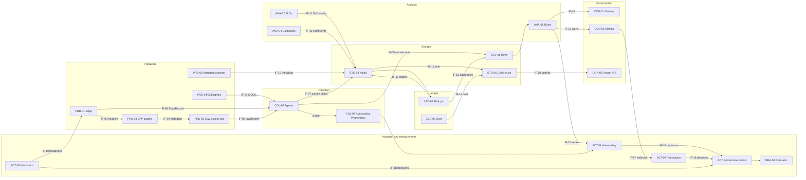
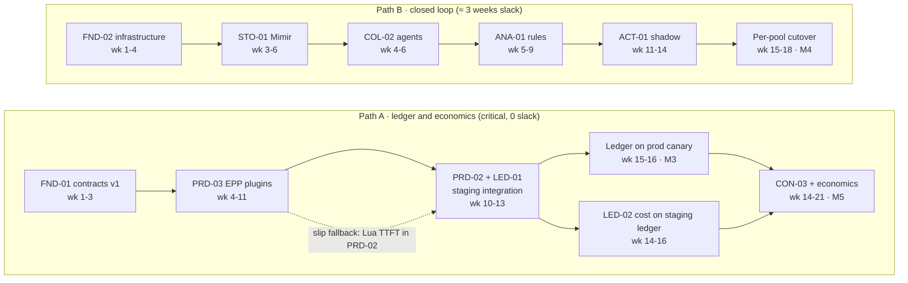
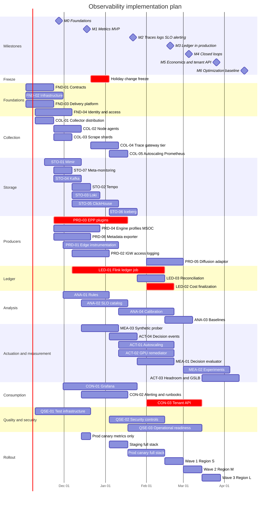

# Observability Implementation Plan for AI Inference at Scale

| | |
|---|---|
| **Status** | Draft v1.0 |
| **Date** | 2026-10-19 |
| **Owner** | Inference Platform Engineering / SRE |
| **Parent documents** | [System design](../design/system-design.md) · [System architecture](../architecture/system-architecture.md) |
| **Planning horizon** | 2026-11-02 → 2027-04-16 (23 weeks) |
| **Audience** | Engineering leads, module owners, release managers, SRE, security, FinOps |

---

## Table of contents

1. [Purpose and how to use this plan](#1-purpose-and-how-to-use-this-plan)
2. [Implementation principles](#2-implementation-principles)
3. [Module architecture](#3-module-architecture)
4. [Interface catalog](#4-interface-catalog)
5. [Dependencies](#5-dependencies)
6. [Repositories, build and release](#6-repositories-build-and-release)
7. [Environments and configuration](#7-environments-and-configuration)
8. [Deployment architecture and ordering](#8-deployment-architecture-and-ordering)
9. [Module specifications](#9-module-specifications)
10. [Schedule, milestones and staffing](#10-schedule-milestones-and-staffing)
11. [Deployment runbooks](#11-deployment-runbooks)
12. [Test plan](#12-test-plan)
13. [Operational readiness](#13-operational-readiness)
14. [Implementation risks](#14-implementation-risks)
15. [Definition of done](#15-definition-of-done)
- [Appendix A: Module card template](#appendix-a-module-card-template)
- [Appendix B: Interface specification template](#appendix-b-interface-specification-template)
- [Appendix C: Artifacts generated from a pool profile](#appendix-c-artifacts-generated-from-a-pool-profile)

---

## 1. Purpose and how to use this plan

The [architecture](../architecture/system-architecture.md) defines *what* the observability system is and *why*. The [design](../design/system-design.md) defines *how each part works*. This plan defines **how it gets built and deployed**:

- **42 modules**, each with a clear purpose, owner, effort and deliverables.
- **26 versioned interfaces**: the only way modules may interact.
- **An explicit dependency model**: build-time, deploy-time and data-time; hard or soft (stubbed).
- Repositories, CI/CD, environments, deployment order and runbooks.
- A schedule with milestones, the critical path, staffing and readiness gates.

**Conventions**

| Notation | Meaning |
|---|---|
| `FND-01` … `QSE-03` | Module IDs: workstream prefix + number ([§3.2](#32-module-catalog)) |
| `IF-01` … `IF-26` | Interface IDs ([§4.1](#41-interfaces)) |
| **H** / **S** | Hard dependency (blocks) / soft dependency (a declared stub lets work continue) |
| **B** / **D** / **T** | Build-time / deploy-time / data-time dependency ([§5.1](#51-dependency-types)) |
| ew | Engineer-weeks of effort, excluding contingency |
| wk *n* | Plan week, where wk 1 starts Monday 2026-11-02 |

---

## 2. Implementation principles

1. **Contract first.** A module's first deliverable is the spec and fixtures for every interface it provides. Consumers build against fixtures from day one, so providers and consumers proceed in parallel.
2. **Interfaces are the only coupling.** Modules communicate only through the interfaces in [§4](#4-interface-catalog): topics, endpoints, series contracts, CRDs and APIs. No module reads another module's internal tables, topics or state.
3. **Independently deployable and reversible.** Each module has its own Argo CD Application, its own feature flags and a tested rollback ([§11.7](#117-rollback-by-module)).
4. **Anti-corruption layers around upstream projects.** Upstream churn is absorbed at one boundary each:
   - the llm-d/GIE EPP plugin API: an adapter package in PRD-03
   - vLLM metric names: the normalization rules in ANA-01
   - gateway telemetry CRDs: per-implementation overlays in PRD-02
5. **Simulator first, GPUs second.** Every module that doesn't need real GPU behavior is developed and load-tested against vLLM-compatible simulator pods. GPU staging time goes to what only GPUs can show: P/D KV transfer, wide-EP, DCGM, diffusion.
6. **Shadow before active.** Anything that acts on the system starts in shadow or dry-run mode and is promoted only against written criteria. That covers autoscaling, remediation, alerts and edge weighting.
7. **Fail-open is a release gate.** A module that sits on or next to the inference path ships only after a chaos test shows inference latency and throughput are unchanged while that module's back-ends fail ([§12](#12-test-plan)).
8. **Everything as code.** Infrastructure, configuration, rules, SLOs, dashboards, schemas and runbooks live in Git and are deployed by GitOps. Manual changes are reverted on the next sync.

---

## 3. Module architecture

### 3.1 Workstreams and layers

```mermaid
flowchart TB
    subgraph FND["FND · Foundations"]
        F1["FND-01 Contracts and conventions"]
        F2["FND-02 Platform infrastructure"]
        F3["FND-03 Delivery platform"]
        F4["FND-04 Identity and access"]
    end
    subgraph PRD["PRD · Producers"]
        P1["PRD-01 Edge instrumentation"]
        P2["PRD-02 IGW access logging"]
        P3["PRD-03 EPP telemetry plugins"]
        P4["PRD-04 Engine profiles + MSOC"]
        P5["PRD-05 Diffusion adaptor"]
        P6["PRD-06 Metadata exporter"]
    end
    subgraph COL["COL · Collection"]
        C1["COL-01 Collector distribution"]
        C2["COL-02 Node agents"]
        C3["COL-03 Scrape shards"]
        C4["COL-04 Trace gateway tier"]
        C5["COL-05 Autoscaling Prometheus"]
    end
    subgraph STO["STO · Storage"]
        S1["STO-01 Mimir"]
        S2["STO-02 Tempo"]
        S3["STO-03 Loki"]
        S4["STO-04 Kafka + registry"]
        S5["STO-05 ClickHouse + sink"]
        S6["STO-06 Iceberg"]
        S7["STO-07 Meta-monitoring"]
    end
    subgraph LED["LED · Ledger"]
        L1["LED-01 Flink ledger job"]
        L2["LED-02 Cost finalization"]
        L3["LED-03 Reconciliation"]
    end
    subgraph ANA["ANA · Analysis"]
        A1["ANA-01 Rules"]
        A2["ANA-02 SLO catalog"]
        A3["ANA-03 Baselines"]
        A4["ANA-04 Calibration"]
    end
    subgraph ACT["ACT · Actuation"]
        X1["ACT-01 Autoscaling"]
        X2["ACT-02 GPU remediator"]
        X3["ACT-03 Headroom + GSLB"]
        X4["ACT-04 Decision events"]
    end
    subgraph MEA["MEA · Measurement"]
        M1["MEA-01 Decision evaluator"]
        M2["MEA-02 Experiments"]
        M3["MEA-03 Synthetic prober"]
    end
    subgraph CON["CON · Consumption"]
        U1["CON-01 Grafana"]
        U2["CON-02 Alerting + runbooks"]
        U3["CON-03 Tenant API"]
    end
    subgraph QSE["QSE · Quality, security, readiness"]
        Q1["QSE-01 Test infrastructure"]
        Q2["QSE-02 Security controls"]
        Q3["QSE-03 Operational readiness"]
    end
    FND --> PRD
    FND --> COL
    FND --> STO
    PRD --> COL
    COL --> STO
    STO --> LED
    STO --> ANA
    LED --> ANA
    ANA --> ACT
    ACT --> MEA
    ANA --> CON
    LED --> CON
    QSE -.-> PRD
    QSE -.-> ACT
```



### 3.2 Module catalog

| ID | Module | Owner team | Design reference | Effort | Milestone |
|---|---|---|---|---|---|
| FND-01 | Contracts and conventions | Platform Delivery | [§4.2–4.5](../design/system-design.md#42-model-server-observability-contract-msoc-v1) | 4 ew | M0 |
| FND-02 | Observability platform infrastructure | Platform Delivery | [§3](../design/system-design.md#3-deployment-topology) | 8 ew | M0–M1 |
| FND-03 | Delivery platform (CI/CD, GitOps, BOM) | Platform Delivery | [§3.2](../design/system-design.md#32-namespaces-and-repository-layout) | 4 ew | M0 |
| FND-04 | Identity and access | Security | [§16](../design/system-design.md#16-security-design) | 5 ew | M0–M1 |
| COL-01 | Collector distribution | Observability Platform | [§6.1](../design/system-design.md#61-agent-daemonset), [§6.4](../design/system-design.md#64-metric-name-fidelity) | 2 ew | M1 |
| COL-02 | Node agents | Observability Platform | [§6.1](../design/system-design.md#61-agent-daemonset) | 5 ew | M1–M3 |
| COL-03 | Cluster scrape shards | Observability Platform | [§6.2](../design/system-design.md#62-scrape-shards-and-target-allocator) | 2 ew | M1 |
| COL-04 | Trace gateway tier | Observability Platform | [§6.3](../design/system-design.md#63-collector-gateway-tier) | 3 ew | M2 |
| COL-05 | Autoscaling Prometheus | Observability Platform | [§6.5](../design/system-design.md#65-autoscaling-prometheus) | 2 ew | M4 |
| STO-01 | Mimir | Observability Platform | [§7.1](../design/system-design.md#71-mimir) | 6 ew | M1 |
| STO-02 | Tempo | Observability Platform | [§7.2](../design/system-design.md#72-tempo) | 2 ew | M2 |
| STO-03 | Loki | Observability Platform | [§7.3](../design/system-design.md#73-loki) | 3 ew | M2 |
| STO-04 | Kafka and Schema Registry | Data Engineering | [§7.4](../design/system-design.md#74-kafka) | 4 ew | M1–M3 |
| STO-05 | ClickHouse and Connect sink | Data Engineering | [§7.5](../design/system-design.md#75-clickhouse) | 6 ew | M3 |
| STO-06 | Iceberg lake | Data Engineering | [§7.6](../design/system-design.md#76-iceberg) | 4 ew | M3 |
| STO-07 | Meta-monitoring | Observability Platform | [§12.2](../design/system-design.md#122-alertmanager) | 2 ew | M1 |
| PRD-01 | Edge gateway instrumentation | Inference Platform (+ edge team) | [§4.3](../design/system-design.md#43-header-contract-and-sanitization), [§5.1](../design/system-design.md#51-edge-api-gateway) | 5 ew | M2–M3 |
| PRD-02 | Inference-gateway access logging | Inference Platform | [§5.2](../design/system-design.md#52-inference-gateway-envoy) | 3 ew | M3 |
| PRD-03 | EPP telemetry plugins | Inference Platform | [§5.3](../design/system-design.md#53-epp-telemetry-plugins) | 8 ew | M3 |
| PRD-04 | Engine profiles and MSOC conformance | Inference Platform | [§4.2](../design/system-design.md#42-model-server-observability-contract-msoc-v1), [§5.4](../design/system-design.md#54-engine-profiles-vllm) | 5 ew | M1–M3 |
| PRD-05 | Diffusion telemetry adaptor | Inference Platform | [§5.5](../design/system-design.md#55-diffusion-telemetry-adaptor) | 4 ew | M5 |
| PRD-06 | Platform metadata exporter | Inference Platform | [§5.6](../design/system-design.md#56-platform-metadata-exporter) | 4 ew | M1–M3 |
| LED-01 | Flink ledger job | Data Engineering | [§8](../design/system-design.md#8-request-ledger-pipeline) | 12 ew | M3 |
| LED-02 | Cost finalization | Data Engineering | [§8.7](../design/system-design.md#87-cost-finalization) | 3 ew | M5 |
| LED-03 | Reconciliation and data quality | Data Engineering | [§8.6](../design/system-design.md#86-delivery-guarantees-late-data-and-reconciliation) | 2 ew | M3 |
| ANA-01 | Rules (normalization, autoscaling, economics, signatures) | Observability Platform | [§9.1](../design/system-design.md#91-rule-repository-and-evaluation), [§9.4](../design/system-design.md#94-correlation) | 5 ew | M1–M4 |
| ANA-02 | SLO catalog and generator | SRE | [§9.2](../design/system-design.md#92-slo-catalog-and-generation) | 5 ew | M2–M3 |
| ANA-03 | Baselines and anomaly detection | Observability Platform | [§9.3](../design/system-design.md#93-baselines-and-anomaly-detection) | 3 ew | M5 |
| ANA-04 | Workload characterization and calibration | Performance Engineering | [Arch §13.3](../architecture/system-architecture.md#133-workload-characterization-and-capacity-models) | 4 ew | M4 |
| ACT-01 | Autoscaling integration | Inference Platform | [§10.1–10.2](../design/system-design.md#101-autoscaling-signal-path-and-lag-budget) | 5 ew | M4 |
| ACT-02 | GPU remediation controller | Inference Platform | [§10.3](../design/system-design.md#103-gpu-remediation-controller) | 6 ew | M4 |
| ACT-03 | Region headroom summarizer and edge weighting | Inference Platform | [§10.4](../design/system-design.md#104-region-headroom-summarizer) | 4 ew | M6 |
| ACT-04 | Decision events (library + bridge) | Platform Delivery | [§10.5](../design/system-design.md#105-decision-events) | 3 ew | M4 |
| MEA-01 | Decision evaluator | Data Engineering | [§11.1](../design/system-design.md#111-decision-evaluator) | 4 ew | M4 |
| MEA-02 | Experiment framework | Performance Engineering | [§11.2–11.3](../design/system-design.md#112-experiment-analysis) | 5 ew | M6 |
| MEA-03 | Synthetic prober | SRE | [§5.7](../design/system-design.md#57-synthetic-prober) | 3 ew | M2–M3 |
| CON-01 | Grafana and dashboards | Observability Platform | [§12.1](../design/system-design.md#121-grafana) | 6 ew | M1–M5 |
| CON-02 | Alerting and runbooks | SRE | [§12.2](../design/system-design.md#122-alertmanager), [§12.4](../design/system-design.md#124-runbooks) | 3 ew | M2 |
| CON-03 | Tenant observability API | Product Engineering | [§12.3](../design/system-design.md#123-tenant-observability-api) | 6 ew | M5 |
| QSE-01 | Test infrastructure | Platform Delivery | [§17.1](../design/system-design.md#171-test-suite) | 5 ew | M0–M2 |
| QSE-02 | Security controls | Security | [§16.3–16.4](../design/system-design.md#163-redaction-and-payload-capture) | 5 ew | M2–M5 |
| QSE-03 | Operational readiness | SRE | [§13](#13-operational-readiness) | 3 ew | M2–M5 |
| | **Total** | | | **183 ew** | |

---

## 4. Interface catalog

### 4.1 Interfaces

Every interaction between modules goes through one of these interfaces. The **provider** owns the spec, fixtures and compatibility. **Consumers** must not depend on anything outside it.

| ID | Interface | Type | Provider | Consumers | Spec location |
|---|---|---|---|---|---|
| IF-01 | Semantic-convention registry and generated libraries | Registry YAML + Go/Python libraries | FND-01 | All producer and service modules | `conventions/registry.yaml`, `libs/` |
| IF-02 | Pod label contract (`inference.platform/*`) | Kubernetes labels | PRD-04 | COL-02, COL-03, PRD-06, ANA-01, kube-state-metrics | `contracts/labels/pod-labels.v1.yaml` |
| IF-03 | Request header contract | HTTP headers | PRD-01 | PRD-02, PRD-03, PRD-04 (sidecar, engines), LED-01 | `contracts/headers/headers.v1.yaml` |
| IF-04 | Model Server Observability Contract (MSOC v1) | Metrics + spans + logs + readiness | PRD-04 (vLLM), PRD-05 (diffusion) | COL-02, PRD-03 (EPP polling), ANA-01, LED-01 | `contracts/msoc/msoc.v1.md` + fixtures |
| IF-05 | Node-local OTLP endpoint | OTLP gRPC on `${NODE_IP}:4317` | COL-02 | Engines, gateways, sidecars, EPP | `contracts/endpoints.v1.yaml` |
| IF-06 | Metrics write endpoints | Prometheus remote write | STO-01 (Mimir), COL-05 (local) | COL-02, COL-03, LED-01, ANA-03 exporter | `contracts/endpoints.v1.yaml` |
| IF-07 | Source record topics (`edge`, `igw`, `engine`) | Kafka topics, OTLP protobuf | STO-04 (topics) + COL-02 (writer) | LED-01 | [Design App. C](../design/system-design.md#appendix-c-kafka-topics) |
| IF-08 | Request-record attribute contract (`EdgeRecord`, `IgwRecord`, engine span attributes) | OTLP attribute schema | PRD-01, PRD-02, PRD-04 | LED-01 | `contracts/records/*.schema.json` |
| IF-09 | EPP dynamic-metadata keys and EPP telemetry metrics | Envoy dynamic metadata + metrics | PRD-03 | PRD-02, ANA-01, CON-01 | `contracts/epp/epp-telemetry.v1.yaml` |
| IF-10 | Platform metadata (gauges + `inference.metadata.v1`) | Metrics + compacted topic | PRD-06 | ANA-01, LED-01, LED-02 | `contracts/proto/.../metadata.proto` |
| IF-11 | Ledger configuration (`inference.config.v1`: SLO configuration, work-unit coefficients) | Compacted topic | ANA-02 (SLO), ANA-04 (coefficients) | LED-01 | `contracts/proto/.../config.proto` |
| IF-12 | Ledger record (`inference.ledger.v1`, `LedgerRecord`) | Kafka topic, protobuf | LED-01 | STO-05 (sink), MEA-*, future consumers | [Design §8.2](../design/system-design.md#82-assembly-algorithm) |
| IF-13 | Ledger aggregate series (`inference_ledger_*`, `inference_tenant_*`) | Prometheus series | LED-01 | ANA-01, ANA-02, ACT-03 | `conventions/registry.yaml` |
| IF-14 | Cost interface (`inference.cost_rates.v1`, `pool_cost_hourly`, `requests_costed`) | Topic + ClickHouse objects | LED-02 | LED-01, CON-01, CON-03, FinOps | [Design App. D](../design/system-design.md#appendix-d-clickhouse-schema) |
| IF-15 | Normalized series contract (`inference:*`, `accelerator:*`) | Prometheus series | ANA-01 | ACT-01, ACT-03, CON-01, ANA-02, ANA-03, MEA-01, WVA | `conventions/registry.yaml` (series section) |
| IF-16 | SLO catalog schema (`InferenceSLOClass`) | YAML schema (CRD-style) | ANA-02 | SRE authors, generator, PRD-06 | `contracts/crds/inferencesloclass.yaml` |
| IF-17 | Alert contract (labels, annotations, webhook payload) | Alert label schema + Alertmanager webhook v4 | ANA-01, ANA-02, ANA-03 | CON-02, ACT-02 | `contracts/alerts/alerts.v1.yaml` |
| IF-18 | Decision event (`inference.decision.v1`, `DecisionEvent`, emitter library) | Kafka topic + library | ACT-04 | MEA-01, CON-01 (annotations); producers ACT-01..03, MEA-02 | [Design §10.5](../design/system-design.md#105-decision-events) |
| IF-19 | Region headroom API | HTTP `GET /internal/v1/headroom` | ACT-03 | Edge gateway (PRD-01) | `contracts/openapi/headroom.v1.yaml` |
| IF-20 | Analytics query contract (ClickHouse tables and views) | SQL objects | STO-05 (physical), LED-01/02 (semantics) | CON-01, CON-03, MEA-01, MEA-02, ANA-03, ANA-04 | `ledger/clickhouse/contract.v1.sql` |
| IF-21 | Tenant observability API | HTTP `/v1/observability/*` (OpenAPI 3.1) | CON-03 | Tenants, support tooling | `contracts/openapi/tenant-observability.v1.yaml` |
| IF-22 | Pool onboarding manifest (`PoolObservabilityProfile`) | CRD-style YAML | FND-01 (schema), FND-03 (generator) | ACT-01, ANA-02, CON-01, CON-02, PRD-04 | `contracts/crds/poolobservabilityprofile.yaml` |
| IF-23 | Price catalog (`PriceCatalog`) | CRD | PRD-06 | FinOps (author), PRD-06 | `contracts/crds/pricecatalog.yaml` |
| IF-24 | Collector profiles and feature flags | Configuration profiles | COL-01, COL-02 | SRE, release managers | `collectors/profiles/README.md` |
| IF-25 | Experiment spec (`InferenceExperiment`) | CRD-style YAML | MEA-02 | Model owners, performance engineering | `contracts/crds/inferenceexperiment.yaml` |
| IF-26 | Probe and pipeline-health series | Prometheus series | MEA-03 | STO-07, CON-02, observability SLOs | `conventions/registry.yaml` |

### 4.2 Interface map



### 4.3 Key interface specifications

The design document already defines most payloads. These are the interfaces where this plan adds detail or fixes the v1 shape.

#### IF-01 · Telemetry libraries (public API surface)

```go
// Package semconv is generated from conventions/registry.yaml. Do not edit by hand.
package semconv

const (
    AttrInferencePool  = "inference.pool"
    LabelInferencePool = "inference_pool"
    HeaderRequestID    = "x-request-id"
    // ...
)

// Package obsmetrics builds metrics strictly from registry entries.
package obsmetrics

// NewHistogramVec panics at init if the metric is not registered, a label is forbidden,
// or the buckets differ from the registered layout, so violations fail tests and CI.
func NewHistogramVec(m semconv.Metric) *prometheus.HistogramVec
func NewCounterVec(m semconv.Metric) *prometheus.CounterVec
func NewGaugeVec(m semconv.Metric) *prometheus.GaugeVec

// Package decision emits DecisionEvents (IF-18).
package decision

type Emitter interface {
    // Emit never blocks the caller. On overflow it drops and counts the event.
    Emit(ctx context.Context, ev *telemetryv1.DecisionEvent)
    Close(ctx context.Context) error
}

func NewKafkaEmitter(cfg KafkaConfig) (Emitter, error)
func NewNoopEmitter() Emitter // for tests and dry-run modes
```

The Python package (`inference_telemetry`) has the same modules: `semconv`, `metrics`, `headers`, `decision`.

#### IF-02 · Pod label contract

| Label | Allowed values | Set by | Consumed for |
|---|---|---|---|
| `inference.platform/pool` | `InferencePool` name | Model-serving chart | Metric relabeling, kube-state-metrics joins, metadata, enrichment |
| `inference.platform/model-class` | `dense`, `slm`, `moe`, `diffusion` | Chart | Rule and dashboard grouping, scale-signal template |
| `inference.platform/role` | `prefill`, `decode`, `both`, `diffusion` | Chart | P/D join expectations, role-specific rules |
| `inference.platform/accelerator` | Normalized accelerator (for example, `h200`) | Chart (from the target node pool) | Grouping. PRD-06 cross-checks it against node labels and exports a mismatch counter. |
| `inference.platform/variant` | For example, `fp8-tp4` | Chart | Variant comparison, calibration lookup |
| `inference.platform/release-stage` | `stable`, `canary` | Chart / rollout controller | Canary sampling, detailed tracing |

#### IF-08 · Request-record attribute contract (v1, required attributes)

| Record | Required attributes |
|---|---|
| `EdgeRecord` (`log_name=inference-edge`) | `schema_version`, `request_id` (UUIDv7), `client_request_id`, `trace_id`, `tenant_id`, `tenant_tier`, `slo_class`, `model_requested`, `operation`, `stream`, `synthetic`, `auth_outcome`, `ratelimit_outcome`, `status_code`, `t0_unix_ms`, `ttft_client_ms`, `e2e_client_ms`, `edge_overhead_ms`, `end_user_hash` (optional) |
| `IgwRecord` (`log_name=inference-igw`) | `schema_version`, `request_id`, `trace_id`, `tenant_id`, `tenant_tier`, `slo_class`, `fairness_id`, `model_name`, `inference_pool`, `upstream_host`, `status_code`, `response_flags`, `reject_reason`, `start_time`, `duration_ms`, `bytes_sent`, plus the IF-09 metadata keys |
| Engine span (`llm_request` / `diffusion.request`) | Resource: `k8s.pod.name`, `inference.pool`, `inference.role`. Attributes: `gen_ai.request.id`, `gen_ai.request.model`, `gen_ai.usage.input_tokens`, `gen_ai.usage.output_tokens`, the `gen_ai.latency.*` phase timings emitted by the pinned engine version (mapped by the agent transform), `inference.work_units` (diffusion) |

Validation happens in two places: the COL-02 `logs/request-records` pipeline (invalid records go to `inference.dlq.v1`) and the LED-01 parsers.

#### IF-09 · EPP dynamic metadata and metrics (v1)

| Key (namespace `inference.obs`) | Type | Set by |
|---|---|---|
| `ttft_ms`, `tpot_ms`, `e2e_ms`, `first_content` | float, float, float, bool | `ttft-recorder` (or the Lua fallback in PRD-02) |
| `input_tokens`, `cached_tokens`, `output_tokens`, `finish_reason` | int, int, int, string | `ttft-recorder` |
| `flow_queue_ms`, `schedule_ms`, `profile`, `decode_pod`, `prefill_pod`, `disaggregated` | float, float, string, string, string, bool | `decision-annotator` |
| `predicted_cached_tokens`, `candidates`, `filtered` | int, int, int | `decision-annotator` |
| `shadow_endpoint`, `shadow_predicted_cached_tokens` | string, int | `shadow-scorer` |
| `reject_reason` | `quota`, `capacity` or empty | Flow-control rejection path |

The EPP also exports these metrics:

- `inference_gateway_ttft_seconds` and `inference_gateway_tpot_seconds`, with labels `inference_pool`, `model_name` and `slo_class`, using the `ttft` and `tpot` bucket layouts.
- `inference_epp_plugin_chunk_seconds{plugin}`, using the `sched` layout.
- `inference_epp_shadow_disabled_total`.

#### IF-15 · Normalized series contract (v1, stable)

| Series | Labels | Unit | Primary consumers |
|---|---|---|---|
| `inference:ttft_seconds:p95_5m` (also `p50`, `p99`) | `cluster`, `inference_pool`, `model_name` | s | Dashboards, symptom alerts |
| `inference:tpot_seconds:p95_5m` (also `p50`, `p99`) | `cluster`, `inference_pool`, `model_name` | s | Dashboards, symptom alerts |
| `inference:kv_usage:ratio` | `cluster`, `inference_pool`, `pod`, `engine` | 0–1 | ACT-01 triggers, dashboards |
| `inference:queue_depth:pool` | `cluster`, `inference_pool` | requests | ACT-01 triggers, ACT-03 |
| `inference:prefix_cache_hit:ratio_5m` | `cluster`, `inference_pool`, `model_name` | 0–1 | Dashboards, ANA-03 anomalies |
| `inference:batch_seq_fill:ratio`, `inference:batch_token_fill:ratio` | `cluster`, `inference_pool`, `pod` | 0–1 | Dashboards, right-sizing |
| `accelerator:hbm_bandwidth:ratio` | `cluster`, `inference_pool` | 0–1 | Dashboards |
| `inference:pod_pool:info` | `cluster`, `namespace`, `pod`, `inference_pool` | info | Joins in other rules |
| `inference:pool_allocated_gpus`, `inference:pool_cost_dollars_per_hour` | `cluster`, `inference_pool` | GPUs, $/h | LED-02, FinOps |
| `inference:success_per_dollar:1h` | `cluster`, `inference_pool` | requests/$ | FinOps, experiments |
| `inference:sli_error_ratio:rate{5m,30m,1h,2h,6h,1d,3d}` | `inference_pool`, `slo_class`, `sli` | 0–1 | Burn-rate alerts (ANA-02) |
| `inference:shadow_desired_replicas` | `inference_pool` | replicas | ACT-01 shadow comparison (generated per pool) |

Series marked *experimental* in the registry may change without the deprecation process. Nothing in this table is experimental.

#### IF-17 · Alert contract (v1)

| Field | Kind | Required | Values |
|---|---|---|---|
| `alertname` | label | yes | PascalCase, unique |
| `severity` | label | yes | `page`, `ticket`, `info` |
| `team` | label | yes | Owning team (routing key) |
| `category` | label | yes | `slo`, `saturation`, `hardware`, `pipeline`, `anomaly`, `finops` |
| `scope` | label | yes | `fleet`, `region`, `pool`, `node`, `pod` |
| `stage` | label | yes | `shadow` or `live` ([§11.5](#115-enable-alerts-shadow-to-live)) |
| `action` | label | no | `auto-remediate`. If set, `node` and `remediation` are required. |
| `node`, `remediation` | label | conditional | `remediation` is one of `cordon-drain`, `restart-pod`, `pd-safe-mode` |
| `summary`, `runbook_url`, `dashboard_url` | annotation | yes | — |

The webhook payload is the standard Alertmanager webhook (version 4) JSON. ACT-02 accepts only alerts with `action="auto-remediate"` and `stage="live"`.

#### IF-22 · Pool onboarding manifest

```yaml
apiVersion: obs.inference.platform/v1alpha1
kind: PoolObservabilityProfile
metadata:
  name: llama-70b-decode
  namespace: inference
spec:
  inferencePool: llama-70b-decode
  modelClass: dense                 # dense | slm | moe | diffusion
  role: decode
  sloClasses: [interactive, standard]
  msoc:
    version: v1
    kv: enabled                     # enabled | none
    kvEvents: true
    exceptions: []                  # each exception needs an expiry date and an approver
  scaling:
    template: decode-kv-queue       # class template: triggers and thresholds
    source: mimir                   # mimir | local-prometheus
    minReplicas: 4
    maxReplicas: 64
    fallbackReplicas: 16
    mode: shadow                    # shadow | active
  tracing:
    detailedOnCanary: true
  cost:
    coefficientsRef: llama-3.3-70b/h200/fp8-tp4
  owners:
    team: llm-serving
    oncall: llm-serving-oncall
```

One pull request with this file onboards a pool. [Appendix C](#appendix-c-artifacts-generated-from-a-pool-profile) lists what the generator produces from it.

#### IF-23 · Price catalog

```yaml
apiVersion: finops.inference.platform/v1alpha1
kind: PriceCatalog
metadata:
  name: gpu-prices-2026q4
spec:
  currency: USD
  effectiveFrom: "2026-10-01"
  entries:                          # illustrative values
    - {accelerator: h100-sxm-80g, region: us-east-1, pricingModel: reserved,  hourlyPerGpu: 2.10}
    - {accelerator: h200,         region: us-east-1, pricingModel: on-demand, hourlyPerGpu: 3.90}
```

### 4.4 Versioning and compatibility policy

| Interface kind | Version marker | Compatible (minor) changes | Breaking changes | Automated check |
|---|---|---|---|---|
| Protobuf topics (IF-10, IF-11, IF-12, IF-14, IF-18) | Package `inference.telemetry.v1`, topic suffix `.v1` | Add optional fields. Add enum values (consumers must tolerate unknown values). | Remove, renumber or retype fields. Change semantics. | `buf breaking` + Schema Registry `BACKWARD_TRANSITIVE` |
| OTLP attribute contracts (IF-08) | `schema_version` attribute | Add optional attributes | Remove, rename or retype required attributes | JSON-schema validation of fixtures. Parser contract tests. |
| Series contracts (IF-04, IF-09, IF-13, IF-15, IF-26) | Registry version + series name | New series. New label with bounded values. | Rename or remove a series or label. Change unit, type or meaning. | Registry diff. `promtool` tests. Reference scan of rules, dashboards and ScaledObjects. |
| HTTP APIs (IF-19, IF-21) | `/v1/`, `/internal/v1/` paths | Add endpoints, optional parameters or response fields | Remove or rename fields. Change types or status semantics. | `oasdiff breaking` |
| CRD-style schemas (IF-16, IF-22, IF-23, IF-25) | `apiVersion` (`v1alpha1` → `v1beta1` → `v1`) | Add optional fields | Remove fields. Tighten validation. | Schema diff. CEL validation tests. Conversion tests when an API version is promoted. |
| Headers (IF-03) | Registry version | Add headers | Rename or remove. Change semantics. | Edge integration tests (header fuzzing) |
| Endpoints (IF-05, IF-06), topic names (IF-07) | DNS names, ports, topic names | — | Any change | Deployment smoke tests |

**Breaking-change rule.** A breaking change ships as a **new version alongside the old**: a `.v2` topic, a new series name, or a `/v2` path. Both run in parallel for **at least 30 days or two releases, whichever is longer**. The old version is removed only when a consumer scan shows no remaining readers. The scan uses Mimir query logs, Kafka consumer-group listings, API access logs and repository reference search.

### 4.5 Contract testing

- **Fixtures.** Each provider publishes canonical fixtures in `contracts/fixtures/IF-xx/<version>/`: recorded payloads, metric exposition snapshots and sample API responses. Producers regenerate fixtures in CI, and diffs are reviewed like code.
- **Provider tests** check that real output matches the spec. For example, PRD-02 runs Envoy with the access-log config, captures `IgwRecord`s and validates them against `igw-record.schema.json`.
- **Consumer tests** run against the provider's fixtures. For example, LED-01 parses every IF-07/IF-08 fixture, and ANA-01 rule tests load IF-04 exposition fixtures for every pinned vLLM version.
- **Engine fixtures** are refreshed by QSE-01 for every new vLLM, EPP or DCGM version, through the MSOC conformance job.

### 4.6 Interface change process

1. The provider opens an **RFC issue** with the change, motivation, compatibility class and affected consumers (generated by the reference scan).
2. A **contract PR** updates the spec and fixtures. CODEOWNERS requires approval from the provider and **every consuming module owner**.
3. The provider implements the change behind the new version. Consumers migrate on their own schedule within the dual-run window.
4. A deprecation notice is added to the registry with a removal date. The reference scan runs weekly and blocks removal while readers remain.
5. Removal PR. The registry entry is marked `removed` and kept for history.

---

## 5. Dependencies

### 5.1 Dependency types

| Type | Meaning | Example | How it is managed |
|---|---|---|---|
| **B: build-time** | Code, library or schema needed to compile or test | PRD-03 uses the `inference-telemetry-go` library from FND-01 | Versioned libraries and schemas. Pinned in `go.mod`/`pom.xml`/`pyproject`. |
| **D: deploy-time** | An endpoint, CRD or service must exist for the module to deploy and become healthy | COL-02 needs the Mimir write endpoint (STO-01) | Argo CD sync waves ([§8.2](#82-sync-waves)) and health gates |
| **T: data-time** | Real data must flow before the module can be *validated* | ANA-02 ledger SLIs need ledger aggregates from LED-01 | Fixtures and simulators in dev. Validation gates in staging and canary. |
| **H: hard** | No workaround. The dependency blocks. | LED-01 cannot start without FND-01's `LedgerRecord` schema | Scheduled as a predecessor |
| **S: soft** | A declared stub lets work continue | LED-01 develops against IF-07 fixtures before the producers ship | The stub is part of the provider's first deliverable |

### 5.2 Module dependency matrix

Unmarked entries are hard dependencies. **(S)** marks a soft dependency, and its stub is named in the last column. "ext:" marks external dependencies ([§5.5](#55-external-dependencies)).

| Module | Build-time (B) | Deploy-time (D) | Data-time (T) | Stubs for soft dependencies |
|---|---|---|---|---|
| FND-01 | — | — | — | — |
| FND-02 | — | ext: cloud accounts, network | — | — |
| FND-03 | — | FND-02 (dev cluster) | — | — |
| FND-04 | — | FND-02 | — | — |
| COL-01 | FND-03 | — | — | — |
| COL-02 | COL-01, FND-01 | FND-04, STO-01; STO-04 (S), COL-04 (S), STO-03 (S) | PRD-04 (IF-02 labels) | Records, traces and logs pipelines flagged off until their back-ends exist |
| COL-03 | COL-01 | STO-01, FND-04 | — | — |
| COL-04 | COL-01 | STO-02, FND-04 | COL-02 | — |
| COL-05 | — | COL-02 | ANA-01 (S) | Raw subset only until the autoscaling rule group lands |
| STO-01 | — | FND-02, FND-04 | — | — |
| STO-02 | — | FND-02, FND-04 | — | — |
| STO-03 | — | FND-02, FND-04 | — | — |
| STO-04 | FND-01 | FND-02, FND-04 | — | — |
| STO-05 | FND-01 | FND-02, FND-04, STO-04 | LED-01 (S) | Seeded fixture data for consumers |
| STO-06 | — | FND-02 | LED-01 | — |
| STO-07 | — | FND-02 | — | — |
| PRD-01 | FND-01 | COL-02 (or a log forwarder for a managed gateway); STO-04 (S); ext: edge gateway team | — | Record export flagged off |
| PRD-02 | FND-01 | COL-02 | PRD-03 (S) | Record emitted without EPP metadata. Lua TTFT fallback. |
| PRD-03 | FND-01; ext: pinned llm-d EPP | COL-02 (S) | QSE-01 (S) | Spans flagged off. Benchmarks on a local simulator until the fleet exists. |
| PRD-04 | FND-01 | QSE-01 | — | — |
| PRD-05 | FND-01 | PRD-04 (conformance harness) | — | — |
| PRD-06 | FND-01 | FND-04; STO-04 (S) | PRD-04 (labels); ANA-02 (S) | Gauges only, Kafka publishing flagged off. No SLO-target gauges until ANA-02. |
| LED-01 | FND-01 | STO-04, STO-01; STO-06 (S) | PRD-01, PRD-02, PRD-04, PRD-06 (S in dev); ANA-02 (S), ANA-04 (S) | IF-07, IF-08 and IF-10 fixtures. Default `ConfigBundle` (SLO defaults, α=β=γ=1). Iceberg sink flagged off. |
| LED-02 | FND-01 | STO-05, STO-01 | LED-01, ANA-01, PRD-06 | — |
| LED-03 | — | STO-05, STO-01 | LED-01, PRD-01 | — |
| ANA-01 | FND-01 | STO-01 | COL-02, COL-03; PRD-06 (S) | Ratio rules that need config gauges stay empty until PRD-06 |
| ANA-02 | FND-01 | STO-01 | ANA-01; LED-01 (S) | Engine-histogram SLIs until ledger SLIs exist |
| ANA-03 | — | STO-01, STO-05 | ANA-01, LED-01 | — |
| ANA-04 | — | QSE-01 (benchmark harness on staging), STO-05 | LED-01 (S) | Characterization from engine histograms before the ledger exists |
| ACT-01 | FND-01, FND-03 | STO-01; COL-05 (S) | ANA-01 | Burst pools read Mimir until COL-05 |
| ACT-02 | FND-01 | CON-02; ACT-04 (S); ext: Node Problem Detector | ANA-01 | Node-condition inputs work without webhooks. Noop decision emitter. |
| ACT-03 | FND-01 | STO-01, PRD-01 | ANA-01, LED-01; ANA-04 (S) | Static capacity table until ANA-04 curves exist |
| ACT-04 | FND-01, COL-01 | STO-04 | — | — |
| MEA-01 | FND-01 | STO-01, STO-05 | ACT-04, ANA-01 | — |
| MEA-02 | FND-01 | STO-05 | LED-01; PRD-03 (S) | Live A/B without shadow scoring |
| MEA-03 | — | PRD-01 (S) | STO-01; STO-02, STO-05, LED-01 (S) | An internal tenant until `x-synthetic` lands. Pipeline checks enabled per signal as each back-end arrives. |
| CON-01 | — | STO-01, STO-02, STO-03, FND-04; STO-05 (S) | ANA-01 | Ledger panels hidden until STO-05 |
| CON-02 | — | STO-07; ext: paging and ticketing tools | ANA-01, ANA-02 | — |
| CON-03 | FND-01 | STO-05, FND-04; ext: API-key authentication service | LED-01 | Seeded ClickHouse for development |
| QSE-01 | — | FND-02, FND-03 | — | — |
| QSE-02 | — | FND-04, COL-02, STO-02, STO-03; PRD-01 (payload mirror) | — | — |
| QSE-03 | — | — | All modules (PRR) | — |

### 5.3 Critical paths



- **Path A is critical.** Its riskiest link is **PRD-03**, which depends on the upstream EPP plugin API (design open issue [O1](../design/system-design.md#20-open-issues)). Mitigations:
  - A one-week spike in wk 4 confirms the extension points before the main build.
  - The Lua fallback in PRD-02 supplies `ttft_ms` and `tpot_ms`. If PRD-03 slips, the ledger ships at M3 with Lua-derived TTFT/TPOT and empty scheduling fields, and LED-01 is unaffected because those fields are optional in IF-08.
- **Path B** has about three weeks of slack. Its risk is the autoscaling cutover, which needs a shadow week per pool. Starting cutovers in the smallest region absorbs the slip.
- **The holiday change freeze** (wk 8–9, 2026-12-21 → 2027-01-03) halts production deployments only. Development and staging continue.

### 5.4 Decoupling strategy

| Technique | Where it is used |
|---|---|
| **Fixture-first interfaces** | Every provider's first PR publishes fixtures (IF-04, IF-07, IF-08, IF-10, IF-12). LED-01, ANA-01, CON-03 and MEA-01 start before real data exists. |
| **Feature-flagged pipelines** | COL-02 `records.enabled`, `traces.tail_sampling.enabled`. PRD-03 `epp.ttft_recorder.enabled`, `epp.shadow_scorer.enabled`. LED-01 `sinks.iceberg.enabled`. |
| **Simulator fleet** | `llm-d-inference-sim` pods (QSE-01) stand in for vLLM metrics and APIs. Used by PRD-03 benchmarks, the COL load tests and LED-01 end-to-end tests. |
| **Default configuration** | LED-01 runs with a default `ConfigBundle` until ANA-02 and ANA-04 publish to IF-11. ACT-03 uses a static capacity table until ANA-04 curves exist. |
| **Adapters** | PRD-03 `adapters/gie` isolates the upstream plugin API. ANA-01 normalization isolates vLLM metric names. PRD-02 per-gateway overlays isolate gateway CRDs. |
| **Noop and dry-run modes** | `decision.NewNoopEmitter()`. ACT-02 `dryRun: true`. ACT-01 `mode: shadow`. Alerts with `stage="shadow"`. |

### 5.5 External dependencies

| Dependency | Needed by | What is needed | Risk | Engagement |
|---|---|---|---|---|
| Edge API gateway team / product | PRD-01, ACT-03, QSE-02 | Request filter for sanitization, record export, headroom consumption, payload mirroring | High: another team's roadmap | Embedded engineer from wk 4. Contract tests owned jointly. |
| llm-d / GIE upstream | PRD-03, PRD-04 | Stable plugin extension points. Sidecar header propagation (design O2). | Medium | Pinned version. Monthly upstream sync. Upstream PRs for O2. |
| vLLM upstream | PRD-04, ANA-01 | Metric and span names (renames expected) | Medium | MSOC gate + normalization `or` fallbacks |
| Cloud and network teams | FND-02 | Accounts, quotas, private connectivity | Medium | Requests filed in wk 1 |
| FinOps | PRD-06, LED-02 | `PriceCatalog` content, cost validation | Low | Monthly catalog PR |
| On-call and ticketing tools | CON-02 | Receivers, routing keys | Low | — |
| API-key authentication service | CON-03 | Principal → tenant resolution | Low | Reuses the inference API's validator |
| GPU staging capacity | PRD-04, ANA-04, QSE-01 | Windows for P/D, wide-EP and diffusion tests | High | GPU windows reserved from wk 4. Wide-EP validated on a non-critical prod-canary pool. |

---

## 6. Repositories, build and release

### 6.1 Repository map

| Repository | Contents | Modules |
|---|---|---|
| `observability` (monorepo) | Contracts, conventions, libraries, collectors, back-end values, ledger, rules, SLOs, control services, dashboards, alerting, tenant API, deployment, tests | Most modules |
| `inference-platform/epp` | Build of the pinned llm-d inference scheduler with the observability plugins | PRD-03 |
| `inference-platform/edge-gateway` | Sanitization filter, edge telemetry, headroom client | PRD-01, edge side of ACT-03 |
| `inference-platform/model-serving-charts` | Engine profiles, pod labels, ModelService values | PRD-04 |
| `inference-platform/diffusion-runtime` | Diffusion server integration with the adaptor | PRD-05 (integration) |
| `infra/terraform-observability` | Observability clusters, buckets, KMS, networking | FND-02 |

### 6.2 Monorepo layout

This refines the layout in [design §3.2](../design/system-design.md#32-namespaces-and-repository-layout). It adds `contracts/`, `libs/`, `autoscaling/`, `alerting/`, `services/` and `deploy/`.

```
observability/
├── bom.yaml                   # FND-03: pinned upstream versions (vLLM, llm-d, GIE, OTel, Mimir, ...)
├── contracts/                 # FND-01: protobuf (buf), JSON schemas, CRD schemas, OpenAPI, fixtures/
├── conventions/               # FND-01: Weaver registry (metrics, attributes, labels, buckets, policy)
├── libs/
│   ├── go/inference-telemetry/
│   └── py/inference_telemetry/
├── collectors/                # COL-01..05: ocb manifest, OTel CRs, Target Allocator, PodMonitors, profiles/
├── backends/                  # STO-01..03, STO-07: Helm values per environment and region
├── ledger/
│   ├── kafka/                 # STO-04: KafkaTopic, KafkaUser, Schema Registry configuration
│   ├── clickhouse/            # STO-05: migrations, Connect sink configuration, contract.v1.sql
│   ├── iceberg/               # STO-06: table definitions, maintenance jobs
│   ├── flink-ledger-job/      # LED-01 (Java)
│   ├── cost-finalizer/        # LED-02 (Go)
│   └── reconciler/            # LED-03 (Go)
├── rules/                     # ANA-01, ANA-03: rule groups + promtool tests + fixtures
├── slos/                      # ANA-02: catalog + generator
├── calibration/               # ANA-04: benchmark configurations, coefficient and curve publisher
├── autoscaling/               # ACT-01: class templates + profile generator plugin
├── control/
│   ├── metadata-exporter/     # PRD-06
│   ├── gpu-remediator/        # ACT-02
│   ├── headroom/              # ACT-03
│   ├── decision-bridge/       # ACT-04 (collector configuration)
│   ├── evaluator/             # MEA-01
│   ├── experiments/           # MEA-02
│   └── prober/                # MEA-03
├── dashboards/                # CON-01 (Grafana Foundation SDK)
├── alerting/                  # CON-02: Alertmanager configuration + runbooks/
├── services/tenant-api/       # CON-03
├── deploy/                    # FND-03: Argo CD parent apps, ApplicationSets, overlays/
└── tests/                     # QSE-01: simulator fleet, load profiles, chaos, end-to-end
```

**Ownership** is enforced by `CODEOWNERS`, per directory. Changes under `contracts/` need approval from the provider *and* consumer owners ([§4.6](#46-interface-change-process)).

**Languages**: Go for controllers and services, Java 17 for Flink, Python for the diffusion adaptor and calibration tooling, YAML/Jsonnet-free configuration, and the Grafana Foundation SDK (Go) for dashboards.

### 6.3 Build and release pipelines

| Artifact | Build | Tests in CI | Publish | Deploy |
|---|---|---|---|---|
| Go services and controllers | `go build`, container via `ko` | Unit, `envtest` (controllers), `golangci-lint`, race detector | Signed image (cosign) + SBOM (syft) | Helm chart in `deploy/` via Argo CD |
| Collector distribution | ocb | `otelcol validate`, golden-pipeline tests, name-fidelity test | Signed image + SBOM | OpenTelemetryCollector CRs |
| Flink job | Gradle shaded JAR → image | Unit (pure functions), Flink MiniCluster, Testcontainers (Kafka, ClickHouse) | Signed image | `FlinkDeployment` (`upgradeMode: savepoint`) |
| Rules and SLOs | SLO generator | `promtool check` and `test`, lint, series-contract diff | Git | `mimirtool rules sync` job + PrometheusRule for local Prometheus |
| Dashboards | Foundation SDK → JSON | Query-rule lint, JSON schema | Git | Grafana provisioning |
| ClickHouse migrations | SQL files | Apply on ephemeral ClickHouse, idempotency, contract check | Git | Pre-sync migration Job (Argo hook) |
| Kafka topics, users, schemas | Strimzi CRs + protobuf | `buf breaking`, registry compatibility | Git + Schema Registry | Argo CD (topic pruning disabled) |
| Python libraries | Wheel | pytest, MSOC conformance against a reference server | Internal package index | Consumed by runtimes |
| EPP image (external repo) | Upstream scheduler + plugins | Benchmark gates, simulator end-to-end, adapter contract tests | Signed image | Inference platform charts |

### 6.4 Versioning, BOM and supply chain

- **Libraries and services** use semantic versioning. **Configuration releases** of the monorepo use calendar versioning (`2026.11.0`), cut from `main` through release branches.
- **`bom.yaml`** pins every upstream component: vLLM, llm-d scheduler, GIE CRDs, the Envoy-based gateway, OTel Collector and Operator, Mimir, Tempo, Loki, Strimzi/Kafka, Flink and its operator, ClickHouse and its operator, Grafana, KEDA, DCGM Exporter, cert-manager and SPIRE. Upgrades go through [design §17.3](../design/system-design.md#173-upgrade-gates-for-vllm-the-epp-and-dcgm). A BOM bump is a PR with conformance results attached.
- **Supply chain**: images are signed (cosign keyless), SBOMs attached, and vulnerability scans block criticals. Admission policy in every cluster admits only signed images from the internal registry.

### 6.5 CI quality gates (example: rules and SLOs)

```yaml
name: rules-and-slos
on:
  pull_request:
    paths: ["rules/**", "slos/**", "conventions/**", "contracts/fixtures/IF-04/**"]
jobs:
  verify:
    runs-on: ubuntu-latest
    steps:
      - uses: actions/checkout@v4
      - run: make slo-generate && git diff --exit-code     # generated rules are committed and current
      - run: make rules-lint                              # naming, IF-17 labels, no raw vllm: outside normalization
      - run: make rules-test                              # promtool tests against fixtures of every pinned vLLM version
      - run: make series-contract-diff                    # IF-15 breaking-change check against main
      - run: make autoscaling-lint                        # triggers reference inference:* only and are additive totals
```

---

## 7. Environments and configuration

### 7.1 Environment matrix

| Environment | Purpose | Inference substrate | Observability back-ends | Data | Promotion |
|---|---|---|---|---|---|
| **local** | Developer loop | kind + tens of simulator pods | Single-binary or monolithic modes (Mimir, Tempo, Loki), single Kafka broker, single ClickHouse, Flink session cluster | Fixtures, synthetic | — |
| **dev** | Integration, load tests at 1× design | CPU cluster with ~2,000 simulator pods | Microservices, scaled down | Synthetic + replayed fixtures | Automatic on merge |
| **staging** | Real GPU behavior | One GPU cluster (8–16 nodes): dense, P/D, SLM, a small single-node MoE with EP, diffusion | Full topology, small | Synthetic load + internal dogfood traffic | Automatic after dev gates |
| **prod-canary** | First production cluster | One production inference cluster in Region S | Region S observability cluster | Real | Release-manager approval |
| **prod waves** | Fleet | Region S → Region M → Region L | Regional observability clusters | Real | Wave approval after canary soak |

Wide-EP (multi-node MoE) is validated first on a **non-critical prod-canary pool**, because staging rarely has enough GPUs for multi-node groups.

### 7.2 Configuration layering

```
deploy/overlays/
├── base/                     # defaults for all environments
├── env/{local,dev,staging,prod}/
├── region/{region-s,region-m,region-l}/
└── cluster/<cluster-name>/   # only true per-cluster facts: name, endpoints, node-pool selectors
```

Precedence is cluster > region > env > base. Per-cluster overlays must not change behavior: no thresholds, sampling or limits. CI enforces this with a key allow-list.

### 7.3 Secrets

- No secrets in Git. External Secrets Operator syncs from the secret manager. KMS keys come from FND-02.
- Workload-to-workload authentication uses mTLS identities from FND-04, not shared secrets. The remaining static secrets (third-party receivers, for example) are rotated every 90 days with alerts on expiry.

### 7.4 Feature flags

| Flag | Module | Default in dev / staging / prod | Enabled at |
|---|---|---|---|
| `records.enabled` | COL-02 | on / on / off | M3 per cluster, after STO-04 smoke test |
| `traces.tail_sampling.enabled` | COL-02, COL-04 | on / on / off | M2 |
| `degradation.level` (0–5) | COL-02 | 0 / 0 / 0 | Operational lever ([design §15.3](../design/system-design.md#153-degradation-ladder)) |
| `epp.ttft_recorder.enabled` | PRD-03 | on / on / off | M3 per pool |
| `epp.decision_annotator.enabled` | PRD-03 | on / on / off | M3 per pool |
| `epp.shadow_scorer.enabled` | PRD-03 | on / off / off | M6 per experiment |
| `igw.lua_ttft.enabled` | PRD-02 | off / off / off | Fallback only |
| `sinks.iceberg.enabled` | LED-01 | on / on / off | M3, after STO-06 |
| `scaling.mode` (per pool) | ACT-01 | active / shadow / shadow | M4 per pool ([§11.4](#114-cut-over-autoscaling-for-a-pool)) |
| `remediator.dryRun` | ACT-02 | false / false / true | M4, after a two-week dry run |
| `headroom.weighting.enabled` | ACT-03, PRD-01 | on / on / off | M6 per region pair |

---

## 8. Deployment architecture and ordering

### 8.1 Argo CD structure

- **One parent "app of apps" per cluster type**: `obs-cluster` for observability clusters and `inference-cluster` for inference clusters. Each child is a module Application.
- **ApplicationSets** with the cluster generator select clusters by labels: `cluster-type`, `env`, `region`, `rollout-wave`.
- **Ordering within a cluster** uses sync waves on child Applications. Argo CD needs a custom health check for `argoproj.io/Application` resources, configured in `argocd-cm`. Without it, a wave does not wait for its children to become healthy.
- **Ordering across clusters** (observability cluster before inference clusters in a region) is set by the release process: a region's `obs-cluster` parent must be healthy before its inference clusters move to the new release.
- **Progressive rollout across clusters** uses ApplicationSet `RollingSync` steps keyed on `rollout-wave` ([§8.3](#83-example-applicationset-with-progressive-rollout)).

### 8.2 Sync waves

| Wave | Cluster type | Contents | Health gate before the next wave |
|---|---|---|---|
| −2 | Both | Namespaces, CRDs (OTel Operator, prometheus-operator CRDs, Strimzi, Flink operator, ClickHouse operator, KEDA, External Secrets, cert-manager) | CRDs established |
| −1 | Both | Identity: issuers or SPIRE, secret stores, back-end auth gateway (observability cluster) | Test certificate issued. Auth gateway ready. |
| 0 | Observability | STO-01..07: Mimir, Tempo, Loki, Kafka + topics + registry, ClickHouse + migrations, Iceberg catalog, meta-monitoring | Ready + write/read smoke jobs pass |
| 1 | Inference | COL-02..05: agents, Target Allocator, shards, gateway tier, autoscaling Prometheus | Agents ready on ≥ 99.5% of nodes. Remote-write success ≥ 99.9%. |
| 2 | Inference | PRD-06 metadata exporter. PRD-02 gateway telemetry CRs. PRD-03/PRD-04 flags (images are released through the inference charts). | Records arriving on IF-07 topics with zero DLQ |
| 3 | Observability | LED-01 (from savepoint), Connect sink, LED-02/LED-03 CronJobs, ACT-04 bridge | Consumer lag < 60 s |
| 4 | Observability | ANA-01..03 rules and SLOs (via `mimirtool`); COL-05 rule copies on inference clusters | Rule evaluation without errors |
| 5 | Inference | ACT-01 ScaledObjects (in their profile's mode), ACT-02 remediator (in its configured mode) | Controllers ready |
| 6 | Observability | MEA-01..03, ACT-03, CON-01..03 | Prober green for every model × class |

### 8.3 Example ApplicationSet with progressive rollout

```yaml
apiVersion: argoproj.io/v1alpha1
kind: ApplicationSet
metadata:
  name: obs-agents
  namespace: argocd
spec:
  goTemplate: true
  generators:
    - clusters:
        selector:
          matchLabels:
            inference.platform/cluster-type: inference
  strategy:
    type: RollingSync
    rollingSync:
      steps:
        - matchExpressions: [{key: rollout-wave, operator: In, values: [canary]}]
        - matchExpressions: [{key: rollout-wave, operator: In, values: [wave-1]}]
        - matchExpressions: [{key: rollout-wave, operator: In, values: [wave-2]}]
          maxUpdate: 50%
        - matchExpressions: [{key: rollout-wave, operator: In, values: [wave-3]}]
          maxUpdate: 25%
  template:
    metadata:
      name: 'obs-agents-{{.name}}'
      labels:
        rollout-wave: '{{index .metadata.labels "rollout-wave"}}'
      annotations:
        argocd.argoproj.io/sync-wave: "1"
    spec:
      project: observability
      source:
        repoURL: https://git.internal/observability.git
        targetRevision: release/2026.11
        path: 'collectors/agents/overlays/{{index .metadata.labels "env"}}'
      destination:
        server: '{{.server}}'
        namespace: obs-agents
      syncPolicy:
        automated: {prune: true, selfHeal: true}
        syncOptions: [CreateNamespace=true, ServerSideApply=true]
```

---

## 9. Module specifications

Each card lists the module's interfaces and dependencies (copied from [§5.2](#52-module-dependency-matrix)), deliverables and "done when" criteria. Design details are linked, not repeated. Every module also has to meet the global [definition of done](#15-definition-of-done).

### 9.1 Foundations

#### FND-01 · Contracts and conventions

One home for every interface definition and naming rule. It generates the telemetry libraries and enforces compatibility.

| Owner | Effort | Milestone | Provides | Consumes |
|---|---|---|---|---|
| Platform Delivery | 4 ew | M0 | IF-01. Schema hosting, codegen and compatibility checks for all schema-based interfaces. | — |

- **Depends on**: none.
- **Deliverables**:
  - Weaver registry with every v1 metric, attribute, label, bucket layout and the label policy.
  - `contracts/` containing a buf module (`inference.telemetry.v1`: `LedgerRecord`, `DecisionEvent`, `PodMetadata`, `CostRate`, `ConfigBundle`), record JSON schemas, CRD schemas, OpenAPI specs, and a fixtures skeleton.
  - Generated Go and Python libraries ([§4.3 IF-01](#if-01--telemetry-libraries-public-api-surface)).
  - CI checks: registry check, `buf lint` and `buf breaking`, `oasdiff`, CRD schema diff, metric policy lint.
- **Done when**:
  - v1 specs for all 26 interfaces are merged, each with at least one fixture. This is the **contract freeze at M0**.
  - The libraries are published.
  - A seeded breaking-change PR is blocked by CI (negative test).

#### FND-02 · Observability platform infrastructure

The cloud and cluster substrate for observability clusters in every environment and region.

| Owner | Effort | Milestone | Provides | Consumes |
|---|---|---|---|---|
| Platform Delivery (Observability Platform and Data Engineering engineers pooled in M0) | 8 ew | M0 (dev, staging) · M1 (prod regions) | Observability clusters, buckets, KMS keys, private connectivity, DNS | ext: cloud accounts, network |

- **Depends on**: external only.
- **Deliverables**:
  - Terraform modules `obs-cluster`, `obs-buckets` and `obs-network`, with per-environment stacks.
  - Node pools from the [design sizing](../design/system-design.md#141-per-region-sizing-region-l-40-of-global-traffic): general, storage-optimized NVMe (Kafka, ClickHouse) and system.
  - Buckets (`mimir-blocks`, `mimir-ruler`, `tempo`, `loki`, `iceberg`, `flink-state`, `clickhouse-cold`, `backups`) with versioning and lifecycle rules.
  - DNS `*.obs.<region>.internal`.
- **Done when**:
  - The dev and staging clusters exist by wk 2, and the three production regional clusters by wk 4.
  - A connectivity test job passes from every inference cluster to every observability ingress endpoint.

#### FND-03 · Delivery platform

Builds, releases and deploys everything as code.

| Owner | Effort | Milestone | Provides | Consumes |
|---|---|---|---|---|
| Platform Delivery | 4 ew | M0 | CI templates, registry, signing, `bom.yaml`, Argo CD parents and ApplicationSets, overlays, the IF-22 generator framework | IF-22 |

- **Depends on**: FND-02 (D, dev cluster).
- **Deliverables**:
  - CI templates for every artifact type ([§6.3](#63-build-and-release-pipelines)).
  - Argo CD parent apps, sync waves with the Application health customization, and the RollingSync ApplicationSet pattern.
  - The overlay key allow-list check.
  - The release-branch process.
  - The generator framework: a plugin interface that turns a `PoolObservabilityProfile` into artifacts. Each module (ACT-01, ANA-02, CON-01, CON-02) contributes a generator plugin.
- **Done when**:
  - A sample module goes automatically from PR → dev → staging.
  - Production requires approval.
  - A revert-based rollback is demonstrated.
  - Unsigned images are rejected by admission policy.

#### FND-04 · Identity and access

mTLS and authorization on every telemetry path.

| Owner | Effort | Milestone | Provides | Consumes |
|---|---|---|---|---|
| Security + Platform Delivery | 5 ew | M0 (dev, staging) · M1 (prod) | Workload certificates, back-end auth gateway (identity → `X-Scope-OrgID`), Kafka ACL patterns, ClickHouse RBAC roles, Grafana SSO and team sync | — |

- **Depends on**: FND-02 (D).
- **Deliverables**:
  - cert-manager issuers or SPIRE.
  - Auth gateway (Envoy-based) in front of Mimir, Tempo and Loki.
  - `KafkaUser` templates per principal.
  - ClickHouse roles: `connect_sink`, `tenant_api`, `analyst`, `finops`.
  - The [design authorization matrix](../design/system-design.md#162-authorization-matrix) as code.
- **Done when**: negative tests pass in staging. For example, an agent certificate cannot query Mimir, a Flink principal cannot produce to source topics, and the `tenant_api` role returns no rows without `custom_tenant_id`.

### 9.2 Collection

#### COL-01 · Collector distribution

One pinned, minimal OpenTelemetry Collector build for every collector role.

| Owner | Effort | Milestone | Provides | Consumes |
|---|---|---|---|---|
| Observability Platform | 2 ew | M1 | `otelcol-inference` image, component manifest, profile mechanism (IF-24) | — |

- **Depends on**: FND-03 (B).
- **Deliverables**:
  - An ocb manifest with exactly the components in [design Appendix A](../design/system-design.md#appendix-a-otel-agent-configuration), plus `tail_sampling` and `k8sobjects`.
  - Pinned feature gates.
  - The name-fidelity test ([design §6.4](../design/system-design.md#64-metric-name-fidelity)).
  - Persistent-queue format compatibility tests across versions.
- **Done when**: the image is signed with an SBOM, the fidelity test passes for every pinned vLLM fixture, and there are no critical CVEs.

#### COL-02 · Node agents

Node-local collection of metrics, spans, logs and request records on every node.

| Owner | Effort | Milestone | Provides | Consumes |
|---|---|---|---|---|
| Observability Platform | 5 ew | M1 metrics · M2 traces and logs · M3 records | IF-05. Writer side of IF-06 and IF-07. IF-24 profiles. | IF-01, IF-02, IF-04, IF-08 |

- **Depends on**:
  - B: COL-01, FND-01.
  - D: FND-04, STO-01. STO-04, COL-04 and STO-03 are soft (their pipelines stay flagged off).
  - T: PRD-04 (labels).
- **Deliverables**:
  - The DaemonSet `OpenTelemetryCollector` CR from [design Appendix A](../design/system-design.md#appendix-a-otel-agent-configuration).
  - A Target Allocator with the `per-node` strategy.
  - Shared PodMonitor templates.
  - DCGM Exporter field list with pod attribution, and node-exporter with trimmed collectors.
  - A hostPath persistent queue, priority class and GPU tolerations.
  - Degradation profiles `level-0` to `level-5`.
- **Done when**:
  - Agents run on ≥ 99.5% of nodes, with zero scrape errors on engine targets.
  - Remote-write success is ≥ 99.9%.
  - Per-node p99 stays within 1 vCPU and 2 GiB at 3× fixture load.
  - Records fixtures pass with zero DLQ.
  - Fail-open chaos test: Mimir and Kafka are blocked for 30 min with no inference impact, and queues replay afterwards.

#### COL-03 · Cluster scrape shards

Scrapes cluster-scoped targets.

| Owner | Effort | Milestone | Provides | Consumes |
|---|---|---|---|---|
| Observability Platform | 2 ew | M1 | Metrics from gateways, EPP, llm-d, kube-state-metrics, control plane, metadata exporter | IF-09 metrics, IF-10 gauges |

- **Depends on**: COL-01 (B). STO-01 and FND-04 (D).
- **Deliverables**:
  - A StatefulSet with a `consistent-hashing` Target Allocator.
  - ServiceMonitors.
  - The kube-state-metrics label allow-list (IF-02).
- **Done when**: no target is unassigned during a shard rollout, and each shard stays under 500 k series.

#### COL-04 · Trace gateway tier

Tail sampling, redaction and export to Tempo.

| Owner | Effort | Milestone | Provides | Consumes |
|---|---|---|---|---|
| Observability Platform | 3 ew | M2 | Sampled traces in Tempo | Spans from COL-02 (trace-ID load-balanced) |

- **Depends on**: COL-01 (B). STO-02 and FND-04 (D). COL-02 (T).
- **Deliverables**:
  - Deployment with a headless Service and HPA.
  - The policies in [architecture A.2](../architecture/system-architecture.md#a2-otel-collector-gateway-tier-tail-sampling), plus probe and debug policies.
  - The decision caches.
- **Done when**:
  - A replay of fixture traces keeps 100% of errors and SLO violators.
  - Fewer than 5% of traces are incomplete during a 4 → 12 replica scale event.
  - Memory stays within limits at 3× span rate.

#### COL-05 · Autoscaling Prometheus

A low-latency local source for burst-sensitive autoscaling.

| Owner | Effort | Milestone | Provides | Consumes |
|---|---|---|---|---|
| Observability Platform | 2 ew | M4 | Local query endpoint (IF-06 local, IF-15 subset) | Subset remote-write from COL-02 |

- **Depends on**: COL-02 (D). ANA-01 (T, soft).
- **Deliverables**:
  - A two-replica StatefulSet with 2 h retention.
  - The generated `inference-autoscaling` rule group, with a checksum identical to the Mimir copy.
- **Done when**: query p99 ≤ 100 ms, only allow-listed series are present, and the rule checksums match Mimir.

### 9.3 Storage

#### STO-01 · Mimir

| Owner | Effort | Milestone | Provides | Consumes |
|---|---|---|---|---|
| Observability Platform | 6 ew | M1 | IF-06 write endpoint, query API, ruler, isolated autoscaling read path, tenants and limits | — |

- **Depends on**: FND-02 and FND-04 (D).
- **Deliverables**:
  - A microservices deployment with zone-aware replication.
  - Tenants `inference-prod`, `inference-longterm` and `platform-infra` with [design Appendix F](../design/system-design.md#appendix-f-mimir-tenant-limits) limits.
  - Federated rule groups, or the rollup-writer fallback ([design §7.1](../design/system-design.md#71-mimir)).
  - The autoscaling read path deployment.
  - `mimirtool` rule sync job.
- **Done when**:
  - At 3× load (6.4 M series per region), write p99 is < 1 s.
  - The autoscaling path holds p99 ≤ 500 ms during a concurrent dashboard load test.
  - A zone-loss chaos test loses no data.

#### STO-02 · Tempo

| Owner | Effort | Milestone | Provides | Consumes |
|---|---|---|---|---|
| Observability Platform | 2 ew | M2 | Trace storage and query (TraceQL) | Sampled spans from COL-04 |

- **Depends on**: FND-02 and FND-04 (D).
- **Deliverables**: distributed deployment, 14 d retention, metrics-generator disabled, Grafana correlations configuration.
- **Done when**: a sampled error trace is queryable within 60 s of ingest at 3× retained span rate.

#### STO-03 · Loki

| Owner | Effort | Milestone | Provides | Consumes |
|---|---|---|---|---|
| Observability Platform | 3 ew | M2 | Log storage and query | Logs from COL-02 |

- **Depends on**: FND-02 and FND-04 (D).
- **Deliverables**: simple scalable deployment, OTLP ingest, the label set and structured metadata from [design §7.3](../design/system-design.md#73-loki), per-stream retention, and an audit tenant.
- **Done when**: a `request_id` lookup over 24 h returns in p95 < 3 s, and no stream exceeds its label budget.

#### STO-04 · Kafka and Schema Registry

| Owner | Effort | Milestone | Provides | Consumes |
|---|---|---|---|---|
| Data Engineering | 4 ew | M1 (dev) · M3 (prod) | IF-07 topics and topic infrastructure for IF-10, IF-11, IF-12, IF-14 and IF-18. Schema Registry. ACLs. | Schemas from FND-01 |

- **Depends on**: FND-01 (B). FND-02 and FND-04 (D).
- **Deliverables**:
  - Strimzi cluster.
  - `KafkaTopic` CRs from [design Appendix C](../design/system-design.md#appendix-c-kafka-topics), with pruning disabled.
  - Apicurio Schema Registry with `BACKWARD_TRANSITIVE` compatibility.
  - `KafkaUser` ACLs.
- **Done when**:
  - 18 k msg/s per region (3×) runs with produce p99 < 50 ms.
  - Losing a broker causes no unavailability.
  - Registering an incompatible schema is rejected.

#### STO-05 · ClickHouse and Connect sink

| Owner | Effort | Milestone | Provides | Consumes |
|---|---|---|---|---|
| Data Engineering | 6 ew | M3 | IF-20 physical objects, migrations, exactly-once Connect sink, row policies, tiered storage | IF-12 |

- **Depends on**: FND-01 (B). FND-02, FND-04 and STO-04 (D). LED-01 (T, soft: seeded fixtures).
- **Deliverables**:
  - Operator-managed cluster (two shards × two replicas) with Keeper.
  - The migrations from [design Appendix D](../design/system-design.md#appendix-d-clickhouse-schema) plus `requests_late`, `requests_1h_tenant`, `decision_events` and `decision_effects`.
  - `contract.v1.sql` defining the IF-20 objects.
  - Kafka Connect cluster with the ClickHouse sink in exactly-once mode.
  - Backups.
- **Done when**:
  - Killing Connect mid-batch causes no duplicates and no loss.
  - Rollups equal aggregates over the raw data.
  - Tenant-API query shapes run in p95 < 500 ms over 90 d of synthetic data.

#### STO-06 · Iceberg lake

| Owner | Effort | Milestone | Provides | Consumes |
|---|---|---|---|---|
| Data Engineering | 4 ew | M3 | Regional tables, global catalog, maintenance jobs | Writes from LED-01 |

- **Depends on**: FND-02 (D). LED-01 (T).
- **Deliverables**: table definitions (partitioned by `day(ts)` and `model_class`), compaction and snapshot-expiry jobs, the nightly late-field `MERGE INTO`, and residency partitions.
- **Done when**: a ClickHouse partition can be rebuilt from Iceberg in a drill, and maintenance jobs keep the file count within target.

#### STO-07 · Meta-monitoring

| Owner | Effort | Milestone | Provides | Consumes |
|---|---|---|---|---|
| Observability Platform | 2 ew | M1 | Independent monitoring of the observability system, plus the external heartbeat | IF-26 |

- **Depends on**: FND-02 (D).
- **Deliverables**: a separate Prometheus and Alertmanager (`obs-meta`), `pipeline-health` rules, the `Watchdog` alert to an external heartbeat, and a self-SLO dashboard ([design §2.2](../design/system-design.md#22-slos-for-the-observability-system)).
- **Done when**: stopping Mimir pages within 2 min through the meta path, and losing the heartbeat pages within 5 min.

### 9.4 Producers

#### PRD-01 · Edge gateway instrumentation

| Owner | Effort | Milestone | Provides | Consumes |
|---|---|---|---|---|
| Inference Platform + edge gateway team | 5 ew | M2 (headers, spans) · M3 (records) | IF-03 (implementation), IF-08 `EdgeRecord`, edge spans and metrics | IF-01, IF-05, IF-19 (M6) |

- **Depends on**: FND-01 (B). COL-02 (D), or a log forwarder for a managed gateway. STO-04 (S). ext: edge team.
- **Deliverables**:
  - The sanitization filter ([design §4.3](../design/system-design.md#43-header-contract-and-sanitization)): UUIDv7 request IDs, `include_usage` injection, fairness-ID mapping (refinement R1), debug and synthetic grants.
  - `EdgeRecord` emission for every request, including edge rejections.
  - The `edge.request` span tree.
  - Low-cardinality edge metrics.
- **Done when**:
  - Header-fuzz tests prove no client-supplied internal header passes.
  - 100% of edge-rejected requests produce an `EdgeRecord`.
  - Added p99 latency is ≤ 1 ms.

#### PRD-02 · Inference-gateway access logging

| Owner | Effort | Milestone | Provides | Consumes |
|---|---|---|---|---|
| Inference Platform | 3 ew | M3 | IF-08 `IgwRecord`. Lua TTFT fallback (IF-09 subset). | IF-03, IF-05, IF-09 |

- **Depends on**: FND-01 (B). COL-02 (D). PRD-03 (T, soft).
- **Deliverables**:
  - Gateway telemetry CRs for each supported implementation (overlays for Envoy Gateway, Istio and kgateway) that render the Envoy configuration in [design Appendix B](../design/system-design.md#appendix-b-envoy-request-record-access-log).
  - The outcome-classification test matrix ([design §5.2](../design/system-design.md#52-inference-gateway-envoy)) as end-to-end tests.
  - The Lua first-content filter.
- **Done when**:
  - Fault-injection tests (resets, timeouts, upstream failures) produce exactly one `IgwRecord` per request.
  - The classification matches the matrix 100%.
  - Lua TTFT is within 2 ms of EPP TTFT on the simulator.

#### PRD-03 · EPP telemetry plugins

| Owner | Effort | Milestone | Provides | Consumes |
|---|---|---|---|---|
| Inference Platform | 8 ew | M3 | IF-09 | IF-01, IF-03, IF-05 |

- **Depends on**: FND-01 and the pinned llm-d EPP (B). COL-02 (D, soft). QSE-01 (T, soft).
- **Internal structure** (anti-corruption layer):

```
epp/
├── eppobs/            # stable internal API: RequestCtx, Observer, SSE scanner, TTFT/TPOT logic (no upstream imports)
├── plugins/ttft/      # ttft-recorder
├── plugins/decision/  # decision-annotator
├── plugins/shadow/    # shadow-scorer
├── adapters/gie/      # maps eppobs.Observer onto the pinned EPP plugin interfaces
├── cmd/epp/           # EPP main with the plugins registered
└── bench/             # chunk-path microbenchmarks (CI budget gates)
```

```go
package eppobs

// Observer is the stable interface the plugins implement. Only adapters/gie imports
// upstream EPP packages, so an upstream plugin-API change touches one package.
type Observer interface {
    OnScheduled(ctx *RequestCtx, d *Decision)
    OnResponseChunk(ctx *RequestCtx, chunk []byte, now time.Duration)
    OnResponseComplete(ctx *RequestCtx, now time.Duration) (dynamicMetadata map[string]any)
}
```

- **Deliverables**:
  - Week-1 spike report confirming the extension points (design O1).
  - The three plugins, with the first-content algorithm from [design §5.3](../design/system-design.md#53-epp-telemetry-plugins).
  - Per-plugin flags, and auto-disable of the shadow scorer on budget breach.
  - The EPP image pipeline.
  - CI benchmark gates: ≤ 20 µs per chunk p99, ≤ 30 µs per request p99.
- **Done when**:
  - On the simulator at 5 k streams/s per EPP replica, p99 EPP latency rises by ≤ 0.5 ms.
  - Gateway TTFT agrees with engine TTFT plus network within the tolerance set in staging.
  - An upstream version-bump drill needs changes only in `adapters/gie`.

#### PRD-04 · Engine profiles and MSOC conformance

| Owner | Effort | Milestone | Provides | Consumes |
|---|---|---|---|---|
| Inference Platform | 5 ew | M1 (labels, flags) · M3 (request IDs, spans) | IF-02. IF-04 (vLLM). `msoc-conformance` harness. | IF-01 |

- **Depends on**: FND-01 (B). QSE-01 (D, for running the harness).
- **Deliverables**:
  - Model-serving chart values for each class ([design §5.4](../design/system-design.md#54-engine-profiles-vllm)).
  - Label injection.
  - A test for P/D sidecar `x-request-id` and `traceparent` propagation (design O2).
  - The conformance harness with the five checks in [design §4.2](../design/system-design.md#42-model-server-observability-contract-msoc-v1).
  - Fixture capture into `contracts/fixtures/IF-04/<vllm-version>/`.
- **Done when**: every production engine image passes MSOC v1, and the fixture set for the pinned vLLM version is published.

#### PRD-05 · Diffusion telemetry adaptor

| Owner | Effort | Milestone | Provides | Consumes |
|---|---|---|---|---|
| Inference Platform | 4 ew | M5 | IF-04 (diffusion variant), the `inference-diffusion-telemetry` library | IF-01 |

- **Depends on**: FND-01 (B). PRD-04 (D, harness).
- **Deliverables**:
  - The Python library with the API in [design §5.5](../design/system-design.md#55-diffusion-telemetry-adaptor).
  - The Diffusers step-callback integration.
  - The EPP pool configuration mapping queue depth to `diffusion_requests_waiting`.
- **Done when**: the reference diffusion server passes MSOC v1, and EPP queue-based routing works on a staging diffusion pool.

#### PRD-06 · Platform metadata exporter

| Owner | Effort | Milestone | Provides | Consumes |
|---|---|---|---|---|
| Inference Platform | 4 ew | M1 (gauges) · M3 (Kafka) | IF-10, IF-23 | IF-02, IF-16 |

- **Depends on**: FND-01 (B). FND-04 (D); STO-04 (D, soft). PRD-04 (T); ANA-02 (T, soft).
- **Internal structure**:

```
control/metadata-exporter/
├── api/finops/v1alpha1/   # PriceCatalog types (IF-23) + CEL validation
├── internal/informers/    # InferencePool, Pod, Node, LeaderWorkerSet, PriceCatalog, InferenceSLOClass
├── internal/derive/       # engine-argument parser, accelerator normalizer, pool aggregation
├── internal/export/prom/  # gauges (served by both replicas)
└── internal/export/kafka/ # PodMetadata publisher (Lease holder only), tombstones after 24 h
```

- **Done when**:
  - `inference_pool_config_*` gauges exist for 100% of pools.
  - Metadata-topic lag is < 30 s after pod changes.
  - Leader failover produces no missing or contradictory keys after compaction.
  - Label and node mismatches are counted.

### 9.5 Ledger

#### LED-01 · Flink ledger job

| Owner | Effort | Milestone | Provides | Consumes |
|---|---|---|---|---|
| Data Engineering | 12 ew | M3 | IF-12, IF-13 | IF-07, IF-08, IF-10, IF-11, IF-14 (cost rates) |

- **Depends on**:
  - B: FND-01.
  - D: STO-04, STO-01. STO-06 is soft (sink flagged off).
  - T: PRD-01, PRD-02, PRD-04 and PRD-06 (soft in dev through fixtures). ANA-02 and ANA-04 (soft: default `ConfigBundle`).
- **Internal structure**:

```
ledger/flink-ledger-job/
├── model/       # generated protobuf classes
├── parse/       # OtlpLogParser (edge, igw), OtlpSpanParser (engine) → SourceRecord, DLQ on failure
├── assemble/    # RequestAssembler (KeyedProcessFunction): state machine, timers, tombstones
├── enrich/      # Enricher (KeyedBroadcastProcessFunction): metadata, config, cost rates
├── derive/      # Deriver: work units, SLO evaluation, provisional cost (pure functions, no Flink types)
├── aggregate/   # MinuteAggregator, TenantTopK (space-saving + hysteresis)
├── sinks/       # Kafka exactly-once, Iceberg, Prometheus remote write
└── app/         # job graph wiring and configuration
```

```java
public interface SourceParser<RAW> {
    /** Empty for valid but out-of-scope input. Throws ParseException for malformed input (→ DLQ). */
    Optional<SourceRecord> parse(RAW raw) throws ParseException;
}

public final class Deriver {   // pure and deterministic: unit-tested without a cluster
    public static Derived derive(AssembledRequest req, ConfigBundle cfg, CostRate rate) { /* ... */ }
}
```

| Job setting | Value |
|---|---|
| Parallelism | 24 (up to 48, matching source partitions) |
| Checkpointing | 60 s, exactly-once, incremental RocksDB |
| Assembly timeout / tombstone TTL | 10 min after the first record / 1 h |
| Watermarks | Bounded out-of-orderness 30 s, idleness 1 min |
| Aggregation | 1-min tumbling windows, allowed lateness 2 min |
| Tenant top-K | K = 50, re-ranked every 5 min, a tenant leaves after 3 evaluations above rank 1.5·K |
| Upgrades | `FlinkDeployment` `upgradeMode: savepoint`. State-schema evolution is reviewed for every change. |

- **Done when** (in staging, then prod canary):
  - Assembly unit tests cover complete, partial, late, duplicate, edge-rejected and P/D cases.
  - A restart from checkpoint produces no duplicates or loss in any sink.
  - At 3×, consumer lag stays < 60 s.
  - Ledger freshness p99 is ≤ 2 min.
  - Enrichment misses are < 0.1%.

#### LED-02 · Cost finalization

| Owner | Effort | Milestone | Provides | Consumes |
|---|---|---|---|---|
| Data Engineering | 3 ew | M5 | IF-14 | IF-15 (cost series), IF-20, IF-23 (via PRD-06) |

- **Depends on**: FND-01 (B). STO-05 and STO-01 (D). LED-01, ANA-01 and PRD-06 (T).
- **Deliverables**: the hourly CronJob from [design §8.7](../design/system-design.md#87-cost-finalization), the `cost_rates` publisher, the `requests_costed` view, and backfill of missed hours.
- **Done when**:
  - Per pool-hour, Σ `cost_usd_final` equals allocated pool cost within ±0.5%.
  - Re-runs are idempotent.
  - A missed-hour backfill is demonstrated.

#### LED-03 · Reconciliation and data quality

| Owner | Effort | Milestone | Provides | Consumes |
|---|---|---|---|---|
| Data Engineering | 2 ew | M3 | `ledger_completeness_ratio`, enrichment-miss, late-rate and DLQ-rate series and dashboard | IF-12, IF-20, edge counters |

- **Depends on**: STO-05 and STO-01 (D). LED-01 and PRD-01 (T).
- **Deliverables**: the hourly completeness job, data-quality alerts (IF-17), and later the daily metering diff (design O6).
- **Done when**: completeness is reported hourly for every cluster, and a seeded 1% record drop is detected within one hour.

### 9.6 Analysis

#### ANA-01 · Rules

| Owner | Effort | Milestone | Provides | Consumes |
|---|---|---|---|---|
| Observability Platform | 5 ew | M1 (normalization) · M4 (autoscaling, economics) | IF-15. IF-17 for the alerts it owns. | IF-04, IF-09, IF-10, IF-13 |

- **Depends on**: FND-01 (B). STO-01 (D). COL-02 and COL-03 (T); PRD-06 (T, soft).
- **Deliverables**:
  - The rule groups from [design §9.1](../design/system-design.md#91-rule-repository-and-evaluation).
  - The fault-signature rules from [design §9.4](../design/system-design.md#94-correlation).
  - `promtool` fixtures for every pinned vLLM version.
  - The lint that bans raw `vllm:` outside normalization.
- **Done when**: every IF-15 v1 series is produced in staging, rename-fallback tests pass, and ruler evaluation lag is < 1 interval at 3×.

#### ANA-02 · SLO catalog and generator

| Owner | Effort | Milestone | Provides | Consumes |
|---|---|---|---|---|
| SRE | 5 ew | M2 (histogram SLIs) · M3 (ledger SLIs) | IF-16, the SLO part of IF-11, generated SLO rules, alerts and dashboards | IF-13, IF-15, IF-22 |

- **Depends on**: FND-01 (B). STO-01 (D). ANA-01 (T); LED-01 (T, soft).
- **Deliverables**:
  - The catalog for every SLO class ([design §9.2](../design/system-design.md#92-slo-catalog-and-generation)).
  - The generator, producing Sloth specs, the Flink configuration, dashboards and metadata targets, with golden tests.
  - The SLO generator plugin for IF-22.
- **Done when**:
  - Injected breaches in staging fire burn alerts within the MTTD target.
  - Ledger SLIs replace histogram SLIs for canary pools at M3.

#### ANA-03 · Baselines and anomaly detection

| Owner | Effort | Milestone | Provides | Consumes |
|---|---|---|---|---|
| Observability Platform | 3 ew | M5 | `inference_baseline_*` series, anomaly alerts (IF-17) | IF-15, IF-20 |

- **Depends on**: STO-01 and STO-05 (D). ANA-01 and LED-01 (T).
- **Deliverables**: the baseline job and exporter, the robust z-score rules ([design §9.3](../design/system-design.md#93-baselines-and-anomaly-detection)), and incident-window exclusion.
- **Done when**: replaying four weeks of canary data gives fewer than one false-positive anomaly per pool per week, and a seeded hit-rate regression is detected.

#### ANA-04 · Workload characterization and calibration

| Owner | Effort | Milestone | Provides | Consumes |
|---|---|---|---|---|
| Performance Engineering | 4 ew | M4 | The coefficient part of IF-11. Capacity curves (`calibration/curves/*.json`) for WVA and ACT-03. | IF-20 |

- **Depends on**: QSE-01 and STO-05 (D). LED-01 (T, soft).
- **Deliverables**:
  - Benchmark configurations per variant (benchmark harness on staging GPUs).
  - Fitting of α, β, γ and the capacity curves.
  - A publisher to `inference.config.v1`.
  - A quarterly recalibration job.
- **Done when**: the top 20 pools by GPU count have coefficients and curves, and curve error versus observed production throughput is ≤ 10%.

### 9.7 Actuation

#### ACT-01 · Autoscaling integration

| Owner | Effort | Milestone | Provides | Consumes |
|---|---|---|---|---|
| Inference Platform | 5 ew | M4 | Generated ScaledObjects and shadow rules per pool (IF-22 generator plugin) | IF-15, IF-22 |

- **Depends on**: FND-01 and FND-03 (B). STO-01 (D); COL-05 (D, soft). ANA-01 (T).
- **Deliverables**:
  - Class templates (dense aggregated, prefill, decode, SLM, MoE group, diffusion).
  - The generator plugin.
  - The shadow recording rule ([Appendix C](#appendix-c-artifacts-generated-from-a-pool-profile)).
  - `autoscaling-lint`. **Every trigger must be an additive pool total** using KEDA's default `AverageValue` metric type, so that `desired = ceil(total / threshold)` and `fallback` applies. Ratio averages are rejected.
  - The cutover runbook ([§11.4](#114-cut-over-autoscaling-for-a-pool)).
- **Done when**: every pool in the wave-1 region has completed a shadow week, ≥ 80% are cut over, and there are no thrash alerts for 7 days afterwards.

#### ACT-02 · GPU remediation controller

| Owner | Effort | Milestone | Provides | Consumes |
|---|---|---|---|---|
| Inference Platform | 6 ew | M4 | Remediation actions. IF-18 events. | IF-17 (webhook), node conditions |

- **Depends on**: FND-01 (B). CON-02 (D); ACT-04 (D, soft); ext: Node Problem Detector. ANA-01 (T).
- **Internal structure**:

```
control/gpu-remediator/
├── api/v1alpha1/          # RemediationPolicy: budgets, dryRun, signal → action mapping
├── internal/signals/      # node-condition watcher, Alertmanager webhook (POST /v1/alerts)
├── internal/fsm/          # node state machine, state persisted as node annotations
├── internal/budget/       # token buckets per pool and per cluster
├── internal/actions/      # cordon, drain (Deployment- and LeaderWorkerSet-aware), DCGM diagnostic Job
└── internal/audit/        # DecisionEvent emission (IF-18)
```

- **Deliverables**:
  - The controller implementing [design §10.3](../design/system-design.md#103-gpu-remediation-controller).
  - Dry-run mode.
  - DCGM field-injection test scenarios for staging.
  - The escalation integration.
- **Done when**:
  - In staging, an injected fatal XID leads to cordon → drain → diagnostics → the correct final state.
  - Budget exhaustion escalates.
  - Two weeks of production dry-run decisions are reviewed with no false positives before `dryRun: false`.

#### ACT-03 · Region headroom summarizer and edge weighting

| Owner | Effort | Milestone | Provides | Consumes |
|---|---|---|---|---|
| Inference Platform | 4 ew | M6 | IF-19. IF-18 events (`edge-gslb`). | IF-13, IF-15, ANA-04 curves |

- **Depends on**: FND-01 (B). STO-01 and PRD-01 (D). ANA-01 and LED-01 (T); ANA-04 (T, soft: static capacity table).
- **Deliverables**:
  - The service and API from [design §10.4](../design/system-design.md#104-region-headroom-summarizer).
  - The edge client with TTL decay and per-minute weight-change caps.
- **Done when**: headroom-weighted routing runs in one region pair, the stale-summary fallback is tested, and weight changes appear as decision events.

#### ACT-04 · Decision events

| Owner | Effort | Milestone | Provides | Consumes |
|---|---|---|---|---|
| Platform Delivery | 3 ew | M4 | IF-18: the topic schema, the emitter library (inside IF-01), and the decision event bridge | — |

- **Depends on**: FND-01 and COL-01 (B). STO-04 (D).
- **Deliverables**:
  - The bridge collector configuration (`k8sobjects` watching HPA, ScaledObject and Karpenter NodeClaim changes, transformed into `DecisionEvent`s).
  - Default expected-effect models for third-party actors.
- **Done when**: HPA, KEDA and Karpenter changes produce events within 30 s, and the schema compatibility checks are green.

### 9.8 Measurement

#### MEA-01 · Decision evaluator

| Owner | Effort | Milestone | Provides | Consumes |
|---|---|---|---|---|
| Data Engineering | 4 ew | M4 | `decision_effects` (IF-20), `inference_decision_*` series | IF-15, IF-18, IF-20 |

- **Depends on**: FND-01 (B). STO-01 and STO-05 (D). ACT-04 and ANA-01 (T).
- **Deliverables**: the evaluator from [design §11.1](../design/system-design.md#111-decision-evaluator), known-answer tests with synthetic scale events, and owner tickets for low effect ratios.
- **Done when**: 100% of decisions past their window are evaluated, and the known-answer tests pass.

#### MEA-02 · Experiment framework

| Owner | Effort | Milestone | Provides | Consumes |
|---|---|---|---|---|
| Performance Engineering | 5 ew | M6 | IF-25, experiment analysis and dashboard | IF-09 (shadow keys), IF-18, IF-20 |

- **Depends on**: FND-01 (B). STO-05 (D). LED-01 (T); PRD-03 (T, soft: shadow scoring).
- **Deliverables**: the `InferenceExperiment` schema, the stratified analysis with bootstrap confidence intervals and guardrail stop rules ([design §11.2](../design/system-design.md#112-experiment-analysis)), and the routing-efficiency and shadow reports.
- **Done when**: one scorer-weight experiment runs end to end and its decision is recorded as a decision event.

#### MEA-03 · Synthetic prober

| Owner | Effort | Milestone | Provides | Consumes |
|---|---|---|---|---|
| SRE | 3 ew | M2 (client-side) · M3 (pipeline checks) | IF-26 | Tempo, ClickHouse and Mimir query APIs |

- **Depends on**: PRD-01 (D, soft: internal tenant until `x-synthetic`). STO-01 (T); STO-02, STO-05 and LED-01 (T, soft: checks enabled per signal).
- **Deliverables**: the prober from [design §5.7](../design/system-design.md#57-synthetic-prober), the probe matrix generated from IF-22 profiles, and the pipeline-verification checks.
- **Done when**: every model × region × class is probed, and the pipeline SLIs feed STO-07 alerts.

### 9.9 Consumption

#### CON-01 · Grafana and dashboards

| Owner | Effort | Milestone | Provides | Consumes |
|---|---|---|---|---|
| Observability Platform | 6 ew | M1 (levels 2–4) · M2 (trace and log links) · M3 (ledger panels) · M5 (executive, FinOps, tenant) | The dashboard hierarchy, data-source correlations, decision annotations | IF-15, IF-18, IF-20, IF-22 |

- **Depends on**: STO-01, STO-02, STO-03 and FND-04 (D); STO-05 (D, soft). ANA-01 (T).
- **Deliverables**:
  - The [architecture hierarchy](../architecture/system-architecture.md#153-dashboard-hierarchy) as code.
  - Per-pool registration from IF-22.
  - Query-rule lint ([design §12.1](../design/system-design.md#121-grafana)).
- **Done when**: every level is navigable with variables preserved, the lint passes, and panel p95 is ≤ 2 s.

#### CON-02 · Alerting and runbooks

| Owner | Effort | Milestone | Provides | Consumes |
|---|---|---|---|---|
| SRE | 3 ew | M2 | Alertmanager configuration, receivers, shadow routing, runbooks | IF-17 |

- **Depends on**: STO-07 (D); ext: paging and ticketing. ANA-01 and ANA-02 (T).
- **Deliverables**: the routing and inhibition from [design Appendix E](../design/system-design.md#appendix-e-alertmanager-routing), plus a `stage="shadow"` route to a null receiver and the shadow dashboard. A runbook for every page alert.
- **Done when**: CI rejects alerts without runbooks, one alert has gone through the shadow → live process, and an on-call drill is complete.

#### CON-03 · Tenant observability API

| Owner | Effort | Milestone | Provides | Consumes |
|---|---|---|---|---|
| Product Engineering (+ Data Engineering) | 6 ew | M5 (beta) | IF-21 | IF-20 |

- **Depends on**: FND-01 (B). STO-05 and FND-04 (D); ext: API-key authentication service. LED-01 (T).
- **Internal structure**:

```
services/tenant-api/
├── api/openapi.yaml       # IF-21 → generated server stubs (oapi-codegen)
├── internal/auth/         # principal → tenant via the API-key authentication service
├── internal/query/        # parameterized ClickHouse queries per endpoint (no string building)
├── internal/cache/        # 60 s response cache keyed by (tenant, endpoint, parameters)
└── internal/limits/       # per-tenant rate limiting
```

- **Done when**:
  - OpenAPI contract tests pass.
  - Cross-tenant fuzzing (another tenant's request IDs, injected filters) returns 404 or no rows.
  - p95 is ≤ 500 ms, and rate limits are enforced.
  - Three design-partner tenants are in beta.

### 9.10 Quality, security and readiness

#### QSE-01 · Test infrastructure

| Owner | Effort | Milestone | Provides | Consumes |
|---|---|---|---|---|
| Platform Delivery | 5 ew | M0 (simulator v0) · M1 (load) · M2 (chaos) | Simulator fleet, load profiles, fixture-capture tooling, chaos catalog, ephemeral environments | — |

- **Depends on**: FND-02 and FND-03 (D).
- **Deliverables**:
  - A Helm chart for up to 2,000 simulator pods with realistic metric dynamics.
  - `telemetrygen` and Kafka load profiles at 1× and 3×.
  - Chaos Mesh experiments matching [design §15.1](../design/system-design.md#151-failure-mode-analysis).
  - Fixture-capture jobs for engine, EPP and DCGM version bumps.
- **Done when**: the dev environment reproduces Region L's 3× design load on demand.

#### QSE-02 · Security controls

| Owner | Effort | Milestone | Provides | Consumes |
|---|---|---|---|---|
| Security | 5 ew | M2 (redaction scans) · M3 (audit) · M5 (payload capture, optional) | Leakage scans, audit pipeline, payload-capture service | — |

- **Depends on**: FND-04, COL-02, STO-02, STO-03 and PRD-01 (D).
- **Deliverables**:
  - The weekly canary-string scans of Loki and Tempo, plus the MSOC log check.
  - Audit shipping of ClickHouse query logs and bucket access logs.
  - The payload-capture service ([design §16.3](../design/system-design.md#163-redaction-and-payload-capture)).
- **Done when**: the redaction scan is clean for 7 days before M2 and again before M3 (both are **release gates**), and audit records are queryable for 1 y.

#### QSE-03 · Operational readiness

| Owner | Effort | Milestone | Provides | Consumes |
|---|---|---|---|---|
| SRE | 3 ew | M2–M5 | PRR process, on-call rotations, training, game days | All modules |

- **Depends on**: all modules (T).
- **Deliverables**: the PRR checklist ([§13.1](#131-production-readiness-review-prr)), rotations for the observability and ledger teams, a training curriculum, and the quarterly game-day plan.
- **Done when**: every production module has a signed PRR, and the first game day is complete.

---

## 10. Schedule, milestones and staffing

### 10.1 Milestones

| Milestone | Target | Scope | Exit criteria |
|---|---|---|---|
| **M0 Foundations** | 2026-11-27 (wk 4) | FND-01..04 (dev, staging), QSE-01 simulator v0 | v1 contracts frozen and published. Dev and staging observability clusters running. CI gates live. mTLS issuance works. |
| **M1 Metrics MVP** | 2026-12-18 (wk 7) | COL-01..03, STO-01, STO-07, ANA-01 normalization, CON-01 levels 2–4, PRD-04 labels, PRD-06 gauges | Staging: all pools visible with the metric side of the eight signals. Cardinality within budget. Meta heartbeat live. Prod-canary metrics flowing (read-only). Overhead within budget. |
| *Change freeze* | 2026-12-21 → 2027-01-03 | No production deployments | — |
| **M2 Traces, logs and SLO alerting** | 2027-01-22 (wk 12) | STO-02/03, COL-04, ANA-02 (histogram SLIs), CON-02, MEA-03 client probes, QSE-02 scans, PRD-01 headers and spans | Prod canary: a trace for every error request. MTTD ≤ 2 min on an injected breach. Redaction scans clean for 7 days. Alerts live after a shadow week. |
| **M3 Ledger in production** | 2027-02-19 (wk 16) | PRD-01/02/03 records, STO-04/05/06, LED-01, LED-03 | Prod canary: completeness ≥ 99.9% for 7 days. Freshness p99 ≤ 2 min. Exactly-once restart drill passed. Ledger SLIs active for canary pools. |
| **M4 Closed loops** | 2027-03-05 (wk 18) | COL-05, ACT-01/02/04, MEA-01, ANA-04 v1 | ≥ 80% of wave-1 pools on new autoscaling. Remediation active with budgets. Decision effect ratios published. Fail-open chaos test passed in prod canary. |
| **M5 Economics and tenant API** | 2027-03-26 (wk 21) | LED-02, ANA-03, CON-03 beta, PRD-05, waves 2–3 | Success-per-dollar for every pool in all regions. Attributed cost reconciles with allocated cost within ±1%. Tenant API beta with 3 partners. Diffusion pools on shared SLO tooling. |
| **M6 Optimization baseline** | 2027-04-16 (wk 24) | MEA-02, ACT-03, shadow scoring | First experiment decided from ledger analysis. Headroom-weighted routing live in one region pair. |

### 10.2 Gantt chart



Each wave rolls out the capabilities that have passed their milestone by then. Waves 2 and 3 carry the ledger and closed loops, because M3 and M4 precede them.

### 10.3 Effort and staffing

| Workstream | Modules | Effort | Primary team |
|---|---|---|---|
| FND | 4 | 21 ew | Platform Delivery (pooled with others in M0) |
| COL | 5 | 14 ew | Observability Platform |
| STO | 7 | 27 ew | Observability Platform, Data Engineering |
| PRD | 6 | 29 ew | Inference Platform |
| LED | 3 | 17 ew | Data Engineering |
| ANA | 4 | 17 ew | Observability Platform, SRE, Performance |
| ACT | 4 | 18 ew | Inference Platform, Platform Delivery |
| MEA | 3 | 12 ew | Data Engineering, Performance, SRE |
| CON | 3 | 15 ew | Observability Platform, SRE, Product |
| QSE | 3 | 13 ew | Platform Delivery, Security, SRE |
| **Total** | **42** | **183 ew** (+25% contingency ≈ **229 ew**) | |

The plan covers 23 weeks. Average demand is about 10 FTE. Reviews, operating the systems as they come up, and holidays add roughly 40%, so the staffing plan is about 14 FTE:

| Team | FTE | Peak period | Notes |
|---|---|---|---|
| Observability Platform | 4 | wk 3–14 | Joins FND work in M0 |
| Data Engineering | 3 | wk 6–21 | Joins FND work in M0. Supports CON-03. |
| Inference Platform | 3 | wk 4–18 | Plus an embedded engineer from the edge team (wk 4–16) |
| Platform Delivery | 1.5 | wk 1–6 | Front-loaded. Pooled help in M0. |
| SRE | 1.5 | wk 7–21 | |
| Security | 0.5 | wk 2–16 | |
| Performance Engineering | 0.5 | wk 11–24 | |
| Product Engineering | 1 | wk 14–20 | |
| FinOps analyst | 0.25 | wk 14–21 | Price catalog, cost validation |

### 10.4 RACI

| Workstream | Obs Platform | Data Eng | Inference Platform | Platform Delivery | SRE | Security | Performance | Product | FinOps |
|---|---|---|---|---|---|---|---|---|---|
| FND | C | C | C | **A/R** | C | R (FND-04) | I | I | I |
| COL | **A/R** | I | C | C | C | C | I | I | I |
| STO | **A/R** (STO-01..03, 07) | **R** (STO-04..06) | I | C | C | C | I | I | I |
| PRD | C | C | **A/R** | I | C | C | C | I | C (PRD-06) |
| LED | C | **A/R** | C | I | C | C | C | I | C |
| ANA | **A/R** (ANA-01, 03) | C | C | I | **R** (ANA-02) | I | **R** (ANA-04) | I | C |
| ACT | C | I | **A/R** | R (ACT-04) | C | C | C | I | I |
| MEA | C | **R** (MEA-01) | C | I | **R** (MEA-03) | I | **R** (MEA-02) | I | I |
| CON | **R** (CON-01) | C | I | I | **A/R** (CON-02) | C | I | **R** (CON-03) | C |
| QSE | C | C | C | **R** (QSE-01) | **A/R** (QSE-03) | **R** (QSE-02) | I | I | I |

A = accountable, R = responsible, C = consulted, I = informed. The program lead (Inference Platform Engineering) is accountable for the overall plan and arbitrates cross-workstream conflicts.

---

## 11. Deployment runbooks

### 11.1 Bootstrap a region

1. **Infrastructure (FND-02).** Apply `infra/terraform-observability/regions/<region>`: the cluster, node pools, buckets (versioning and lifecycle), KMS keys, private connectivity to each inference VPC, and DNS.
2. **Register** the observability cluster in Argo CD with labels `cluster-type=observability`, `region`, `env` and `rollout-wave`.
3. **Sync the `obs-cluster` parent.** Waves −2, −1 and 0 deploy CRDs, identity and back-ends.
4. **Smoke tests** (automated jobs):
   - remote-write and read on Mimir
   - OTLP into Tempo and Loki
   - Kafka produce and consume with a registered schema
   - the ClickHouse migration version and the Connect sink connector status
5. **Waves 3, 4 and 6** on the observability cluster: ledger jobs from an empty state, rules, measurement and consumption.
6. **Global registration**: data sources in global Grafana, the Iceberg catalog namespace, and the meta-monitoring heartbeat.
7. **Exit check**: STO-07 self-SLO dashboard green for 24 h. Then onboard inference clusters ([§11.2](#112-onboard-an-inference-cluster)).

### 11.2 Onboard an inference cluster

1. Register the cluster in Argo CD with labels `cluster-type=inference`, `region`, `env` and `rollout-wave`.
2. **Wave 1, collectors.** Verify:
   - agents run on all nodes, including tainted GPU nodes
   - Target Allocator assignments are complete
   - DCGM metrics carry pod attribution
   - remote-write success is ≥ 99.9%
3. **Wave 2, producers' configuration.** Deploy the metadata exporter and check `inference_pool_config_*` for every pool. Apply the gateway telemetry CRs.
4. Turn on `records.enabled` once the Kafka smoke test from this cluster passes. Verify topic throughput and that the DLQ stays at zero.
5. **Wave 5, actuation**, in shadow and dry-run modes.
6. Update the prober matrix and confirm green probes for every pool in the cluster.
7. Onboard pools ([§11.3](#113-onboard-a-model-pool)).

### 11.3 Onboard a model pool

1. **MSOC.** The engine image has a passing `msoc-conformance` result in the BOM.
2. **Labels.** The model-serving chart values set the IF-02 labels.
3. **Profile PR.** Add a `PoolObservabilityProfile` with `scaling.mode: shadow`. The generator output ([Appendix C](#appendix-c-artifacts-generated-from-a-pool-profile)) is reviewed in the same PR.
4. **Calibration.** A coefficient set and capacity curve exist for this model × accelerator × variant. If not, the pool uses defaults and an ANA-04 ticket is opened automatically.
5. **Verify** (checklist in the PR):
   - the level-2 pool dashboard shows all panels
   - ledger rows carry the pool
   - the enrichment-miss count is zero
   - the probe is green
6. **Promote** alerts to live after 7 days ([§11.5](#115-enable-alerts-shadow-to-live)) and autoscaling to active ([§11.4](#114-cut-over-autoscaling-for-a-pool)).

### 11.4 Cut over autoscaling for a pool

1. **Shadow.** With `scaling.mode: shadow`, the generated ScaledObject carries `autoscaling.keda.sh/paused: "true"` and the shadow rule publishes `inference:shadow_desired_replicas`. The legacy autoscaler stays in control.
2. **Seven-day comparison.** All criteria must hold:
   - shadow ≥ actual replicas whenever the TTFT or TPOT burn rate is above 1
   - ≤ 4 direction reversals per hour
   - shadow stays within `[minReplicas, maxReplicas]`
   - shadow is below actual for ≥ 20% of low-load hours (it shows a cost benefit)
3. **Cutover change**, in a change window and as one PR:
   - delete the legacy HPA
   - set `scaling.mode: active`, which removes the pause annotation
   - **never let two HPAs target the same workload**
4. **Watch for 1 h**: decision events flowing, no SLO burn, and the MEA-01 effect ratio as each window closes.
5. **Rollback**: revert the PR. The legacy HPA comes back and the ScaledObject pauses.

### 11.5 Enable alerts (shadow to live)

1. New alert rules ship with `stage="shadow"`. Alertmanager routes them to a null receiver, and they appear on the shadow-alert dashboard.
2. After 7 days, the owner reviews every firing: true or false positive, and actionable or not. Promotion needs zero un-actionable pages, and ticket-severity precision ≥ 80%.
3. The promotion PR sets `stage="live"` and links the review.

### 11.6 Upgrade an engine, the EPP or DCGM

1. Bump `bom.yaml` on a branch. CI runs `msoc-conformance` and refreshes the fixtures (`contracts/fixtures/IF-04/<new-version>/`).
2. The metric-family diff against the rules and the EPP model-server mapping must pass ([design §17.3](../design/system-design.md#173-upgrade-gates-for-vllm-the-epp-and-dcgm)). Update the normalization `or` fallbacks if needed.
3. For an EPP bump, run the PRD-03 adapter contract tests and benchmark gates.
4. Canary one pool. Check for gaps in the normalized series and in ledger fields.
5. Roll out progressively through the inference charts. Remove fallbacks only after the dual-run window ([§4.4](#44-versioning-and-compatibility-policy)).

### 11.7 Rollback by module

| Module | Rollback method | Time | Data considerations |
|---|---|---|---|
| COL-01..05 | Argo revert to the previous release, or switch the collector profile | Minutes | Persistent-queue format compatibility is checked in CI, so queues survive the rollback |
| STO-01..03 | Helm revert | 15–30 min | Block formats must stay backward-compatible within the BOM range. The BOM gates any format change. |
| STO-04 | Strimzi revert | 15 min | Automation never deletes topics (pruning disabled) |
| STO-05 | Compensating migration | 30 min | Migrations are forward-only, each paired with a compensating migration. Destructive DDL is deferred one release. Rebuild from Iceberg if needed. |
| LED-01 | Redeploy the previous image from the last compatible savepoint | 10 min | Exactly-once outputs. Reprocesses from savepoint offsets. |
| LED-02, LED-03 | Revert the CronJob image | Minutes | Idempotent re-runs |
| ANA-01..03 | Revert the commit; `mimirtool rules sync` | Minutes | None |
| PRD-01..03 | Flags off (instant), then image rollback through the inference charts | Seconds / 30 min | Ledger fields fall back to Lua TTFT or stay empty |
| PRD-06 | Argo revert | Minutes | Flink keeps the last-known metadata in broadcast state |
| ACT-01 | `scaling.mode: shadow` (pauses), or restore the legacy HPA | Minutes | — |
| ACT-02 | `dryRun: true` | Seconds | — |
| ACT-03 | `headroom.weighting.enabled=false` | Seconds | The edge returns to static weights |
| CON-01..03 | Argo revert | Minutes | — |

---

## 12. Test plan

| Suite | Modules | Environment | Trigger | Gate |
|---|---|---|---|---|
| Unit and static analysis | All code modules | CI | Every PR | Merge |
| Contract tests (provider and consumer) | Every IF provider and consumer | CI | PRs touching `contracts/` or a consumer | Merge |
| Rule and SLO tests (`promtool`, golden files) | ANA-01, ANA-02, ACT-01 | CI | Every PR | Merge |
| Collector golden pipelines and fidelity | COL-01, COL-02 | CI | Every PR, BOM bumps | Merge |
| Flink MiniCluster + Testcontainers | LED-01 | CI | Every PR | Merge |
| MSOC conformance | PRD-04, PRD-05 | dev / staging | Engine image or BOM bump | BOM merge |
| EPP benchmark gates | PRD-03 | CI (dedicated runners) | Every PR | Merge |
| Pipeline load (1×, 3×) | COL, STO, LED | dev | Before each milestone, then quarterly | Milestone exit |
| GPU behavior (P/D, MoE, diffusion, DCGM injection) | PRD-02..06, ACT-02 | staging | Milestone candidates | Milestone exit |
| Fail-open chaos | COL-02, STO-*, PRD-03, LED-01 | staging, then prod canary | Milestone candidates, then monthly | Milestone exit |
| End-to-end probe verification | MEA-03 (all signals) | All environments | Continuous | Wave promotion |
| Redaction and leakage scans | QSE-02 | staging, prod | Weekly | M2 and M3 exits |
| Exactly-once and recovery drills | STO-05, LED-01, STO-06 | staging | Milestone candidates | M3 exit |
| Game days | All | prod canary | Quarterly from M4 | — |

---

## 13. Operational readiness

### 13.1 Production readiness review (PRR)

A module may enter prod canary only with a signed PRR covering:

- [ ] **SLOs**: module SLIs and SLOs defined (or the module covered by [design §2.2](../design/system-design.md#22-slos-for-the-observability-system)), with dashboards
- [ ] **Alerts**: every alert meets IF-17 and has a runbook. Shadow review done.
- [ ] **Capacity**: validated at 3× design load, with scaling triggers documented
- [ ] **Failure modes**: the module's rows in [design §15.1](../design/system-design.md#151-failure-mode-analysis) tested by chaos experiments, including fail-open where relevant
- [ ] **Rollback**: tested in staging, with timing recorded ([§11.7](#117-rollback-by-module))
- [ ] **Security**: authorization matches the matrix, no secrets in Git, image signed, no critical CVEs, threat-model review for modules on the inference path
- [ ] **Interfaces**: provided interface specs and fixtures current, and consumers' contract tests green
- [ ] **Operations**: on-call owner assigned, rotation staffed, runbooks reviewed by someone outside the authoring team
- [ ] **Documentation**: README, architecture notes, configuration reference

### 13.2 On-call and ownership

| Rotation | Starts | Covers |
|---|---|---|
| Observability Platform | M1 | COL-*, STO-01..03, STO-07, ANA-01/03, CON-01 |
| Data Engineering | M3 | STO-04..06, LED-*, MEA-01 |
| Inference Platform (existing rotation, extended) | M2 | PRD-*, ACT-01..03 |
| SRE (existing rotation) | M2 | SLO alerts, CON-02, MEA-03, game days |

Paging for an observability-system SLO goes to the owning rotation. Paging for a *serving* SLO goes to the serving on-call, as before.

### 13.3 Handover and enablement

- **Training before M2**: dashboard hierarchy, trace and ledger investigation, SLO burn response, collector degradation levels.
- **Training before M4**: autoscaling cutover and rollback, remediation dry-run review, decision-effect review.
- **Office hours** run weekly through M5 for model-owner teams onboarding pools.
- **Game days** run quarterly from M4: fabric fault, KV pressure, Kafka outage, loss of a regional observability cluster.

---

## 14. Implementation risks

| Risk | Likelihood | Impact | Mitigation | Owner |
|---|---|---|---|---|
| Upstream EPP plugin API changes during the build | High | Medium | Adapter layer, pinned version, week-1 spike, Lua fallback for TTFT | Inference Platform |
| EPP per-chunk overhead exceeds budget at scale | Medium | High | CI benchmark gates, per-pool flags, Lua fallback, shadow-scorer auto-disable | Inference Platform |
| Edge team capacity or managed-gateway limits | Medium | High | Embedded engineer, log-forwarder path, joint contract tests, early wk-4 engagement | Program lead |
| Not enough GPU staging capacity for P/D, wide-EP and diffusion | High | Medium | Simulator-first development, reserved GPU windows, wide-EP on a prod-canary pool | Inference Platform |
| Flink expertise gap delays LED-01 | Medium | High | Pairing, pure-function design (most logic testable without Flink), ClickHouse-join MVP as a contingency ([design §19](../design/system-design.md#19-design-trade-offs)) | Data Engineering |
| Cardinality incident during rollout | Medium | High | Per-tenant series limits, wave rollout, CI metric lint, cardinality dashboard reviewed at each wave | Observability Platform |
| Contract churn after the M0 freeze | Medium | High | Change process with dual-run, consumer sign-off, reference scans | Platform Delivery |
| Holiday freeze compresses the schedule | High | Medium | The freeze is used for dev and staging work. Prod canary metrics land before it. | Program lead |
| Autoscaling cutover causes a capacity regression | Low | High | Shadow week, written criteria, single-PR revert, change windows | Inference Platform |
| Redaction gap leaks content into telemetry | Low | High | MSOC canary check, weekly scans, M2 and M3 release gates | Security |
| Cross-AZ traffic costs exceed the estimate | Medium | Medium | Zone-aware routing, measured in canary, adjust before waves 2–3 | Observability Platform |
| Cost-model coefficients disputed by FinOps | Medium | Medium | FinOps sign-off on the method, ±1% reconciliation, published methodology | Data Engineering + FinOps |

---

## 15. Definition of done

A module is **done** for a milestone when everything below holds, in addition to its own "done when" criteria in [§9](#9-module-specifications):

1. **Code**: merged with tests. Core logic (assembler, deriver, FSM, budget, SSE scanner, generators) has ≥ 80% branch coverage. CI is green. Artifacts are signed with SBOMs.
2. **Interfaces**: specs and fixtures for provided interfaces are current. Provider and consumer contract tests pass. Consumers have been notified of any change.
3. **Deployment**: deployed by GitOps through dev → staging → prod canary, with the feature flag at its planned state and rollback tested.
4. **Self-observability**: the module exports its own health metrics and has a dashboard and IF-17 alerts with runbooks.
5. **Capacity and resilience**: validated at 3×. Failure modes tested. The fail-open test passed where applicable.
6. **Security**: authorization per the matrix, no secrets in Git, scans clean.
7. **Readiness**: the PRR is signed and an on-call owner is assigned.
8. **Documentation**: README, configuration reference and operations notes, linked from the module catalog.

---

## Appendix A: Module card template

```markdown
#### <ID> · <Module name>

<One-sentence purpose.>

| Owner | Effort | Milestone | Provides | Consumes |
|---|---|---|---|---|
| <team> | <n> ew | <M#> | <IF-xx, ...> | <IF-xx, ...> |

- **Depends on**: <B/D/T entries, matching §5.2>.
- **Internal structure** (optional): <package layout and key internal interfaces>.
- **Deliverables**: <artifacts, configuration, tests, runbooks>.
- **Done when**: <measurable acceptance criteria>.
```

## Appendix B: Interface specification template

```markdown
# IF-xx · <Interface name> (v<major>.<minor>)

- **Type**: topic | series | HTTP API | CRD | headers | endpoint | library
- **Provider**: <module>        **Consumers**: <modules>
- **Transport and location**: <endpoint, topic, path, registry entry>
- **Schema**: <link to proto, JSON schema, OpenAPI or registry section>
- **Semantics**: <field meanings, units, invariants, ordering, delivery guarantees>
- **Non-functional**: <freshness, throughput, availability, size limits>
- **Fixtures**: contracts/fixtures/IF-xx/<version>/
- **Compatibility class**: per §4.4 · **Deprecations**: <list with removal dates>
- **Change log**: <version → change → date → RFC link>
```

## Appendix C: Artifacts generated from a pool profile

The generator (FND-03 framework plus module plugins) turns one `PoolObservabilityProfile` (IF-22) into:

| Artifact | Plugin (module) | Notes |
|---|---|---|
| KEDA `ScaledObject` (paused in shadow mode) | ACT-01 | Class template, additive triggers, fallback, HPA behavior |
| Shadow recording rule `inference:shadow_desired_replicas` | ACT-01 | Same formula as the triggers |
| SLO overrides and class mapping | ANA-02 | Feeds Sloth specs and the Flink SLO configuration |
| Dashboard registration (pool variables, owners) | CON-01 | Adds the pool to the level 2–3 dashboards |
| Alert routing labels (`team`) and on-call mapping | CON-02 | Routes the pool's alerts |
| Probe matrix entries | MEA-03 | One probe per SLO class |
| MSOC exception records | PRD-04 | Expiry date and approver required |

**Generated ScaledObject (shadow mode):**

```yaml
apiVersion: keda.sh/v1alpha1
kind: ScaledObject
metadata:
  name: llama-70b-decode
  namespace: inference
  annotations:
    autoscaling.keda.sh/paused: "true"       # present while scaling.mode = shadow
    obs.inference.platform/generated-from: PoolObservabilityProfile/llama-70b-decode
spec:
  scaleTargetRef: {name: llama-70b-decode}
  minReplicaCount: 4
  maxReplicaCount: 64
  fallback: {failureThreshold: 3, replicas: 16}
  advanced:
    horizontalPodAutoscalerConfig:
      behavior:
        scaleUp:   {stabilizationWindowSeconds: 0,   policies: [{type: Percent, value: 50, periodSeconds: 60}]}
        scaleDown: {stabilizationWindowSeconds: 600, policies: [{type: Pods,    value: 2,  periodSeconds: 300}]}
  triggers:
    # Every trigger is an additive pool total with the default AverageValue metric type:
    # desired = ceil(total / threshold), and fallback applies.
    - type: prometheus
      metadata:
        serverAddress: https://mimir-autoscale.obs.region-s.internal/prometheus
        customHeaders: X-Scope-OrgID=inference-prod
        query: sum(max by (pod) (quantile_over_time(0.9, inference:kv_usage:ratio{inference_pool="llama-70b-decode"}[2m])))
        threshold: "0.75"
    - type: prometheus
      metadata:
        serverAddress: https://mimir-autoscale.obs.region-s.internal/prometheus
        customHeaders: X-Scope-OrgID=inference-prod
        query: sum(inference:queue_depth:pool{inference_pool="llama-70b-decode"})
        threshold: "8"
```

**Generated shadow rule** (the same formula, so the shadow comparison in [§11.4](#114-cut-over-autoscaling-for-a-pool) is like-for-like):

```yaml
- record: inference:shadow_desired_replicas
  labels: {inference_pool: llama-70b-decode}
  expr: |
    clamp(
      ceil(max(
        label_replace(
          sum(max by (pod) (quantile_over_time(0.9, inference:kv_usage:ratio{inference_pool="llama-70b-decode"}[2m]))) / 0.75,
          "trigger", "kv", "", "")
        or
        label_replace(
          sum(inference:queue_depth:pool{inference_pool="llama-70b-decode"}) / 8,
          "trigger", "queue", "", "")
      )),
      4, 64)
```

The shadow rule leaves out HPA's 10% tolerance and its stabilization windows. The comparison criteria in §11.4 allow for that difference.
